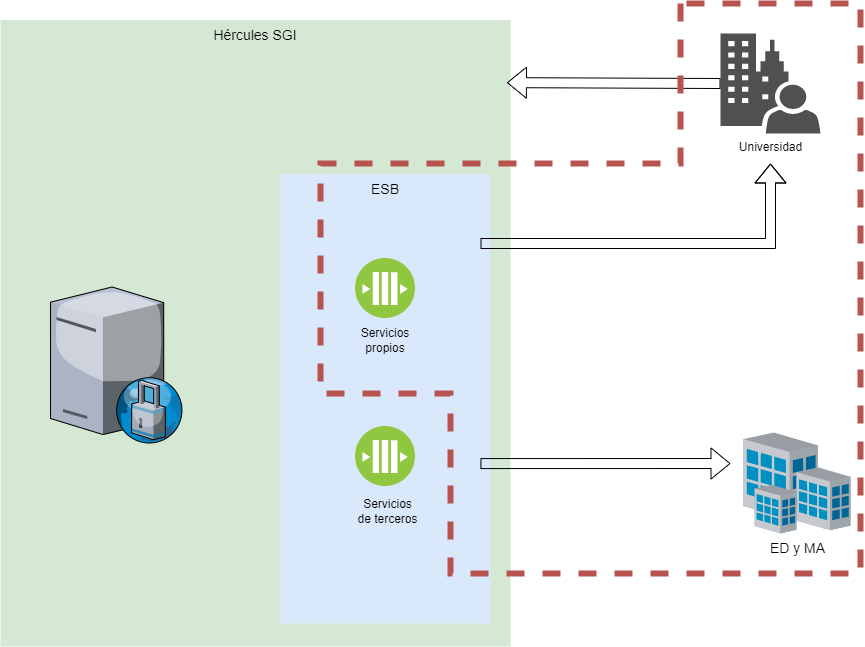

# SGI: Servicios propios que expone

A continuación se describen los **servicios que expone el SGI a partir de la información propia** registrada en el SGI. En este caso el Sistema de Gestión de la Investigación **a través de su bus de integración (ESB)** permite acceder a una serie de métodos que habilitan a las distintas aplicaciones externas a consultar y trabajar con la información recogida en el sistema.

Estos métodos se agrupan en las siguientes **categorías**:

* [Autorizaciones y notificaciones de proyectos externos](autorizaciones-y-notificaciones-de-proyectos-externos.md)
* [SGI - Grupos de investigación](sgi-grupos-de-investigacion.md)
* [Producción científica](produccion-cientifica/index.md)
* [Convocatorias](convocatorias.md)
* [Solicitudes](solicitudes.md)
* [Gestión proyectos](gestion-proyectos.md)
* [Protección Industrial e Intelectual (Patentes)](proteccion-industrial-e-intelectual-patentes.md)

Además, indicar que el SGI proporciona un número de servicios que son “internos”. Estos servicios no están documentados como los planteados para consumo externo. Básicamente porque son todos los métodos internos que se utilizan en la aplicación para intercambiar información entre front y back.

Existe la posibilidad de atacar estos servicios de forma externa.

Para poder verlos, se hace desde la capa "controller" del servicio, según el módulo, y en ella se podrán ver los endpoints, junto con los permisos necesarios para la invocación y los objetos de entrada y salida. Siendo cada método del controller un endpoint.