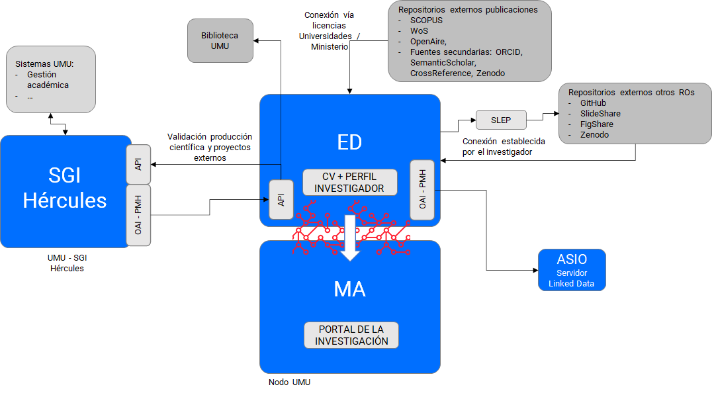
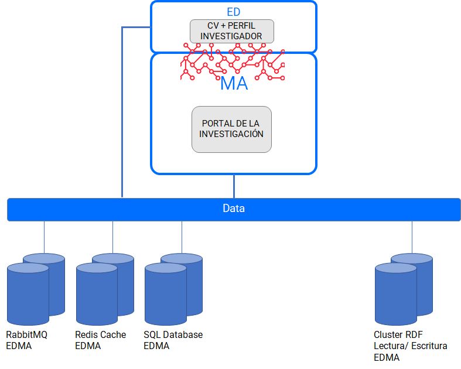
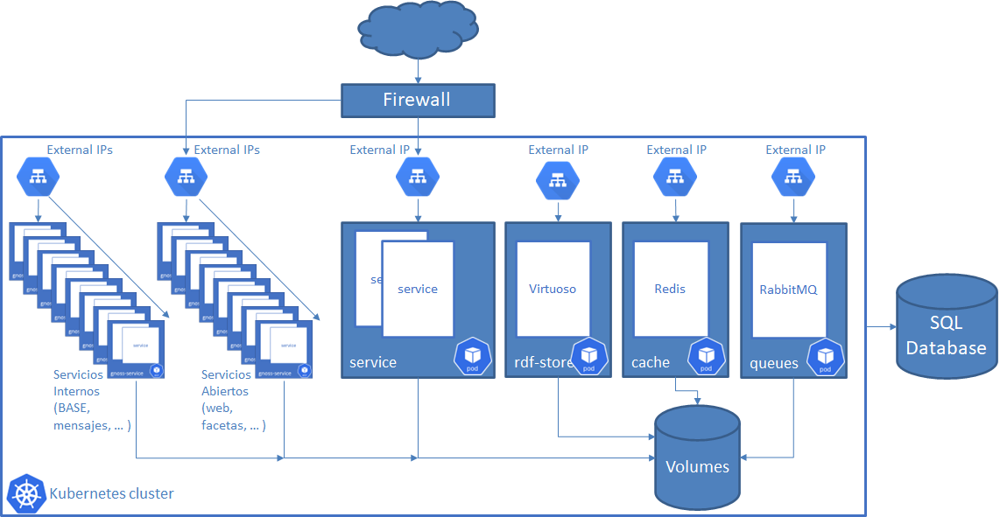

# Arquitectura de la Herramienta de CV. Hércules ED - Enriquecimiento de Datos

* [Relación de componentes Hércules ED en la Universidad de Murcia](#relacion-de-componentes-hercules-ed-en-la-universidad-de-murcia)
* [Arquitectura lógica en la Universidad de Murcia](#arquitectura-logica-en-la-universidad-de-murcia)
* [Arquitectura Kubernetes. Despliegue en la Universidad de Murcia](#arquitectura-kubernetes-despliegue-en-la-universidad-de-murcia)

La descripción del proyecto puede consultarse en [Herramienta de CV. Hércules ED - Enriquecimiento de Datos](../herramienta-cv/index.md).

## Relación de componentes Hércules ED en la Universidad de Murcia

* Hércules ED (Enriquecimiento de datos). Se comunica con:
  + **Hércules SGI** (Sistema de Gestión de Innovación). Se pueden ver detalles de la conexión en [Servicios de integración utilizados por Hércules ED y MA](../apis/ed-y-ma-integraciones.md)).
    - Consulta un servicio OAI-PMH que proporciona información actualizada del SGI y de otros sistemas de la Universidad.
    - Envía información introducida en ED para la validación de la producción científica, la conformidad de proyectos externos y la creación de ofertas tecnológicas.
  + Biblioteca de la UMU. Envío de publicaciones.
  + Fuentes externas de publicaciones científicas.
  + Fuentes externas de otros recursos de investigación (Research Objects).
  + **Hércules ASIO** (Arquitectura Semántica - Infraestructura Ontológica). Servicio de datos para el servicio Linked Data Server.
  + [**Hércules MA** (Métodos de Análisis. Portal Nacional Avanzado de Investigación)](../portal-avanzado/index.md).Creación del grafo de conocimiento del portal de la investigación.

Hay que hacer notar que el diagrama anterior se corresponde con una implantación de ED en la que también existan el resto de componentes Hércules. En caso contrario, ED tiene la capacidad de recibir y enviar su información directamente con sistemas de la universidad, tal y como está documentado en Servicios de integración utilizados por Hércules ED y MA.

## Arquitectura lógica en la Universidad de Murcia

Hércules ED:

* Despliegue de servicios web (web, edición CV, importación CVN, …)
* Despliegue de otros servicios (BASE, mensajes, extracción, enriquecimiento, similitud, …)

Servicios de datos:

* Cluster RDF. Grafo de investigadores.
* SQL Database. Almacenamiento de tipo SQL para garantizar procesos transaccionales
* Redis Cache. Almacenamiento de datos pregenerados (p.e. similitud)
* RabbitMQ. Sistema de colas de eventos para los servicios

## Arquitectura Kubernetes. Despliegue en la Universidad de Murcia

Cluster kubernetes con los siguientes *pods*:

* Servicios web abiertos al firewall de la Universidad de Murcia (web, edición CV, …)
* Servicios internos (BASE, mensajes, APIs, extracción, enriquecimiento, similitud, …)
* Virtuoso RDF Store
* Redis Cache
* RabbitMQ colas.

Externos:

* Oracle. SQL Database (el prototipo se desplegará con un POD de PostgreSQL).