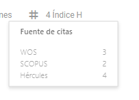
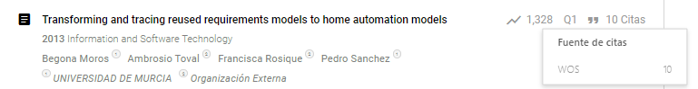

# Índice H

El índice H mide la productividad y el impacto de las publicaciones de un autor. De forma que un autor con índice H de x tiene al menos x publicaciones con x citas al menos.

En Hércules calculamos 3 valores:

* H Index de WOS: Se calcula el H index teniendo en cuenta únicamente las citas de WOS.
* H Index de Scopus: Se calcula el H index teniendo en cuenta únicamente las citas de Scopus.
* H Index de Hercules: Se calcula el H index sin importar del origen de las citas.

Aquí podemos ver que WOS tiene un índice H de 3, eso significa que este autor tiene 3 publicaciones con al menos 3 citas de origen de WOS:

Scopus tiene 2:

Y hércules tiene 4 publicaciones(las 3 de WOS y la primera de Scopus) con al menos 4 citas.

[Información sobre el H index](https://support.clarivate.com/ScientificandAcademicResearch/s/article/Web-of-Science-h-index-information?language=en_US)