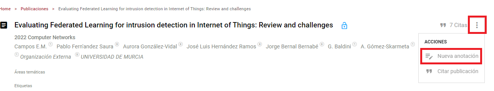
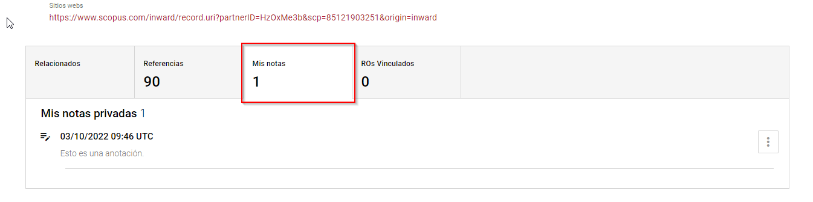
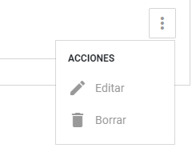
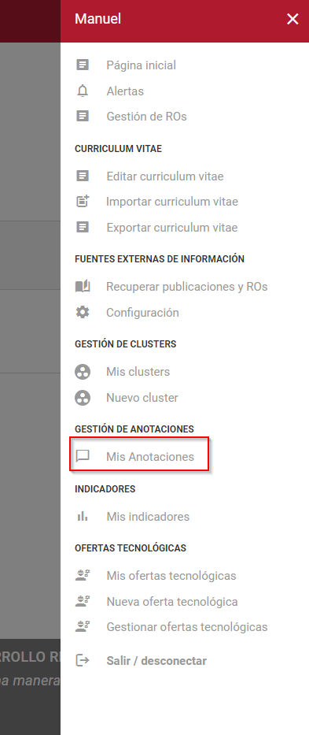
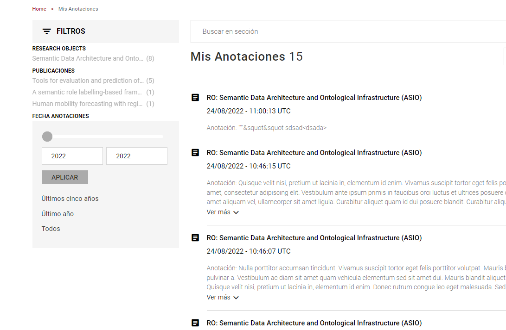

# Anotaciones

Las anotaciones son notas personales asignadas a una publicación o RO, se crean en la ficha del recurso donde se desea anotar.

En la esquina superior derecha de una publicación o RO aparecerá un menú de acciones donde se te deja crear una nueva.

Una vez creada una anotación aparecerá en la ficha del recurso en la pestaña de mis notas.

En las anotaciones en si también hay opciones, se pueden editar y borrar.

Cuando editas una anotación se abre un modal con el texto actual de la anotación.

Todas las anotaciones que se han creado aparecen en la pagina "Mis anotaciones"

Aquí aparece un buscador con facetas de todas la anotaciones que han sido creadas ordenadas por fecha de creación

Cuando haces clic en el titulo de una anotación te dirige a la pestaña de anotaciones del recurso al que pertenece.