# Gestión de ROs - ED

La Gestión de ROs es una pagina de búsqueda con todos los ROs en los que eres investigador principal o secundario.

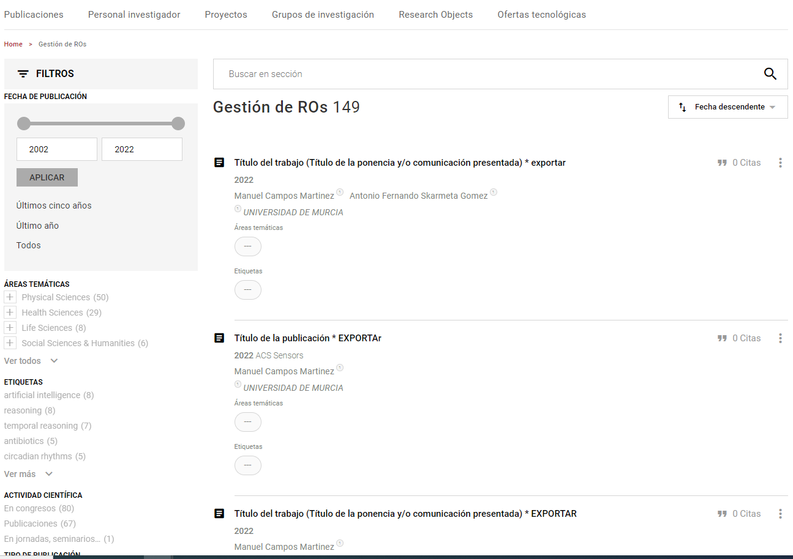

Se puede acceder desde la pagina principal de ED o desde el menú lateral.

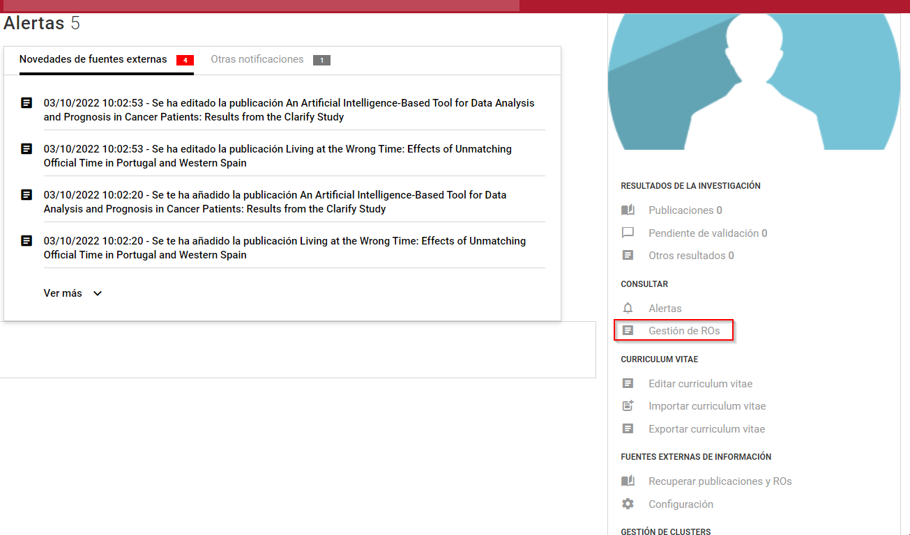 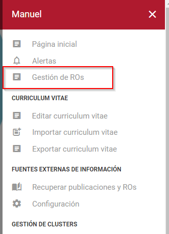

En la pagina aparecen ROs en lo que se participo como investigador,

Cada uno de estos ROs muestra lo siguiente:

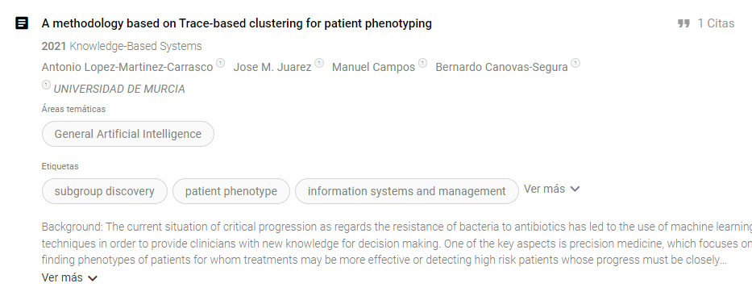

El titulo es un enlace a la ficha del recurso, seguido aparece el año junto al campo de estudio al que pertenece el RO.

Después aparecen los investigadores con un numero que indica a que organización pertenecen, al final de la lista de autores aparecen las organizaciones con el numero correspondiente.

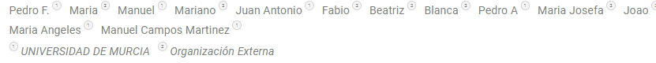

Debajo de los autores salen las áreas temáticas y las etiquetas, si hay muchas muestra unas pocas y un botón de "ver mas" que se expande para mostrar todas, clicando en un área temática o etiqueta la aplica como filtro a la pagina.

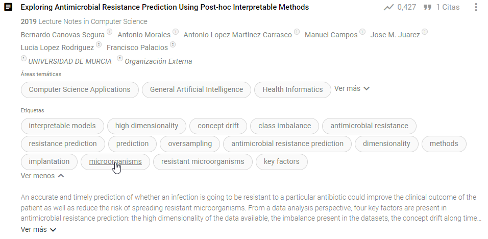

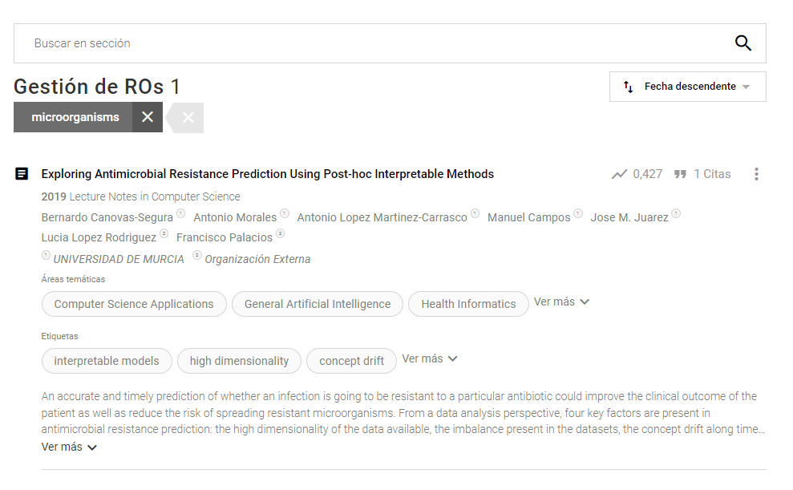

Al final de la mini ficha aparece la descripción de la RO con un botón de ver mas si se pasa de 3 líneas.

En la esquina superior derecha aparecen siempre las citas y la opción de editar, además de esto si esta disponible según su revista aparece el factor de impacto y el cuartil.

Al pasar el ratón por encima del Factor de impacto aparece el factor de impacto según la fuente.

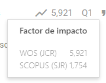

Al pasar el ratón por encima del cuartil aparece información del posicionamiento de la revista es su respectiva categoría según las fuentes en las que esta disponible.

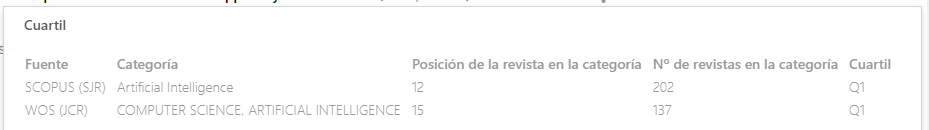

Al pasar el ratón por encima de las citas aparecen las fuentes de esas citas.

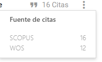

Al clicar en las opciones que están a la derecha aparece el botón de editar que te redirige al mismo RO en el editor del CV.

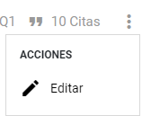

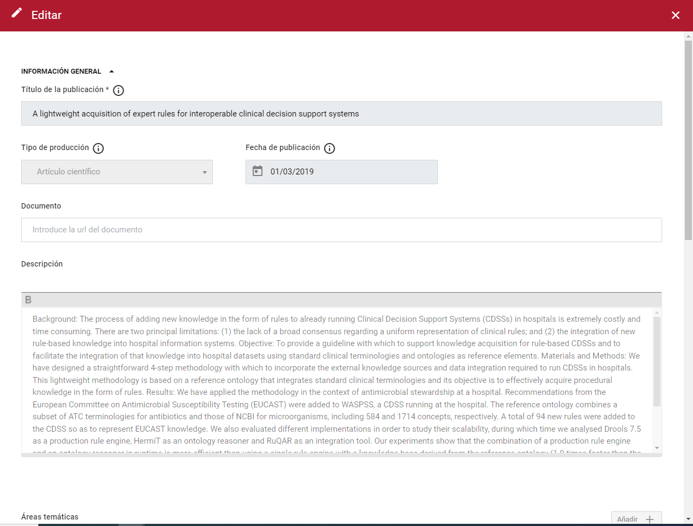