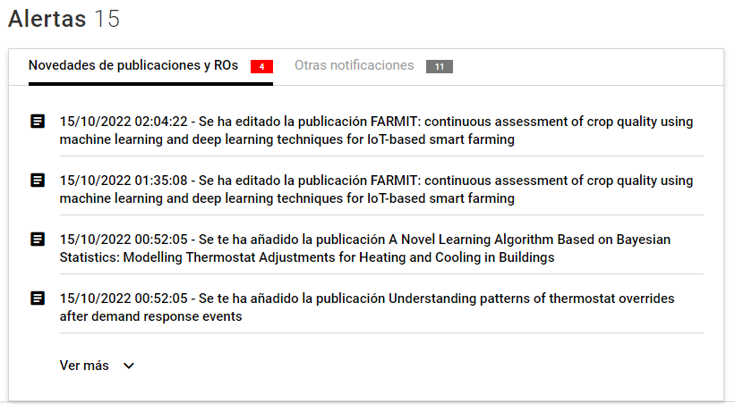
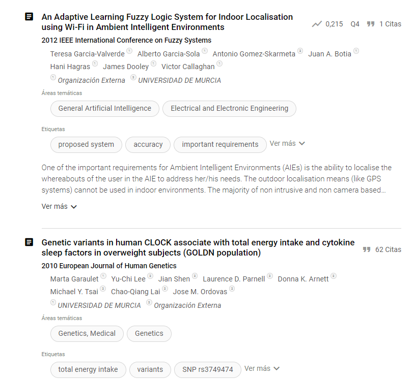
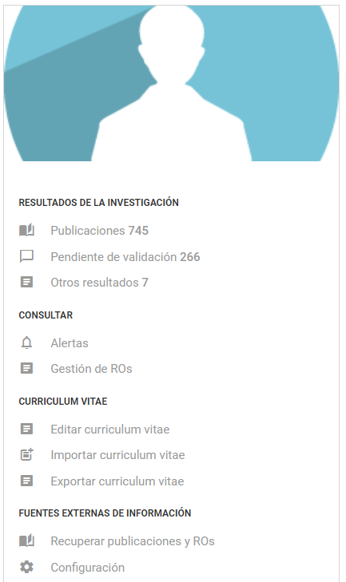

# Home de ED

En esta página nos encontramos con la página de inicio para la sección de enriquecimiento de datos del proyecto de Hércules.

La Home de ED se divide en tres secciones, alertas, publicaciones de interés y un menú por el que podremos navegar por Hércules.

### **Alertas**

Esta sección se coloca en la parte izquierda superior de la home.

La sección de alertas sigue el diseño de las alertas de Hércules, el cual se explica en profundidad en este apartado: [Alertas](alertas.md)

Las alertas será el lugar donde el usuario recibirá distintas notificaciones relacionadas, entre otros, con:

* La recuperación de información de sexenios, acreditaciones, fuentes externas...
* La modificación del CV, tanto propia como por parte de otros autores
* La edición o adición de recursos

Esta sección está dividida en apartados distintivos por los cuales se pueden navegar con el menú superior dándole click a las distintas categorías, accediendo a distintos tipos de notificaciones.

### **Publicaciones de interés**

En la parte inferior de las alertas podemos encontrar una sección que nos mostrará distintas publicaciones de posible interés para el usuario.

Este listado de publicaciones es similar al que podemos encontrar en este apartado: [Búsqueda de publicaciones](../../portal-avanzado/ma-manual-de-usuario/paginas-de-busqueda/busqueda-de-publicaciones.md)

De una forma muy parecida a la que funciona el buscador de publicaciones, este listado de publicaciones contará con las correspondientes funcionalidades.

### **Menú lateral**

Este menú lateral de la parte derecha sirve tanto a modo de perfil como a modo de menú de navegación por Hércules.

En la parte superior de este menú encontramos la foto de perfil del usuario junto a su nombre.

Más abajo se encuentra todo el listado de acciones y zonas por las que navegar en Hércules, cada una explicada en su correspondiente sección:

* [Herramienta de CV](herramienta-de-cv/index.md)
  + [Editor de CV](herramienta-de-cv/editor-de-cv.md)
  + [Importación de CV](herramienta-de-cv/importacion-de-cv.md)
  + [Exportación de CV](herramienta-de-cv/exportacion-de-cv.md)
* [Gestión de clusters (Equipos de proyecto)](../../portal-avanzado/ma-manual-de-usuario/gestion-de-clusters-equipos-de-proyecto.md)
* [Gestión de ofertas tecnológicas](../../portal-avanzado/ma-manual-de-usuario/gestion-de-ofertas-tecnologicas.md)
* [Fuentes externas de información](fuentes-externas-de-informacion.md)
* [Alertas](alertas.md)