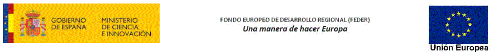

---
# La portada no lleva menú lateral (el primer nivel son las pestañas) ni
# tabla de contenidos (solo tiene el título).
hide:
  - navigation
  - toc
---

# Hércules

El proyecto “Hércules - Semántica de Datos de Investigación de Universidades” es una iniciativa de la Conferencia de Rectores de las Universidades Españolas (CRUE) liderado por la Universidad de Murcia con el objetivo de crear un Sistema de Gestión de Investigación (SGI) basado en datos abiertos semánticos que ofrezca una visión global de los datos de investigación del Sistema Universitario Español (SUE), para mejorar la gestión, el análisis y las posibles sinergias entre universidades y el gran público.

Esta iniciativa se estructura en torno a dos pilares: Arquitectura Semántica y Prototipo innovador de un Sistema de Gestión de la Investigación (ver imagen).

El proyecto tiene un presupuesto de CINCO MILLONES CUATROCIENTOS SESENTA Y DOS MIL SEISCIENTOS euros con una cofinanciación FEDER de un 80%, por tanto el Fondo Europeo de Desarrollo Regional (FEDER), a través del entonces Ministerio de Economía, Industria y Competitividad (actualmente ministerio de Ciencia e Innovación) como Organismo Intermedio del Programa Operativo Crecimiento Inteligente del FEDER– POCint (ahora Programa Operativo Plurirregional de España – POPE) realiza una aportación de CUATRO MILLONES TRESCIENTOS SETENTA MIL OCHENTA euros.

---

En líneas generales, los módulos que forman parte del sistema y que están disponibles como software libre son:

* [Sistema innovador para la gestión de la investigación, SGI Hércules.](sgi/index.md)
* [Herramienta para la gestión del CV basada en tecnologías semánticas. Hércules ED](herramienta-cv/index.md). Enriquecimiento de datos con fuentes externas (OpenAir, Scopus, Web of Science …)
* [Portal avanzado de investigación](portal-avanzado/index.md) Basado en datos abiertos semánticos con IA y procesamiento del lenguaje natural. Promueve la Ciencia Abierta.
* *Servidor de datos de investigación enlazados y abiertos.*
* [Procesos RPA.](rpa/index.md)

Hércules es un producto de software libre para Universidades. *Sin coste de licencias*. Código, documentación y materiales de formación disponibles en abierto.

---

---

---