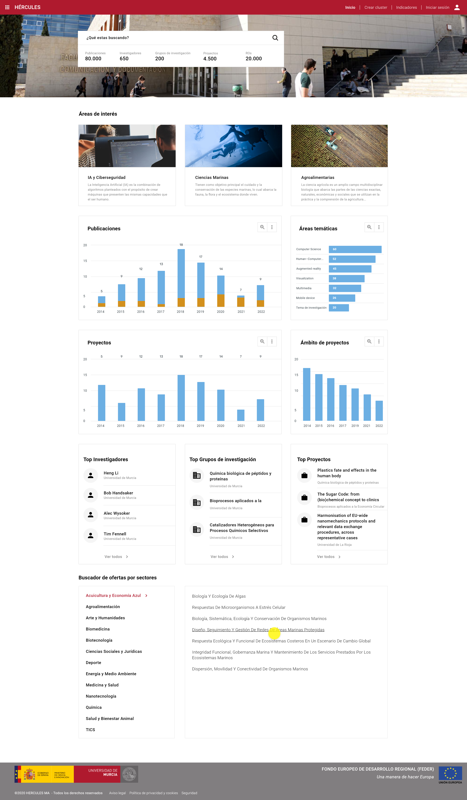
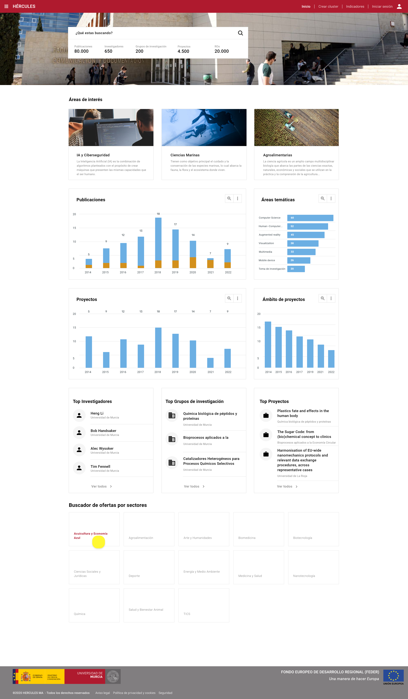
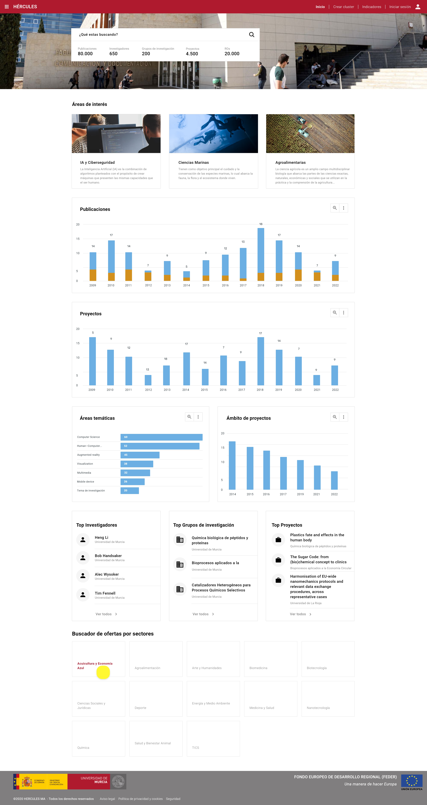

# MA. Home. UX

Proponemos un diseño modular de la Home con un contenido que puede ser gestionado por el administrador de la plataforma.

Opción 1. Ofertas tecnológicas con lista de sectores

Opción 2. Ofertas tecnológicas en mosaico de sectores

Opción 3. Más relevancia a las gráficas

