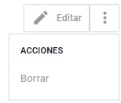
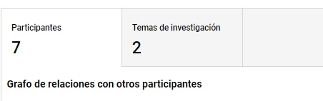

# MA. Ficha del cluster

* [Acceso a la ficha del cluster](#acceso-a-la-ficha-del-cluster)
* [Estructura](#estructura)
  + [Datos principales](#datos-principales)
  + [Menú de opciones](#menu-de-opciones)
  + [Datos enriquecidos:](#datos-enriquecidos)

Información de desarrollo

<https://github.com/HerculesCRUE/HerculesMA/blob/main/Docs/funcionamiento-de-los-cluster.md#ficha-del-cluster>

## Acceso a la ficha del cluster

Se accede desde el listado de los clusters o desde la creación/edición de los mismos una vez que se han guardado los cambios.

## Estructura

### Datos principales

En esta pantalla nos encontramos con las funciones típicas de las fichas de los diferentes contenidos; nos encontramos con:

* Título,
* Fecha de creación del cluster
* Descripción
* Áreas temáticas

### Menú de opciones

Respecto al menú de acciones, nos encontramos con los siguientes enlaces:

* **Edición**: Botón que otorga la posibilidad de editar el cluster (un enlace), que lleva a la página edición (creación) de clusters, junto a un parámetro con el id del recurso para la carga y edición del mismo.
* **Borrar**: Botón que permite borrar el recurso, para evitar accidentes, saldrá un mensaje para confirmar la acción.

### Datos enriquecidos:

Participantes: Pestaña con una gráfica de las relaciones de los participantes elegidos para el cluster y un listado del personal investigador seleccionado indicando a qué perfil se ha añadido.  
Temas de investigación: Gráfica que pone de relieve los Áreas de investigación que más se repiten en la publicación científica de los investigadores seleccionados.

