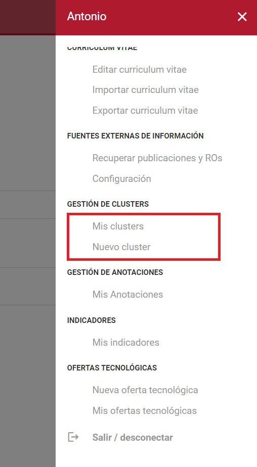
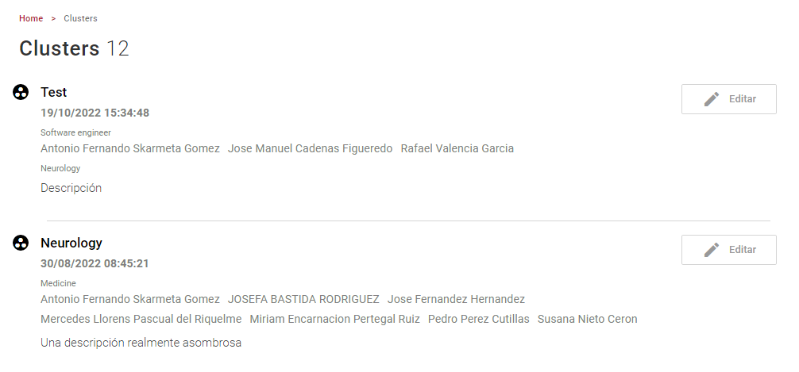

# MA. Listado de mis Clusters

* [Acceso desde el menú](#acceso-desde-el-menu)
* [Listado de los clusters](#listado-de-los-clusters)

## Acceso desde el menú

Existe un listado simple de "Mis clusters", para acceder a él hay que ir al menú lateral derecho > "Gestión de clusters" > "Mis clusters".

Para acceder a la página de 'Mis clusters' hay que haber iniciado sesión, y únicamente se mostrarán los clusters que tú has creado.

## Listado de los clusters

El listado de clusters contiene un listado simple de los clusters y un listado de los investigadores por cada perfil de investigador. Así mismo dispone de un enlace a la ficha de los clusters de investigación y un botón de edición al mismo. El enlace de editar enlaza a la página de creación del cluster pasándole como parámetro el id del mismo.

