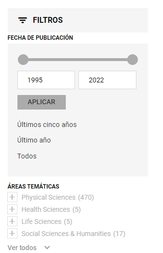
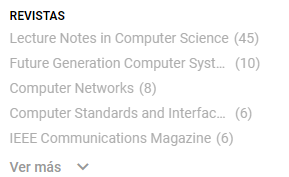
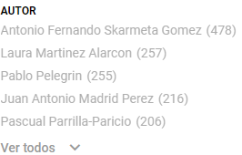
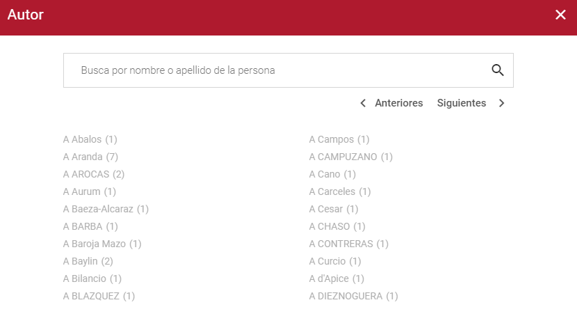
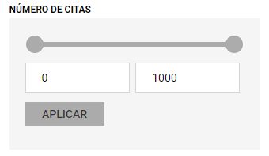
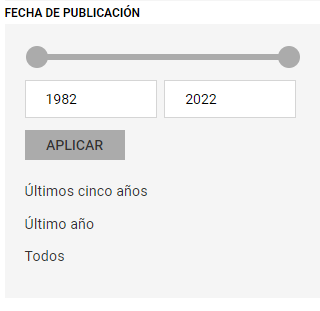
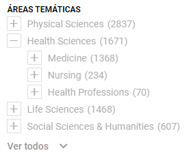
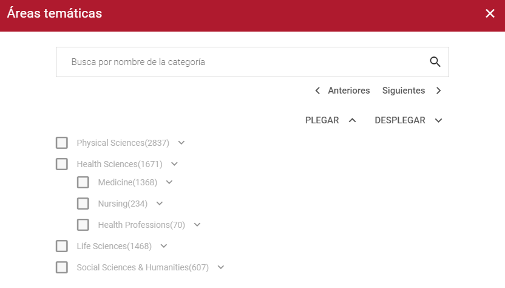

# Filtros/Facetas

Para filtrar una búsqueda o unos resultados en Hércules se utiliza una sección de facetas las cuales pueden aplicar filtros fácilmente sobre la búsqueda que hemos realizado.

Los filtros aparecen en distintas páginas, aunque sobre todo aparecen en las de búsqueda para facilitar la especificación de esta.

Se pueden aplicar numerosos filtros y de la misma forma se pueden eliminar de uno en uno o todos a la vez.

Ya que hay muchos tipos de filtros distintos, a continuación solo se nombrarán las categorías de filtros más distintivas.

### **Filtro básico**

Para empezar, los filtros básicos son filtros simples los cuales tienen pocas particularidades.

En este ejemplo existe la opción de Ver más, la cual nos mostrará la lista completa de revistas.

En este otro ejemplo existe la opción de Ver todos, la cual nos mostrará una pequeña ventana para buscar entre los autores.

### **Filtro numérico/año**

Los filtros numéricos y de años son muy parecidos.

Este es un ejemplo de filtro numérico el cual cuenta con un deslizable y dos cajas de texto para ajustar manualmente el rango de número de citas que filtrar.

Este es un ejemplo de filtro de año el cual también cuenta con un deslizable y dos cajas de texto pero que además incluye tres opciones predefinidas para filtrar por último año, últimos 5 años y todos los años.

### **Filtro de áreas temáticas/tesauro**

Los filtros de áreas temáticas o tesauro tienen esta estructura en la que nos aparecerá un listado que podremos ir desplegando.

También cuenta con la opción de Ver todos la cual nos mostrará una ventana para buscar el área temática específica.

