# Búsqueda de grupos de investigación

La página de búsqueda de personal investigador es accesible a través del buscador principal de Hércules, o dándole click a "Grupos" en el buscador de la home.

Al acceder a este buscador encontraremos la siguiente estructura con un buscador en la parte superior:

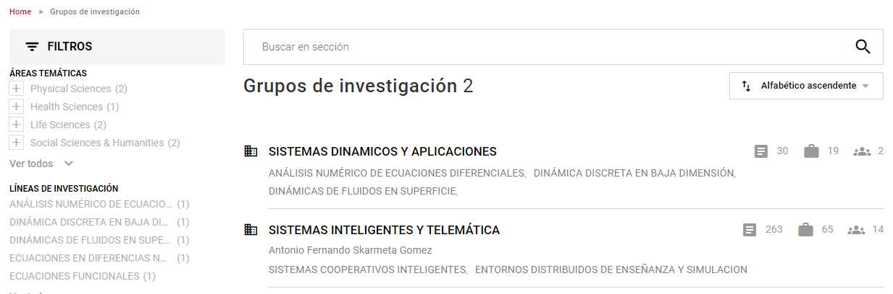

#### **Filtros**

A la izquierda contamos con una sección de filtros los cuales se repetirán en otras partes de la página.

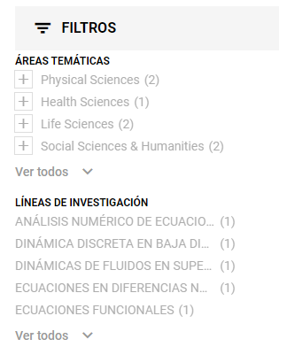

Los distintos filtros nos ayudarán a buscar de forma específica sobre áreas temáticas, líneas de investigación, número de proyectos, número de publicaciones...

Junto a estos filtros aparece un desplegable en la parte inferior del buscador el cual nos dejará ordenar la página alfabéticamente ascendente y descendente.

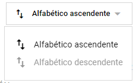

#### **Listado de grupos**

Para cada grupo se mostrará una previsualización de esta en la que aparecen título, descripción, publicaciones, proyectos y personas.

Al hacer click en el grupo accederemos a la ficha del recurso:

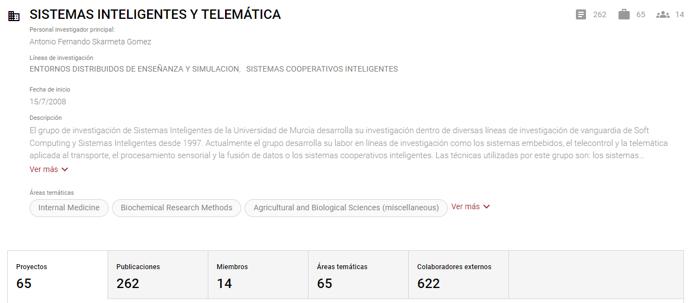

Esta ficha es una visualización más extensa de la anterior y se le añaden áreas temáticas, personal investigador principal, líneas de investigación, fechas y demás opciones.

En la parte inferior hay diferentes apartados los cuales nos mostrarán los proyectos, las publicaciones, miembros del grupo, áreas temáticas y colaboradores externos.

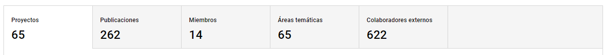

#### **Proyectos**

La sección de proyectos contiene 3 gráficas: proyectos por año, investigadores por proyecto y ámbito de los proyectos.

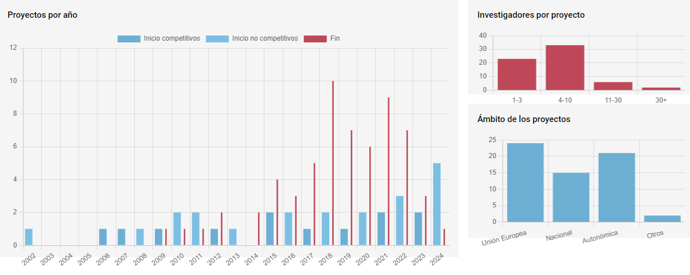

Debajo aparece un listado con [buscador de los proyectos](busqueda-de-proyectos.md) del grupo.

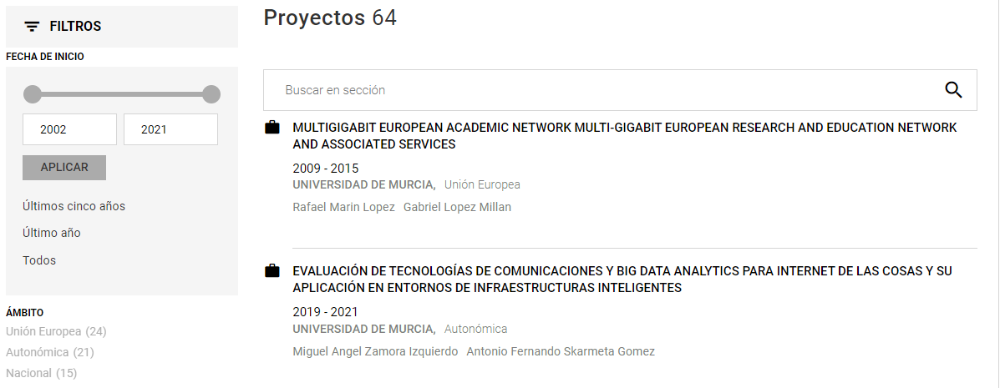

#### **Publicaciones**

En este apartado aparece una gráfica de publicaciones y citas por año.

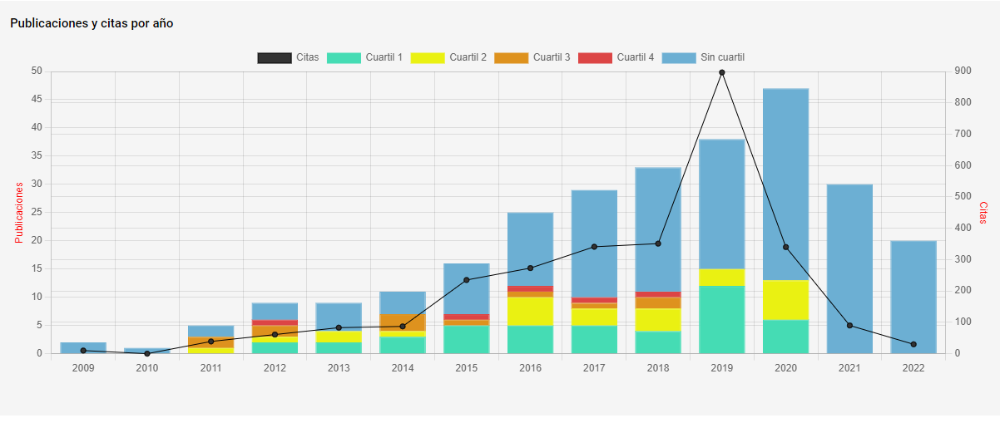

Debajo aparece un buscador entre las publicaciones del investigador, idéntico al [buscador de publicaciones](busqueda-de-publicaciones.md).

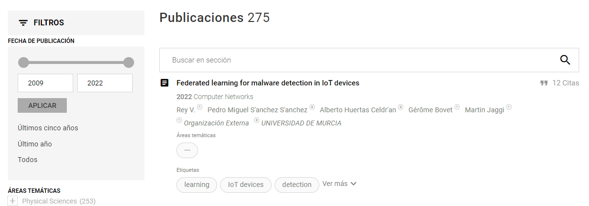

#### **Miembros**

Aquí aparecerán los miembros del grupo, con una gráfica de nodos en la que los relaciona y una [búsqueda de personal investigador](busqueda-de-grupos-de-investigacion.md).

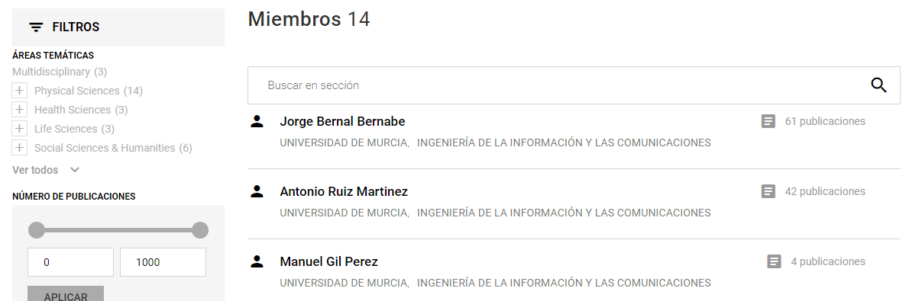

#### **Áreas temáticas**

Se muestran dos gráficas, una de nodos y otra de barras horizontal, las cuales indican las relaciones de los temas y el uso de los temas respectivamente.

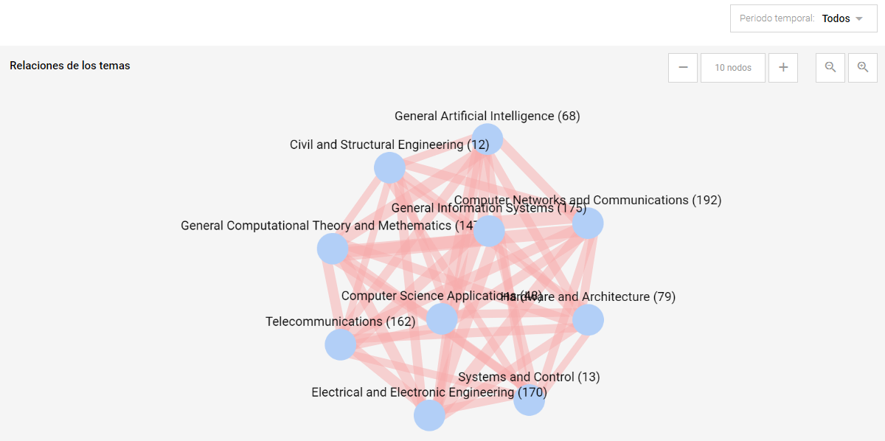

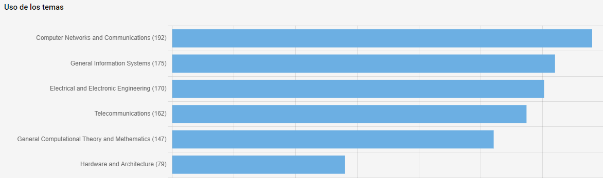

#### **Colaboradores externos**

En este apartado sale una gráfica de nodos que relaciona los colaboradores del proyecto y una [búsqueda de personal investigador](busqueda-de-grupos-de-investigacion.md).

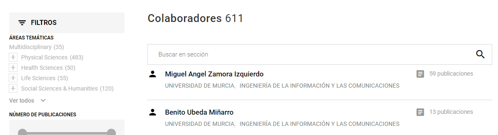