# Búsqueda de personal investigador

La página de búsqueda de personal investigador es accesible a través del buscador principal de Hércules, o dándole click a "Investigadores" en el buscador de la home.

Al acceder a este buscador encontraremos la siguiente estructura con un buscador en la parte superior:

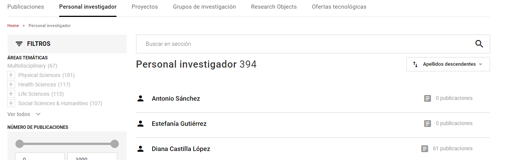

#### **Filtros**

A la izquierda contamos con una sección de filtros los cuales se repetirán en otras partes de la página.

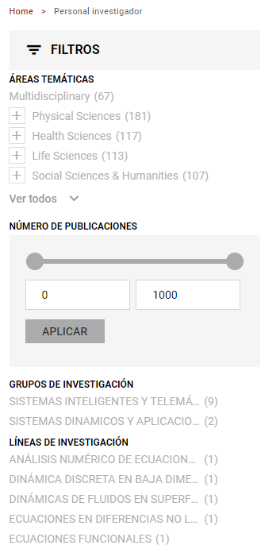

Los distintos filtros nos ayudarán a buscar de forma específica sobre grupo de investigación, investigador principal, líneas de investigación...

Junto a estos filtros aparece un desplegable en la parte inferior del buscador el cual nos dejará ordenar la página por apellidos ascendente y descendente.

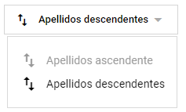

#### **Listado de personal investigador**

Para cada investigador se mostrará una previsualización de esta en la que aparecen varios datos recuperados, entre ellos el autor, el número de publicaciones, índice H, biografía/descripción y otros datos descriptivos.

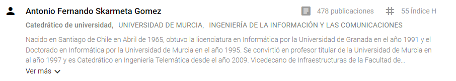

Al hacer click en el investigador accederemos a su ficha personal:

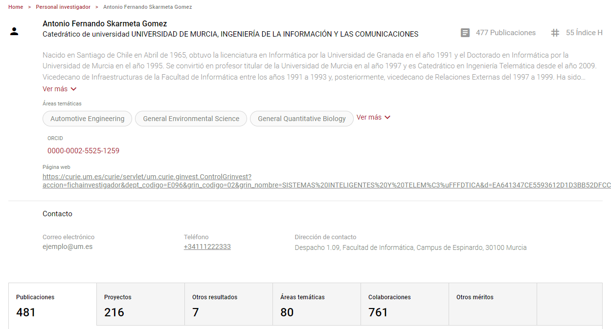

Esta ficha es una visualización más extensa de la anterior y se le añaden áreas temáticas, ORCID, página web, métodos de contacto y demás opciones.

En la parte inferior hay diferentes apartados los cuales nos mostrarán las publicaciones, proyectos, áreas temáticas, colaboraciones y otros resultados del investigador.

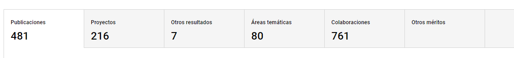

#### **Publicaciones**

La sección de publicaciones contiene una gráfica que muestra todas las publicaciones a lo largo de los años del investigador

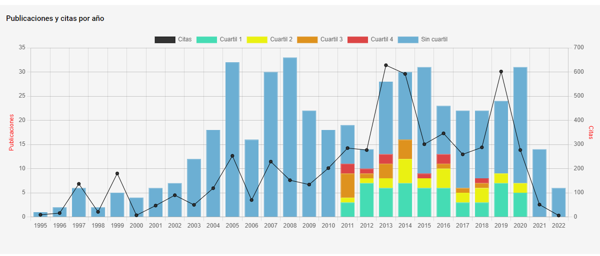

Debajo aparece un buscador entre las publicaciones del investigador, idéntico al [buscador de publicaciones](busqueda-de-publicaciones.md).

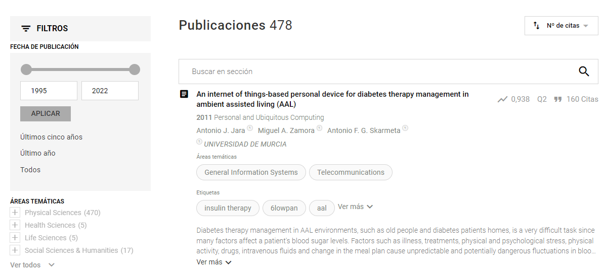

#### **Proyectos**

En este apartado aparecen tres gráficas, una de proyectos por año, otra de número de investigadores por proyecto y la última de ámbito de los proyectos.

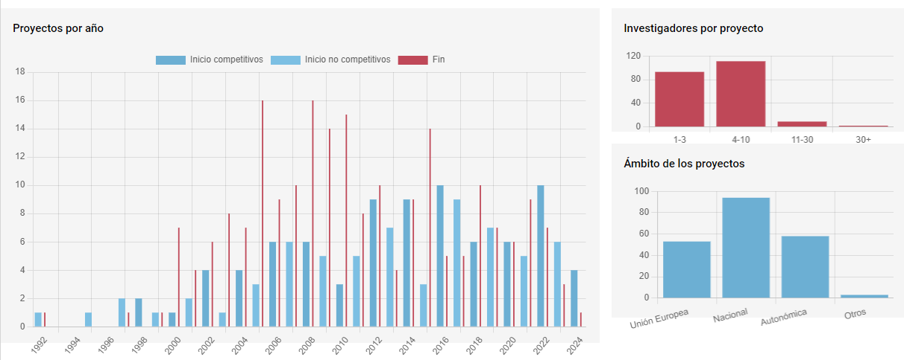

Debajo aparece nuevamente un listado con [buscador de los proyectos](busqueda-de-proyectos.md) en los que ha participado el investigador.

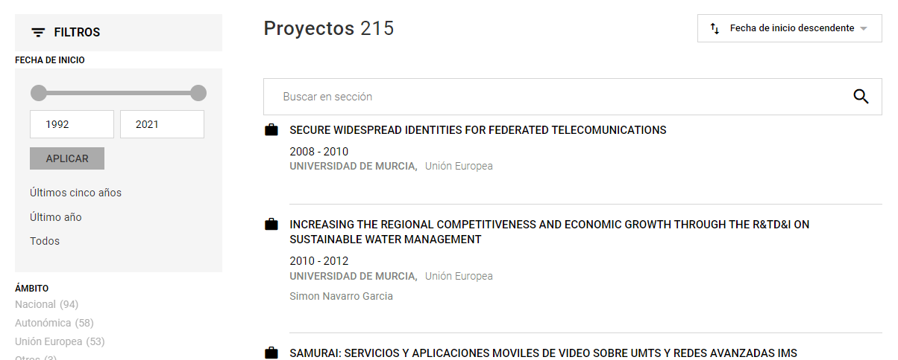

#### **Otros resultados**

Aquí aparecerán el resto de resultados que no se han podido incluir en las publicaciones o los proyectos.

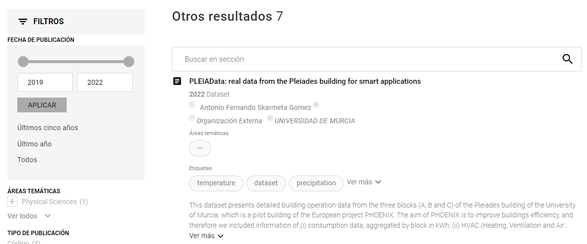

#### **Áreas temáticas**

Se muestran dos gráficas, una de nodos y otra de barras horizontal, las cuales indican las relaciones de los temas y el uso de los temas respectivamente.

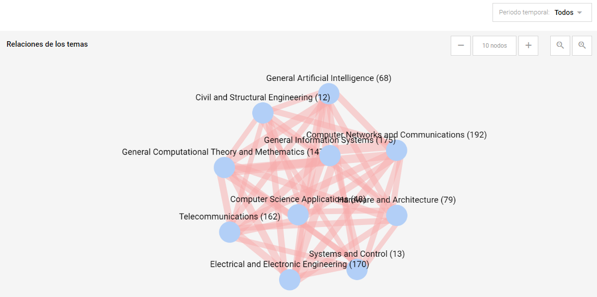

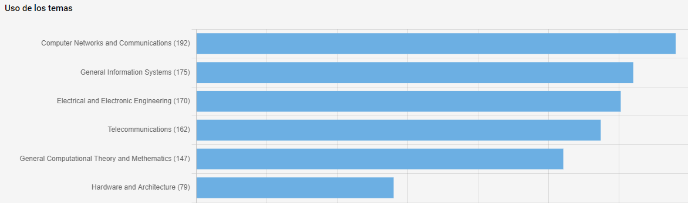

#### **Colaboraciones**

En este apartado sale una gráfica de nodos que relaciona los colaboradores y una [búsqueda de personal investigador](busqueda-de-personal-investigador.md).

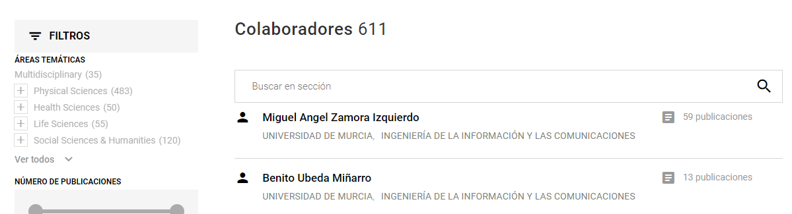

#### **Otros méritos**

Aquí saldrá un listado de los recursos del investigador que haya seleccionado previamente como públicos.

Se muestran con un formato similar al del [editor cv](../../../herramienta-cv/ed-manual-de-usuario/herramienta-de-cv/editor-de-cv.md).