# Búsqueda de proyectos

La página de búsqueda de proyectos es accesible a través del buscador principal de Hércules, o dándole click a "Proyectos" en el buscador de la home.

Al acceder a este buscador encontraremos la siguiente estructura con un buscador en la parte superior:

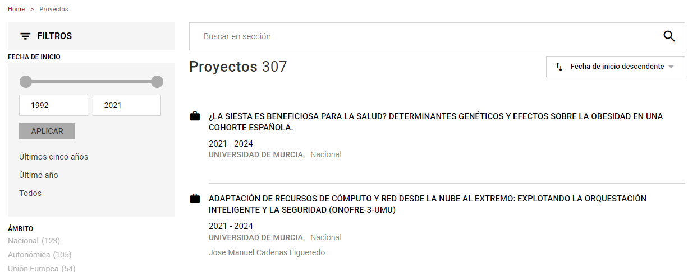

#### **Filtros**

A la izquierda contamos con una sección de filtros los cuales se repetirán en otras partes de la página.

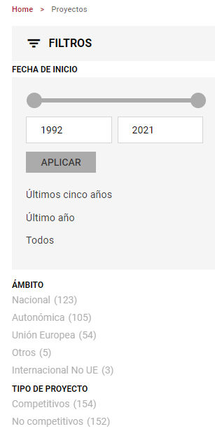

Los distintos filtros nos ayudarán a buscar de forma específica sobre una etiqueta, fecha, autor, revista...

Junto a estos filtros aparece un desplegable en la parte inferior del buscador el cual nos dejará ordenar la página por fecha de inicio y de fin

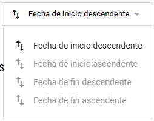

#### **Listado de proyectos**

Para cada proyecto se mostrará una previsualización de este en la que aparecen título, organización, autores cada uno con un enlace que te redirige directamente al recurso correspondiente.

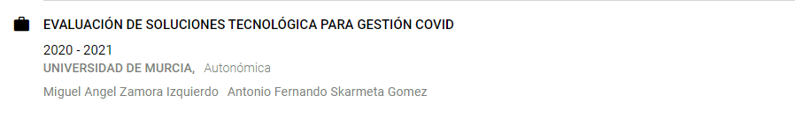

Al hacer click en el proyecto accederemos a la ficha del recurso:

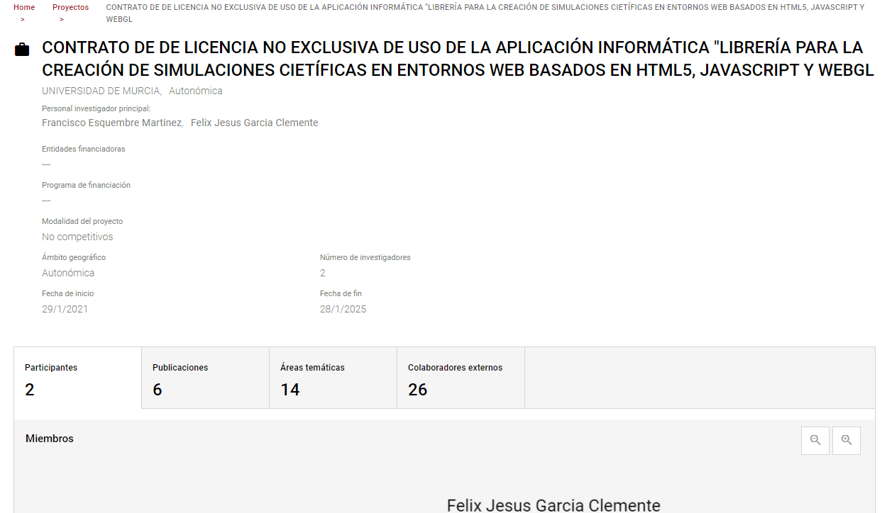

Esta ficha es una visualización más extensa de la anterior y se le añaden entidades financiadores, ámbito geográfico, modalidad del proyectos y demás opciones.

En la parte inferior hay diferentes apartados los cuales nos mostrarán los participantes del proyecto, las publicaciones, áreas temáticas y colaboradores externos.

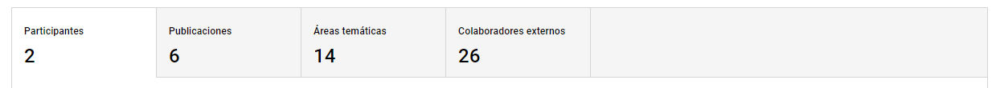

#### **Participantes**

En el apartado de participantes tenemos un grafo que relaciona a los participantes y un pequeño buscador con filtros de investigadores dentro del proyecto.

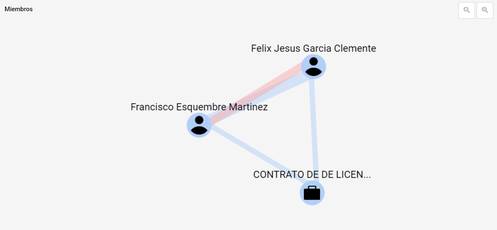

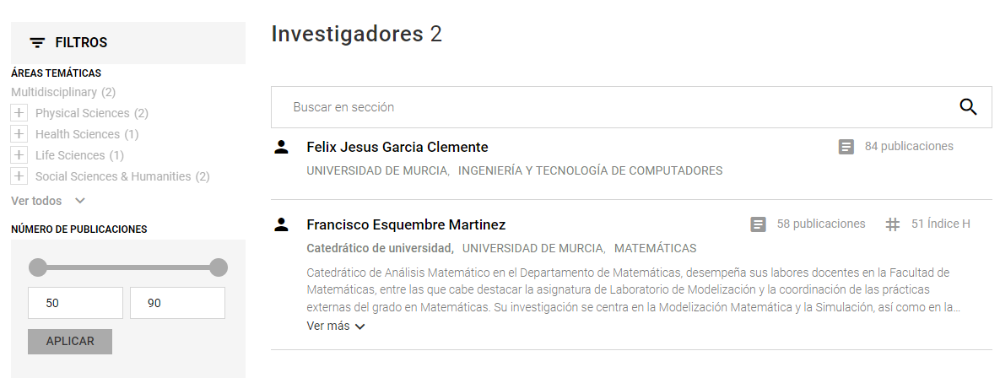

#### **Publicaciones**

En la sección de publicaciones se encuentra otra gráfica en relación a los años de duración y otro buscador

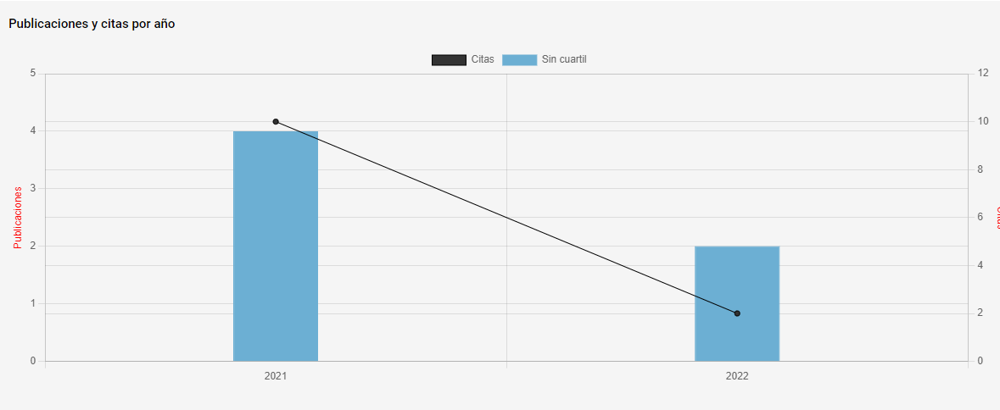

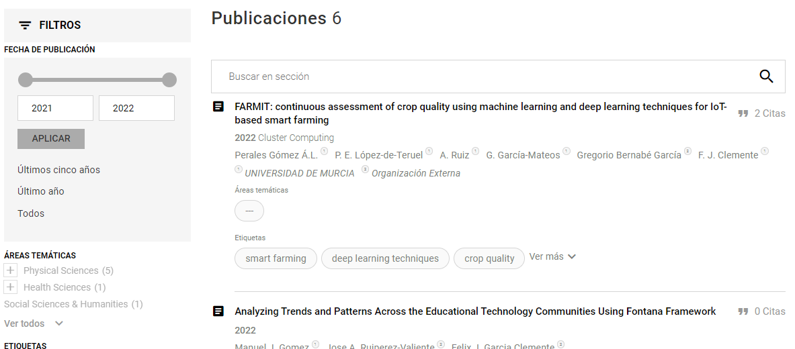

#### **Áreas temáticas**

En el apartado de áreas temáticas encontramos dos gráficas, una de nodos y otra de barras horizontal.

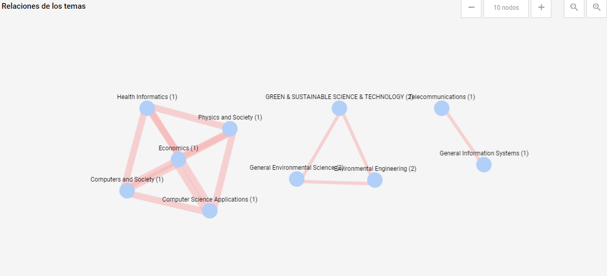

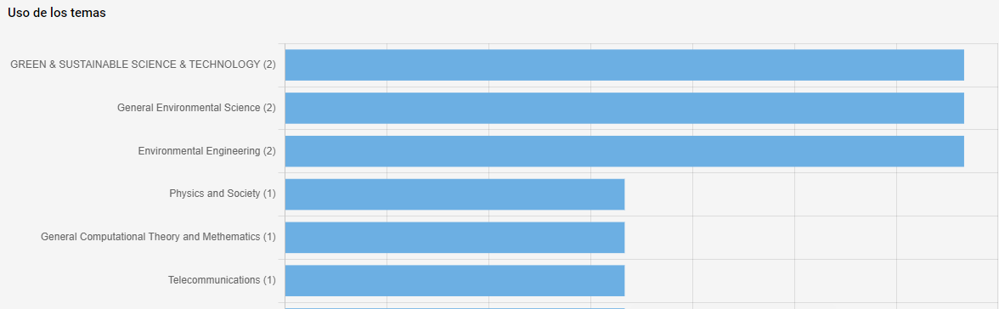

#### **Colaboradores externos**

Por último los colaboradores externos, los cuales salen relacionados con el proyecto junto a un buscador de investigadores.

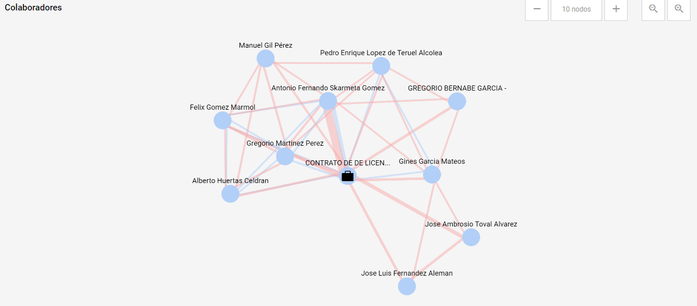

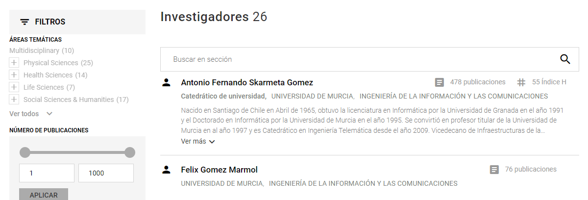