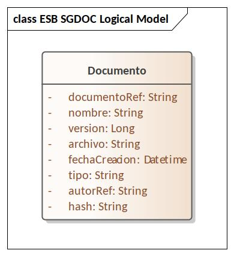

# SGI - ESB - SGDOC

---

* [Sistema de Gestión Documental](#sistema-de-gestion-documental)
  + [Entidades](#entidades)
  + [Modelo lógico](#modelo-logico)
  + [API](#api)
    - [Definición de los objetos](#definicion-de-los-objetos)
      * [Documento](#documento)
    - [Servicios](#servicios)

---

## Sistema de Gestión Documental

### Entidades

| Entidad | Descripción |
| --- | --- |
| Documento | Datos del documento |

### Modelo lógico



### API

Características generales que todas las API REST deben de cumplir:

* [Consultas filtradas y paginadas](../../../../desarrollo-y-configuracion/estandares-de-desarrollo/consultas-filtradas-y-paginadas.md)
* [Formatos de datos API](../../../../desarrollo-y-configuracion/estandares-de-desarrollo/formatos-de-datos-api.md)

#### Definición de los objetos

##### Documento

| Nombre | Tipo | Descripción |
| --- | --- | --- |
| documentoRef | String | Identificador del documento |
| nombre | String | Nombre del documento |
| version | String | Versión del documento |
| fechaCreacion | Date | Fecha de creación del documento |
| tipo | String | Tipo de archivo |
| autorRef | String | Identificador del autor del documento. |
| hash | String | Hash del documento. SHA-256 |

**Documento** Ampliar origen

```
{
	"documentoRef": "6712829d-ea85-4b10-be25-5130dbb264fa",
	"nombre": "archivo.pdf",
	"version": 1,
	"fechaCreacion": "2022-03-07T10:15:52.527",
	"tipo": "application/pdf",
	"autorRef": "anonymous",
    "hash":"sdfsdfsdfsdfsdfs"
}
```

#### Servicios

Para componer la URL llamada completa, se debe anteponer a lo indicado en la columna URL lo siguiente: **{HOST}/api/sgdoc**, donde **{HOST}** de deberá sustituir el dominio correspondiente al entorno al que se está accediendo y dicho acceso será por http o https según el caso.

| Servicio | Método | URL | Parámetros | Respuesta | Descripción |
| --- | --- | --- | --- | --- | --- |
| [ESB - SGI - Documentos - Eliminar](esb-sgi-documentos-eliminar.md) | DELETE | /documentos/{id} |  |  | Elimina el documento cuyo identificador se pasa en la URL del Sistema de Gestión Documental. |
| [ESB - SGI - Documentos - Descargar fichero](esb-sgi-documentos-descargar-fichero.md) | GET | /documentos/{id}/archivo |  | Fichero binario. | Devuelve el archivo binario del documento. |
| [ESB - SGI - Documentos - Listar por identificador](esb-sgi-documentos-listar-por-identificador.md) | GET | /documentos/bydocumentorefs/{ids} | El parámetro pasado por URL será una lista de identificadores de documentos separados por ",". | Lista[[Documento](index.md#documento)] | Listado de documentos cuyo identificador se ha pasado por URL. |
| [ESB - SGI - Documentos - Consultar detalle](esb-sgi-documentos-consultar-detalle.md) | GET | /documentos/{id} |  | [Documento](index.md#documento) | Devuelve el detalle del documento solicitado por la URL. |
| [ESB - SGI - Documentos - Buscar](esb-sgi-documentos-buscar.md) | GET | /documentos | q+s (query + sort)  La query estará formada por:   * documentoRef * nombre * version * fechaCreacion * tipo * autorRef | Lista[[Documento](index.md#documento)] | Listado de documentos.  *Ejemplo*:  nombre=ik=documento |
| [ESB - SGI - Documentos - Dar de alta](esb-sgi-documentos-dar-de-alta.md) | POST | /documentos | archivo: fichero binario (multipart/form-data) | [Documento](index.md#documento) | Crea un Documento y almacena el fichero. |