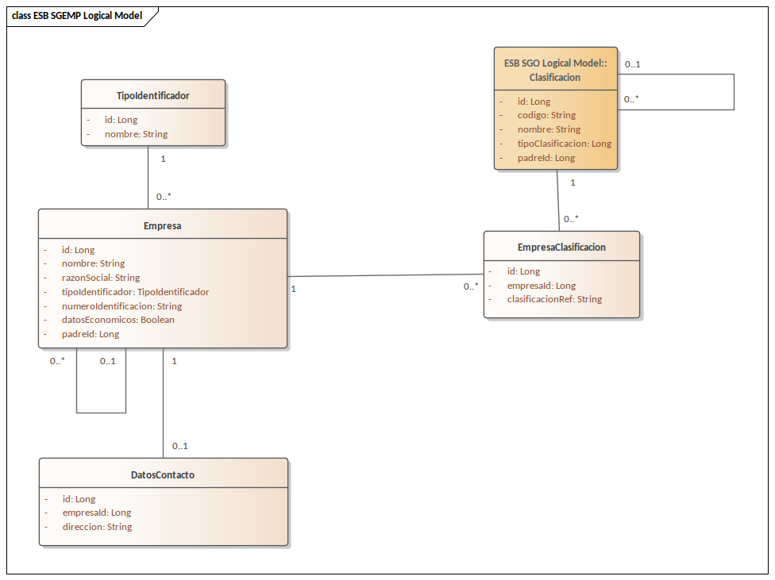

# SGI - ESB - SGEMP

---

* [Sistema de gestión de empresas](#sistema-de-gestion-de-empresas)
  + [Entidades](#entidades)
  + [Modelo lógico](#modelo-logico)
  + [API](#api)
    - [Definición de los objetos](#definicion-de-los-objetos)
      * [Empresa](#empresa)
      * [TipoIdentificador](#tipoidentificador)
      * [DatosContacto](#datoscontacto)
    - [Servicios](#servicios)
      * [Métodos imprescindibles para el funcionamiento de los módulos y gestiones que utilicen empresas.](#metodos-imprescindibles-para-el-funcionamiento-de-los-modulos-y-gestiones-que-utilicen-empresas)
      * [Métodos únicamente necesarios si se requiere gestionar empresas desde el SGI (Alta, Baja, Modificación y Detalle).](#metodos-unicamente-necesarios-si-se-requiere-gestionar-empresas-desde-el-sgi-alta-baja-modificacion-y-detalle)
      * [Métodos donde el SGI solo hace de pasarela entre Universidad y el sistema de terceros llamante (No son necesarios para el funcionamiento del SGI)](#metodos-donde-el-sgi-solo-hace-de-pasarela-entre-universidad-y-el-sistema-de-terceros-llamante-no-son-necesarios-para-el-funcionamiento-del-sgi)

---

## Sistema de gestión de empresas

### Entidades

| Entidad | Descripción |
| --- | --- |
| Empresa | Contiene los datos básicos de una empresa. |
| DatosContacto | Contiene los datos de contacto de la empresa. |
| TipoIdentificador | Listado con los tipos de identificador fiscal (CIF, VAT, ...). |
| EmpresaClasificacion | Listado de relaciones entre empresas y clasificaciones. Las empresas se relacionarán únicamente con las clasificaciones del tipo "Sector Industrial". Ver definición de clasificaciones en [SGI - ESB - SGO](../sgi-esb-sgo/index.md).  IMPORTANTE  La relación entre empresas y clasificaciones de tipo "Sector industrial" se considera algo que puede generalizarse a cualquier empresa y no algo específico de las empresas con las que se relaciona UM, es por ello que se ha modelado a nivel lógico en el diagrama.  Al no haberse identificado por el momento necesidad de gestionar en ningún punto del SGI como producto, sino solamente en los formularios específicos de UM, la clasificación de una empresa no se ha modelado a nivel de objetos de transferencia del API ni tiene servicios específicos para su gestión. |

### Modelo lógico



### API

Características generales que todas las API REST deben de cumplir:

* [Consultas filtradas y paginadas](../../../../desarrollo-y-configuracion/estandares-de-desarrollo/consultas-filtradas-y-paginadas.md)
* [Formatos de datos API](../../../../desarrollo-y-configuracion/estandares-de-desarrollo/formatos-de-datos-api.md)

#### Definición de los objetos

##### Empresa

| Nombre | Tipo | Descripción |
| --- | --- | --- |
| id | String | Identificador de la empresa. |
| nombre | String | Nombre de la empresa. |
| tipoIdentificador | TipoIdentificador | Tipo de identificador fiscal de la empresa. Se devuelve la entidad TipoIdentificador con todos sus campos. |
| numeroIdentificacion | String | Número de identificación fiscal de la empresa del tipo indicado en "tipoIdentificador". |
| razonSocial | String | Razón social de la empresa. |
| datosEconomicos | Boolean | Indicador de si se trata de una empresa con datos económicos (está dada de alta en GENTE y en JUSTO) o sin datos económicos (está dada de alta solo en GENTE). |
| padreId | String | Identificador de la empresa padre o entidad principal. Estará informado en el caso de empresas que son subentidad de otra. |

**Empresa** Ampliar origen

```
{
    "id": "ent-002",
    "nombre": "Empresa de Prueba",
    "tipoIdentificador": {
          "id":"tp-1",
          "nombre":"CIF"
     },
    "numeroIdentificacion": "H11111111",
    "razonSocial": "Empresa que es mayoritariamente de prueba del SGI",
	"datosEconomicos": false,
    "padreId": "ent-001"
}
```

##### TipoIdentificador

| Nombre | Tipo | Descripción |
| --- | --- | --- |
| id | String | Identificador de la entidad TipoIdentificador. |
| nombre | String | Nombre (Posibles valores: CIF, VAT, ...). |

**TipoIdentificador** Ampliar origen

```
{ 
    "id":"tp-1",
    "nombre": "CIF"   
}
```

##### DatosContacto

| Nombre | Tipo | Descripción |
| --- | --- | --- |
| direccion | String | Dirección de contacto de la empresa. |

**DatosContacto** Ampliar origen

```
{
	"direccion": "C/ Uría, número 4, puerta A, 33002, Oviedo, Asturias, España"
}
```

#### Servicios

Para componer la URL llamada completa, se debe anteponer a lo indicado en la columna URL lo siguiente: **{HOST}/api/sgemp**, donde **{HOST}** de deberá sustituir el dominio correspondiente al entorno al que se está accediendo y dicho acceso será por http o https según el caso.

##### Métodos imprescindibles para el funcionamiento de los módulos y gestiones que utilicen empresas.

| Servicio | Método | URL | Parámetros | Respuesta | Descripción |
| --- | --- | --- | --- | --- | --- |
| [SGI - ESB - SGEMP - Empresas - Consultar detalle (Datos generales)](sgi-esb-sgemp-servicios-basicos/sgi-esb-sgemp-empresas-consultar-detalle-datos-generales.md) | GET | /empresas/{id} |  | [Empresa](index.md#empresa) | Detalle de los datos generales de una empresa. |
| [SGI - ESB - SGEMP - Empresas - Buscar](sgi-esb-sgemp-servicios-basicos/sgi-esb-sgemp-empresas-buscar.md) | GET | /empresas | q+s (query + sort)  La query estará formada por:   * id * nombre * razonSocial * numeroIdentificacion | Lista[[Empresa](index.md#empresa)] | Listado de Empresa.  *Ejemplo*:  nombre=like=(Tree);(razonSocial=like=SL) |
| [SGI - ESB - SGEMP - Empresas - Consultar datos contacto](sgi-esb-sgemp-servicios-basicos/sgi-esb-sgemp-empresas-consultar-datos-contacto.md) | GET | /datos-contacto/empresa/{id} |  | [DatosContacto](index.md#datoscontacto) | Contiene los datos de contacto de una empresa. |
| [SGI - ESB - SGEMP - Empresas - Listar tipos de identificador](sgi-esb-sgemp-servicios-basicos/sgi-esb-sgemp-empresas-listar-tipos-de-identificador.md) | GET | /tipos-identificador |  | Lista[[TipoIdentificador](index.md#tipoidentificador)] | Listado de tipos de identificador fiscal para las empresas ordenados alfabéticamente de forma ascendente. |

##### Métodos únicamente necesarios si se requiere gestionar empresas desde el SGI (Alta, Baja, Modificación y Detalle).

---

| Servicio | Método | URL | Parámetros | Respuesta | Descripción |
| --- | --- | --- | --- | --- | --- |
| [SGI - ESB - SGEMP - Empresas - Consultar campos ver detalle](sgi-esb-sgemp-servicios-formly/sgi-esb-sgemp-empresas-consultar-campos-ver-detalle.md) | GET | /empresas/formly/view |  | Formly | Devuelve el formulario (formly) a pintar para la pantalla de ver detalle de empresa. |
| [SGI - ESB - SGEMP - Empresas - Consultar campos modificación](sgi-esb-sgemp-servicios-formly/sgi-esb-sgemp-empresas-consultar-campos-modificacion.md) | GET | /empresas/formly/update |  | Formly | Devuelve el formulario (formly) a pintar para la pantalla de solicitar modificación empresa, pestaña "Datos generales". Ver IU-GEN-0082 - Ver detalle - Solicitar modificación de empresa. |
| [SGI - ESB - SGEMP - Empresas - Consultar detalle](sgi-esb-sgemp-servicios-formly/sgi-esb-sgemp-empresas-consultar-detalle.md) | GET | /empresas/formly/{id} |  | JSON | Devuelve los datos a pintar en el formulario de Ver Detalle/Actualizar en el SGI (formly). |
| [SGI - ESB - SGEMP - Empresas - Modificar](sgi-esb-sgemp-servicios-formly/sgi-esb-sgemp-empresas-modificar.md) | PUT | /empresas | JSON | id  Vendrá relleno si la creación es síncrona y no vendrá si es asíncrona. | Recibe como parámetro la respuesta del usuario del formulario de datos de modificación (formly) con los campos necesarios para actualizar una empresa. |
| [SGI - ESB - SGEMP - Empresas - Dar de alta](sgi-esb-sgemp-servicios-formly/sgi-esb-sgemp-empresas-dar-de-alta.md) | POST | /empresas | JSON |  | Recibe como parámetro la respuesta del usuario del formulario de datos de alta (formly) con los campos necesarios para crear una empresa. |
| [SGI - ESB - SGEMP - Empresas - Consultar campos alta](sgi-esb-sgemp-servicios-formly/sgi-esb-sgemp-empresas-consultar-campos-alta.md) | GET | /empresas/formly/create |  | Formly | Devuelve el formulario (formly) a pintar para la pantalla de solicitar alta empresa, pestaña "Datos generales". Ver [IU-GEN-0081 - Solicitar alta de empresa.](../../../../requisitos-y-analisis-funcional/analisis-funcional-sgi-hercules/gen-aspectos-generales/sha-buscadores-y-listados-comunes/iu-gen-0081-solicitar-alta-de-empresa.md) |

##### Métodos donde el SGI solo hace de pasarela entre Universidad y el sistema de terceros llamante (No son necesarios para el funcionamiento del SGI)

| Servicio | Método | URL | Parámetros | Respuesta | Descripción |
| --- | --- | --- | --- | --- | --- |
| [SGI - ESB - SGEMP - Empresas - Consultar empresas modificadas](sgi-esb-sgemp-servicios-pasarela/sgi-esb-sgemp-empresas-consultar-empresas-modificadas.md) | GET | /empresas/modificadas-ids | q+s  La query estará formada por:   * fechaModificacion | Lista[String] | Listado de los identificadores de empresas que han sufrido cambios en los datos de identificativos de la empresa o en sus datos de contacto. |