# CSP-Participación proyectos externos

* [1. Introducción](#1-introduccion)
  + [1.1 Revisión y autorización de la solicitud por parte del personal de gestión](#11-revision-y-autorizacion-de-la-solicitud-por-parte-del-personal-de-gestion)
  + [1.2 Creación del proyecto externo en el SGI](#12-creacion-del-proyecto-externo-en-el-sgi)
* [2. Autorizaciones](#2-autorizaciones)
  + [2.1 Modificar autorización](#21-modificar-autorizacion)
    - [2.1.1 Datos generales](#211-datos-generales)
    - [2.1.2 Histórico de estados](#212-historico-de-estados)
    - [2.1.3 Certificados](#213-certificados)
      * [2.1.3.1 Añadir certificado](#2131-anadir-certificado)
      * [2.1.3.2 Modificar certificado](#2132-modificar-certificado)
      * [2.1.3.3 Eliminar certificado](#2133-eliminar-certificado)
      * [2.1.3.4 Descargar certificado](#2134-descargar-certificado)
  + [2.2 Eliminar autorización](#22-eliminar-autorizacion)
  + [2.3 Ver autorización](#23-ver-autorizacion)
    - [2.3.1 Datos generales](#231-datos-generales)
    - [2.3.2 Histórico de estados](#232-historico-de-estados)
    - [2.3.2 Certificados](#232-certificados)
  + [2.4 Ver notificación CVN](#24-ver-notificacion-cvn)
  + [2.5 Ver proyecto](#25-ver-proyecto)
  + [2.6 Cambiar estado a una solicitud de autorización](#26-cambiar-estado-a-una-solicitud-de-autorizacion)
* [3. Notificaciones CVN](#3-notificaciones-cvn)
  + [3.1 Ver notificación CVN](#31-ver-notificacion-cvn)
  + [3.2 Asociar Proyecto](#32-asociar-proyecto)
    - [Crear nuevo proyecto](#crear-nuevo-proyecto)
    - [Asociar a un proyecto existente](#asociar-a-un-proyecto-existente)
  + [3.3 Des-asociar Proyecto](#33-des-asociar-proyecto)
  + [3.4 Asociar Autorización](#34-asociar-autorizacion)
  + [3.5 Des-asociar Autorización](#35-des-asociar-autorizacion)
  + [3.6 Ver Autorización](#36-ver-autorizacion)
  + [3.7 Ver Proyecto](#37-ver-proyecto)

### 1. Introducción

La gestión de la participación en proyectos externos  en el SGI sigue el siguiente flujo:

* Registro en el SGI de la solicitud de participación en un proyecto externo por parte del personal de investigación.
* Revisión y autorización de la solicitud por parte del personal de gestión.
* Notificación de las solicitudes autorizadas al módulo de CVN.
* Registro por parte del personal de investigación de los proyectos externos en su CVN.
* Notificación al SGI, desde el módulo de CVN, de los proyectos externos creados por el personal de investigación. Estas notificaciones solo estarán visibles para el personal de gestión.
* Creación del proyecto externo en el SGI por parte del personal de gestión a partir de la información inicial notificada por CVN. El proyecto se creará asociado a un modelo de gestión categorizado como "proyectos externos".

Este manual se centra en la funcionalidad de la unidad de gestión. Las funcionalidades del personal de investigación se explican en su manual [MDU-Manual de usuario - MDU-Perfil personal investigador](../../mdu-perfil-de-investigacion/index.md)

La cuarta opción de menú de CSP es  "Participación proyectos externos" y es únicamente un agrupador de menús de las siguientes funcionalidades:

* Autorizaciones
* Notificaciones CVN

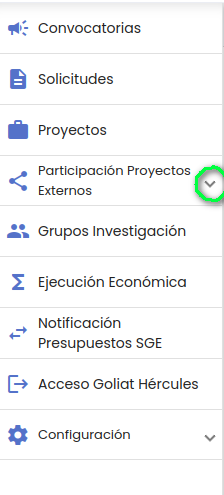

Para acceder a cada una de ellas se tiene que expandir el menú "Participación proyectos externos" a través del icono de la flecha para abajo.

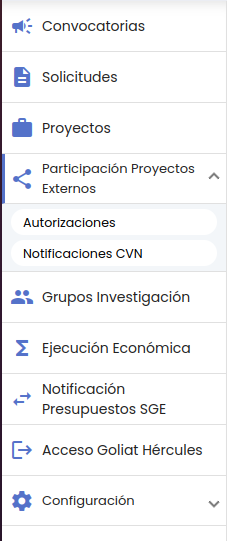

#### 1.1 Revisión y autorización de la solicitud por parte del personal de gestión

El personal de gestión puede consultar todas las solicitudes de autorización registradas, además de recibir una notificación cada vez que cualquier personal de investigación marca como "presentada" una solicitud de participación en proyecto externo.

El personal de gestión puede modificar el estado de la solicitud de autorización. No se implementa ningún flujo concreto, por lo que tendrán libertad para realizar cualquier cambio de estado. Los estados posibles por los que puede pasar una solicitud de participación en proyecto externo son:

* Borrador: estado inicial. Es el estado en el que por defecto se crea la solicitud de autorización para la participación en proyecto externo en el SGI.
* Presentada: estado al que pasa la solicitud de autorización una vez que el personal de investigación envía la solicitud y llega a al personal de gestión. Una vez presentada el personal de investigación no podrá modificar los datos. La edición únicamente podrá realizarla el personal de gestión.
* Revisión: estado previo al estado autorizada. Estará en este estado mientras el personal de gestión estudia la solicitud.
* Autorizada: estado final de la solicitud de autorización para indicarle al personal de investigación que puede descargar el certificado de autorización.

El personal de gestión puede modificar cualquier dato de las solicitudes de autorización, salvo que éstas ya hayan sido marcadas como "autorizadas".

El cambio de estado de la solicitud de autorización realizado desde el personal de gestión lleva implícito un comunicado hacia el personal de investigación.

Una vez que la solicitud de participación en proyecto externo ha sido autorizada será notificada, de forma automática, al módulo de CVN.

El personal de gestión puede generar el certificado de autorización para que sea descargado por personal de investigación. Tendrá la posibilidad de generar el certificado con los datos recogidos en la autorización y con un formato pre-establecido o bien podrá adjuntar un documento generado de forma ajena al SGI. Se podrá generar tantos documentos de autorización si bien solo uno podrá estar marcado como "público", será éste el que esté disponible para su descarga por parte del personal de investigación. Cada vez que se marque un certificado como público, se generará un comunicado automático para informar al personal de investigación.

#### 1.2 Creación del proyecto externo en el SGI

Con la información recibida en la notificación de CVN y la disponibilidad o no del documento acreditativo de la concesión del proyecto, el personal de gestión tomará la decisión de registrar el proyecto en el módulo de CSP. Si este proyecto se registra quedará vinculado a la notificación del proyecto creado en el CVN y, por extensión, a la solicitud de autorización inicial (siempre que ésta hubiese sido vinculada por el personal de investigación) al proyecto creado en el CVN.

La información recogida desde CVN no será suficiente para registrar el proyecto en el SGI, aunque sí se dispondrá de la información de partida básica. La introducción de los campos en el registro del proyecto deberá ser realizada por el personal de gestión, si bien, como para cualquier otro proyecto SGI, la introducción de los mismos podrá ser realizada progresivamente.

### 2. Autorizaciones

Al pinchar sobre la opción del menú "Autorizaciones" se da acceso a la gestión de solicitudes de autorización de participación en proyectos externos por parte del personal de gestión.  Siguiendo la estructura general del SGI, tras pulsar en el menú "Autorizaciones" se accede a la página inicial que contiene el listado de solicitudes de autorizaciones y su buscador, que sigue las normas básicas descritas en [MDU-Manual de usuario - 3.2 Buscadores y listados](../../index.md#34-buscadores-y-listados).

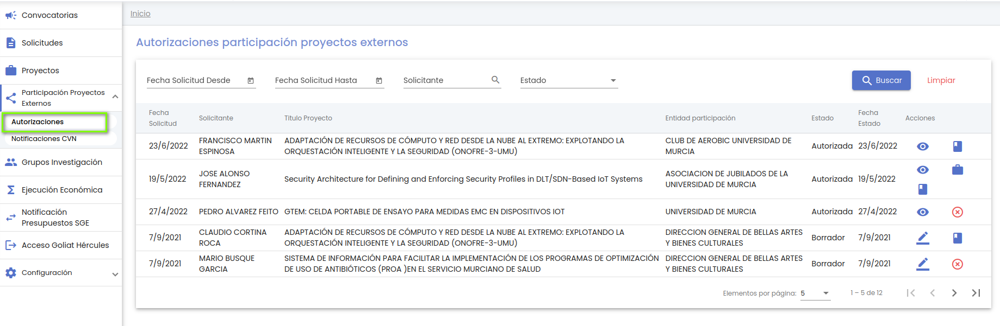

Por defecto, se listan todas las solicitudes de autorización de participación en proyectos externos disponibles sobre una tabla de resultados paginada, [MDU-Manual de usuario - 3.5 Paginación de listados](../../index.md#37-paginacion-de-listados).   El listado se muestra ordenado por defecto por el campo fecha solicitud, de más a menos reciente. La tabla de resultados muestra una serie de campos significativos:

* Fecha solicitud: Fecha de creación de la solicitud.
* Solicitante: Nombre y apellidos del solicitantes, persona que ha solicitado la autorización de participación en un proyecto externo.
* Título proyecto: Título del proyecto indicado en la solicitud de autorización.
* Entidad participación: Entidad externa con la que se realizará el proyecto externo para el que se solicita la autorización de participación.
* Estado: Estado actual de la solicitud de autorización.
* Fecha estado: Fecha en la que la solicitud de autorización adquirió el estado actual.
* Acciones: Conjunto de acciones que están disponibles sobre el grupo de solicitudes de autorización.

Los campos disponibles en el formulario de la búsqueda son:

* Fecha solicitud desde - hasta: Con los campos "desde" y "hasta", ambos del tipo fecha, se puede establecer un periodo que permitirá buscar las solicitudes de autorización cuya fecha de creación esté comprendida en el mismo. Ambos campos disponen de un control calendario a través del que se podrá seleccionar la fecha deseada.
* Solicitante: Este campo permite especificar una persona. Se realizará la búsqueda de las solicitudes de autorización cuyo solicitante sea la persona indicada. Para indicar la persona se utilizará el buscador común de personas [MDU-Manual de usuario - 8.1 Personas](../../index.md#81-personas)
* Estado: Campo para aplicar búsquedas por el estado de la solicitud de autorización. Es un desplegable con el listado de estados posible (borrador, presentada, revisión y autorizada).

Una vez introducidos los filtros de búsqueda se debe pulsar el botón "Buscar". Los resultados coincidentes se mostrarán en el listado de resultados. Todos los filtros de búsqueda actuarán como una conjunción "y", es decir, las solicitudes de autorización que se muestren en el listado de resultados deberán cumplir todos los filtros especificados.

Se puede utilizar el botón "Limpiar" para vaciar cualquier valor introducido en cualquiera de los campos. Además de vaciar los campos de búsqueda, el botón "Limpiar" vuelve a realizar la búsqueda mostrando el listado completo de solicitudes de autorización.

#### 2.1 Modificar autorización

El personal de gestión puede modificar cualquier dato de las solicitudes de autorización (pantalla "Datos generales"), siempre y cuando la solicitud de autorización no se encuentre en estado "autorizada". Si la solicitud de autorización esta en estado "autorizada" sólo se podrá consultar ([2.3 Ver autorización](#23-ver-autorizacion)).

La modificación de los datos de una solicitud de autorización debe de realizarse a través del icono de acción editar del listado de solicitudes de autorizaciones.

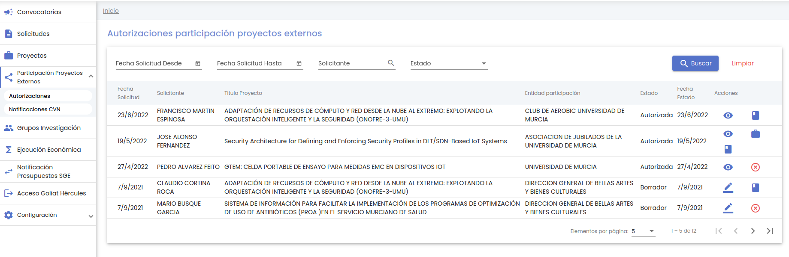

Tras pulsar la acción editar se mostrará el detalle de la solicitud de autorización, en su apartado inicial "datos generales".

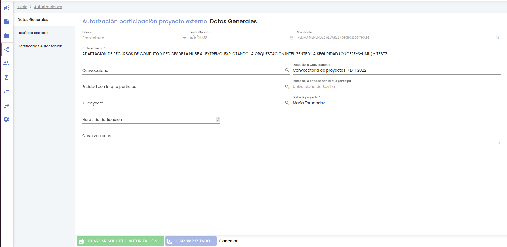

Se podrán introducir cambios sobre los campos del apartado "datos generales". Del mismo modo, accediendo a través del menú lateral izquierdo, se podrán realizar modificaciones sobre los campos del resto de apartados.

La edición de una solicitud de autorización esta formada por los siguientes bloques de información o apartados:

* Datos generales: Conjunto de datos de información general sobre la solicitud de autorización (ya informados durante la creación de la solicitud por el personal de investigación).
* Histórico de estados: Es un apartado únicamente de información para mostrar las fechas en las que ha cambiado de estado la solicitud de autorización.
* Certificados: Listado con los certificados de participación.

Una vez introducidos los datos que se desean modificar o añadir en cualquiera de los apartados, el personal de gestión deberá pulsar sobre el botón "Guardar" situado en la parte inferior de la pantalla en el pie de página para actualizar la solicitud de autorización, sino se pulsa sobre el botón "Guardar" todos los cambios realizados se perderán.

Se mostrará un mensaje informativo confirmando que la solicitud de autorización ha sido modificada correctamente.

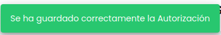

##### 2.1.1 Datos generales

Apartado con los datos de información general sobre la solicitud de autorización, ya informados durante la creación de la solicitud por el personal de investigación.

A continuación se describe cada uno de los campos mostrados en la pantalla:

* Estado: Estado actual de la solicitud de autorización. Es un campo de información para el usuario. El persona de gestión para cambiar el estado de la solicitud debe de hacerlo a través del botón "Cambiar estado" (ver [2.6 Cambiar estado a una solicitud de autorización](#26-cambiar-estado-a-una-solicitud-de-autorizacion))
* Fecha solicitud: Fecha de creación de la solicitud de autorización por el personal de investigación. Es un campo de información para el usuario, no es modificable.
* Solicitante:  Nombre y apellidos del solicitantes, persona que ha solicitado la autorización de participación en un proyecto externo. Es un campo no modificable, es solo de información para el usuario.
* Título de proyecto: Campo de texto para introducir el título del proyecto externo. Será un campo que ya haya informado el personal de investigación durante la creación de la solicitud. Es un dato obligatorio.
* Convocatoria: Título de la convocatoria registrada en el SGI. Para informar del campo se usa el buscador de convocatoria del SGI (ver [MDU-Manual de usuario - Buscador de convocatorias](../../index.md#71-buscador-de-convocatorias)). Es un campo opcional.
* Datos de la convocatoria: Campo de texto libre para introducir el nombre de la convocatoria no registrada en el SGI. Es un campo opcional.
* Entidad con la que participa: Nombre de la entidad con la que se participa. Para informar del campo se usa el buscador de entidades del SGI (ver ver MDU-Manual de usuario - Búsqueda de entidades). Será obligatorio que la entidad quede recogida, bien a través del campo "Entidad con la que participa" (búsqueda de la entidad registrada en el SGI)  o bien a través del campo "Datos de la entidad con la que participa" (campo para escribir directamente sus datos porque no existe registrada en el SGI).
* Datos de la entidad con la que participa: Campo de texto libre para introducir el nombre de la entidad en el caso de que la entidad no este registrada en el SGI. Será obligatorio que la entidad quede recogida, bien a través del campo "Entidad con la que participa" (búsqueda de la entidad registrada en el SGI)  o bien a través del campo "Datos de la entidad con la que participa (campo para escribir directamente sus datos porque no existe registrada en el SGI).
* IP proyecto: Nombre y apellidos de la persona que será el investigador/a principal del proyecto. Para informar del campo se usa el buscador de personas del SGI (ver MDU-Manual de usuario - Búsqueda de personas). Será obligatorio que el IP del proyecto quede recogido, bien a través del campo "IP proyecto" (búsqueda de la persona registrada en el SGI)  o bien a través del campo "Datos IP proyecto" (campo para escribir directamente sus datos porque no existe registrada en el SGI).
* Datos IP proyecto: Campo de texto libre para introducir el nombre y apellidos de la persona que será el investigador/a principal del proyecto en el caso de que la persona no este registrada en el SGI. Será obligatorio que el IP del proyecto quede recogido, bien a través del campo "IP proyecto" (búsqueda de la persona registrada en el SGI)  o bien a través del campo "Datos IP proyecto" (campo para escribir directamente sus datos porque no existe registrada en el SGI).
* Horas de dedicación: Campo para introducir el número total de horas de dedicación al proyecto en el caso de la convocatoria establezca una dedicación mínima. Es un campo opcional.
* Observaciones: Campo de texto libre para introducir las observaciones sobre el proyecto.

Aparte de introducir las modificaciones que estime oportunas en todos los campos, el personal de gestión debe realizar la revisión de la convocatoria, entidad e IP proyecto, puesto que el personal de investigación podría haber introducido sus datos sin haberlos hecho corresponder con una convocatoria, entidad o persona existentes en los sistemas de gestión corporativos de empresas y personas.

Si en la solicitud de autorización no viene informado el campo "Convocatoria" y sí el campo "Datos de la convocatoria indicados en la solicitud", el personal de gestión puede realizar la búsqueda a través del buscador del campo "Convocatoria", para hacer corresponder la convocatoria con una de las registradas en el SGI". No será obligatoria que la convocatoria esté cumplimentada (ya que podría tratarse de una solicitud de autorización para participación en un contrato por lo que no habría convocatoria relacionada). A continuación se explica el flujo para informar del campo "Convocatoria":

1) El personal de investigación ha informado del campo "Datos de la Convocatoria"

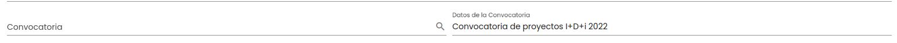

2) El personal de gestión irá al buscador de convocatorias a través de la lupa del campo "Convocatoria". Se abrirá la pantalla del buscador de convocatorias (ver [MDU-Manual de usuario - Buscador de convocatorias](../../index.md#71-buscador-de-convocatorias)). Podrá introducir el título de la convocatoria, pulsar el botón "Buscar" y seleccionar la convocatoria adecuada.

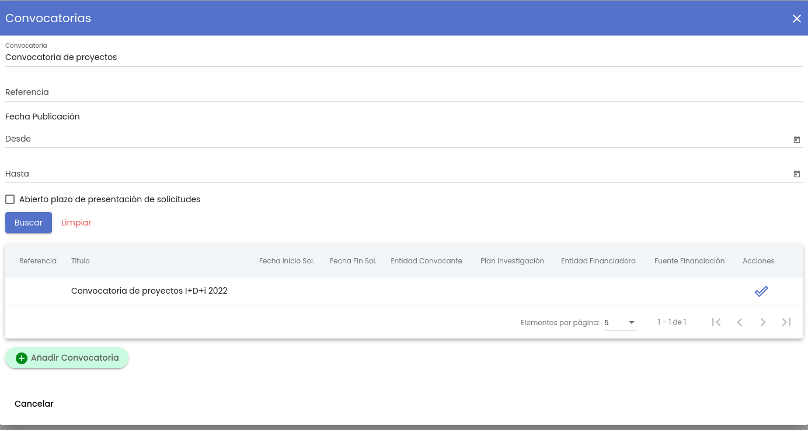

3) Una vez seleccionada se puede ver el campo "Convocatoria" informado

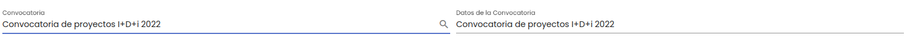

Si en la solicitud de autorización no viene informado el campo "Entidad con la que participa" y sí el campo "Datos de la entidad en la que participa", el personal de gestión debe partir de los datos recogidos en este campo para realizar la búsqueda de la entidad a través del buscador proporcionado en el campo "Entidad con la que participa". Esto asegurará que la solicitud quede vinculada a una de las entidades registradas en el sistema universitario de gestión de empresas. El campo "entidad con la que participa" es un campo obligatorio para que se pueda cambiar de estado la solicitud. A continuación se explica el flujo para informar del campo "Entidad con la que participa":

1) El personal de investigación ha informado del campo "Datos de la entidad en la que participa"

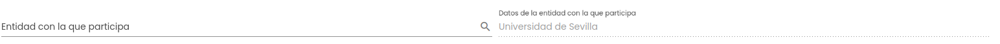

2) El personal de gestión irá al buscador de entidades a través de la lupa del campo "Entidad con la que participa". Se abrirá la pantalla del buscador de entidades (ver MDU-Manual de usuario - Búsqueda de entidades). Podrá introducir el nombre o razón social de la entidad, pulsar el botón "Buscar" y seleccionar la entidad adecuada.

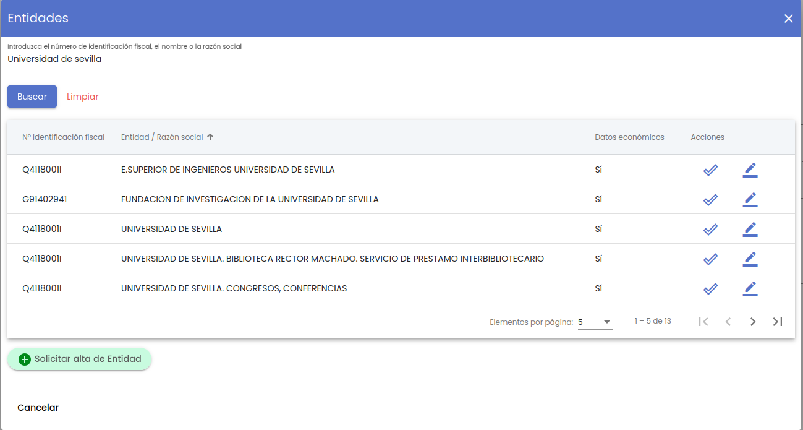

3) Si la entidad deseada no se encuentra registrada aún, el personal de gestión tramitará el alta de la misma a través del botón "Solicitar alta entidad" disponible en el buscador de entidades.(ver MDU-Manual de usuario - Alta entidad).

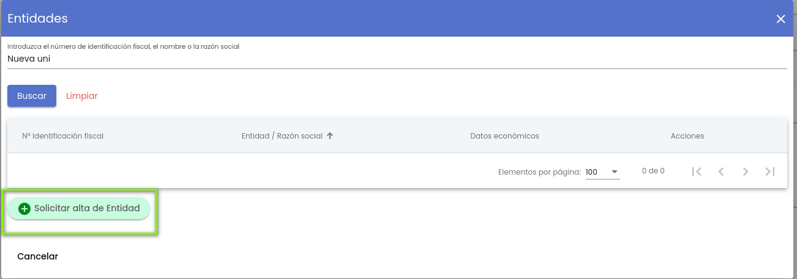

4) Una vez seleccionada la entidad se puede ver el campo "Entidad con la que participa" informado

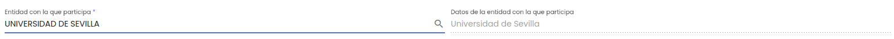

Si en la solicitud de autorización no viene informado el campo "IP proyecto" y sí el campo "Datos de IP proyecto", el personal de gestión puede utilizar los datos recogidos en este campo para realizar la búsqueda de la persona a través del buscador proporcionado en el campo "IP proyecto". De esta forma la solicitud queda vinculada a una persona registrada en el sistema de personas corporativo. El campo "IP proyecto" es un campo obligatorio para que se pueda cambiar de estado la solicitud. A continuación se explica el flujo para informar del campo "IP proyecto":

1) El personal de investigación ha informado del campo "Datos IP proyecto"

2) El personal de gestión irá al buscador de personas a través de la lupa del campo "IP proyecto". Se abrirá la pantalla del buscador de personas (ver MDU-Manual de usuario - Búsqueda de personas). Podrá introducir el nombre y apellidos de la persona, pulsar el botón "Buscar" y seleccionar la persona adecuada.

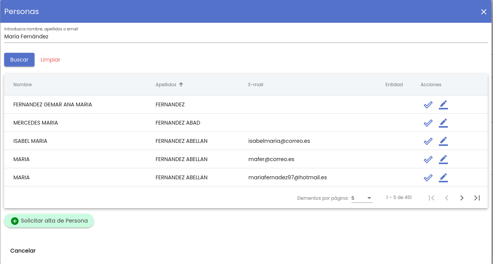

3) Si la persona deseada no se encuentra registrada aún, el personal de gestión puede tramitar el alta de la misma a través del botón "Solicitar alta persona" disponible en el buscador de personas (ver MDU-Manual de usuario - Alta persona).

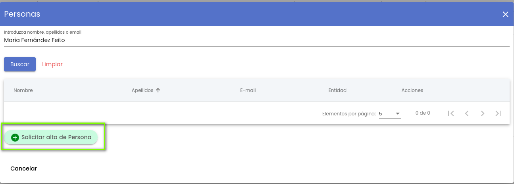

4) Una vez seleccionada la persona se puede ver el campo "IP proyecto" informado

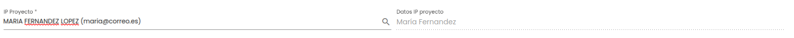

Una vez introducidos los datos que se desean modificar, el personal de gestión deberá pulsar sobre el botón "Guardar" situado en la parte inferior de la pantalla en el pie de página para actualizar la solicitud de autorización, sino se pulsa sobre el botón "Guardar" todos los cambios realizados se perderán.

El botón "Guardar" no estará habilitado hasta que se informen todos los datos obligatorios, que son:

* Título proyecto.
* Entidad con la que participa, habiendo seleccionado una entidad registrada en el sistema de empresas a través del buscador.
* IP proyecto, bien a través del campo "IP proyecto" o bien a través del campo "Datos IP proyecto".

##### 2.1.2 Histórico de estados

El personal de gestión podrá ver el histórico de estados, sin poder realizar ninguna modificación sobre los datos del mismo. Se muestra la fecha y hora de cada uno de los cambios estado que ha tenido la solicitud de autorización.

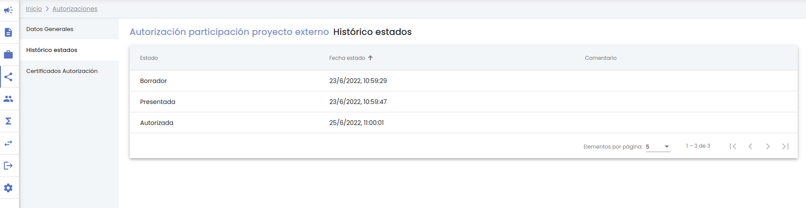

##### 2.1.3 Certificados

Sobre las solicitudes de autorización en estado "autorizada" se podrá generar el documento de certificado de la autorización a participar en el proyecto externo. 

El personal de gestión puede generar el certificado de autorización para que sea descargado por personal de investigación. Tendrá la posibilidad de generar el certificado con los datos recogidos en la autorización y con un formato pre-establecido o bien podrá adjuntar un documento generado de forma ajena al SGI. Se podrá generar tantos documentos de autorización si bien solo uno podrá estar marcado como "público", será éste el que esté disponible para su descarga por parte del personal de investigación. Cada vez que se marque un certificado como público, se generará un comunicado automático para informar al personal de investigación.

Inicialmente el apartado estará vacío, presentando el siguiente aspecto:

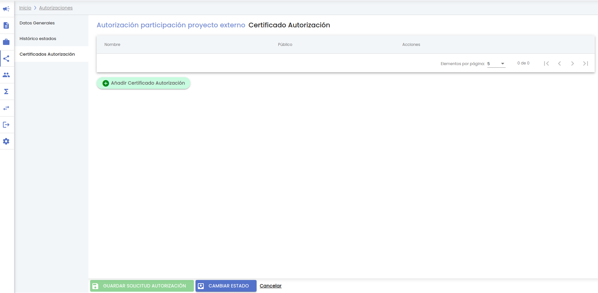

Una vez añadido un certificado el aspecto de la pantalla será:

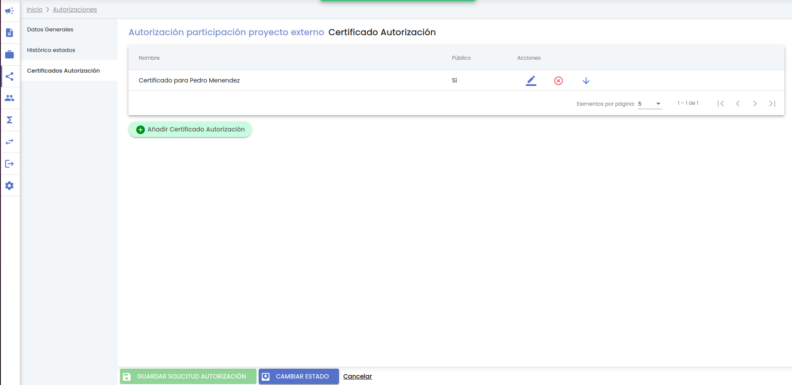

###### 2.1.3.1 Añadir certificado

Para añadir un nuevo certificado se debe pulsar el botón "añadir certificado autorización". Se mostrará la siguiente ventana:

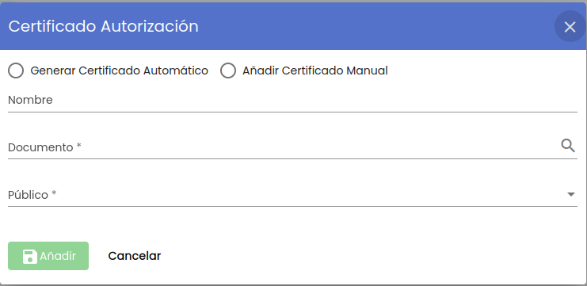

Se dispone de cuatro campos:

* Generar certificado automático/añadir certificado manual: se debe de elegir entre la opción de "generar certificado automático" si lo que se quiere es utilizar la plantilla del SGI y que sea la aplicación de forma automática la que genere el documento o bien la opción "añadir certificado manual" en cuyo caso el personal de gestión deberá de adjuntar el documento de forma manual en el campo "Documento".

Al seleccionar "generar certificado automático" se genera el documento del certificado de forma automática por la aplicación y una vez generado se muestra en el campo "Documento" tal y como puede verse en la siguiente imagen:

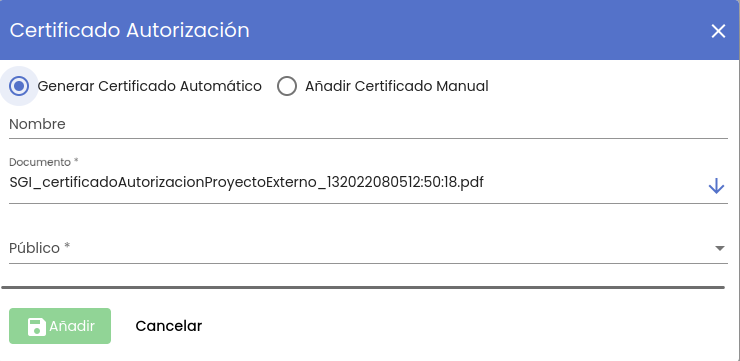

Al seleccionar "añadir certificado manual" será el usuario el que tenga que adjuntar el documento a través de la lupa del campo "Documento"

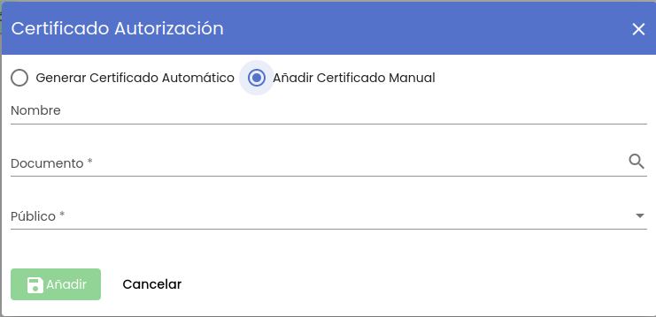

Será obligatorio seleccionar una de las dos opciones.

* Nombre: Nombre con el que se le va a mostrar al personal de investigación el certificador. Es un campo opcional.
* Documento: Es el propio certificado. Si se ha seleccionado la opción "generar certificado automático" de forma automática se rellenará este campo con el documento generado a través de una plantilla pre-establecida del SGI. Si se ha seleccionado la opción  "añadir certificado manual" será el usuario el que tenga que adjuntar el documento a través de la lupa (se abrirá una pantalla de examinador de archivos que permita seleccionar un fichero desde la unidad de disco local). Una vez seleccionado un fichero se mostrará el nombre y extensión del mismo sobre el campo "Documento" del formulario. Es un campo obligatorio.
* Publico: Campo de tipo desplegable que determina que el certificado sea o no descargable por el solicitante (personal de investigación). Los valores disponibles son:  
  + Sí
  + No

Se podrán generar tantos certificados como se desee pero solo uno de ellos podrá marcarse como "público". El documento de certificado marcado como público será visible por el solicitante (personal de investigación) que podrá descargarlo desde su acceso al SGI.

Hasta que no se cumplimente todos los datos obligatorios no se activará el botón "Añadir".

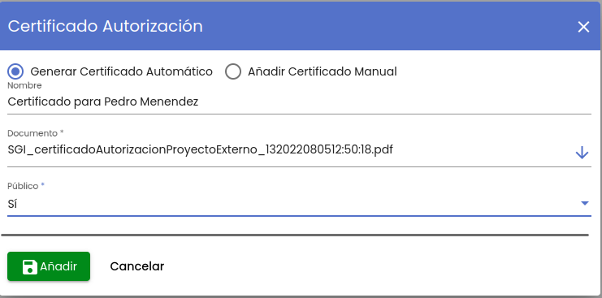

Al pulsar sobre el botón "Añadir" el certificado pasará a estar disponible en el listado de certificados de la solicitud de autorización.

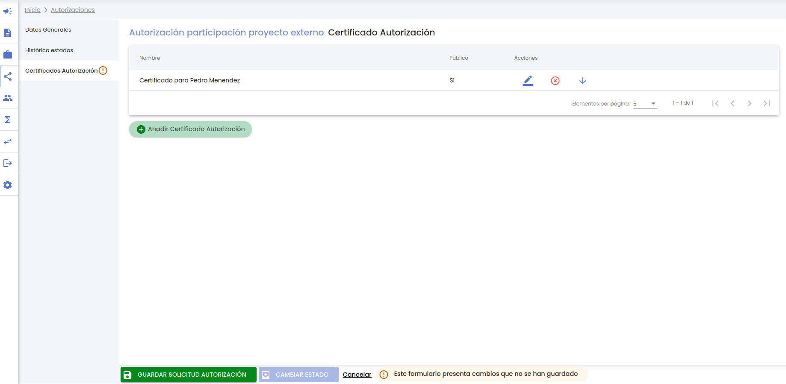

Para que se consoliden los datos el personal de gestión deberá pulsar sobre el botón "Guardar" situado en la parte inferior de la pantalla en el pie de página para actualizar la solicitud de autorización, sino se pulsa sobre el botón "Guardar" todos los cambios realizados se perderán.

Cuando se cree/modifique un certificado marcando a "sí" el campo "público" se generará un comunicado automático dirigido al solicitante para informarle de que ya tiene disponible su certificado de participación.

###### 2.1.3.2 Modificar certificado

El icono "modificar certificado" permite modificar los datos de uno de los certificados de la solicitud de autorización. Tras pulsar el botón se muestra la ventana para la modificación de datos, la pantalla es idéntica a la utilizada durante el alta, dejando la posibilidad de modificar únicamente los campos "Nombre" y "Publico" (ver funcionalidad descrita en el apartado 4.2.1Añadir un nuevo miembro para mas detalle).

En la siguiente imagen se muestra la pantalla de edición de un certificado:

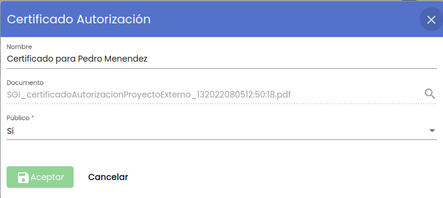

El botón "Aceptar" no se habilitará hasta que se introduzca algún cambio en uno de los datos de la pantalla. Se realizarán las misma validaciones que en la creación de un nuevo certificado.

Al pulsar sobre el botón "Aceptar" el certificado se modificará y los cambios se verán reflejados en la tabla de certificados de la solicitud de autorización mostrando el icono de la admiración en el menú de "Certificados" y el mensaje de información en la parte de abajo de la pantalla en el pie de página para recordar al personal de gestión que debe de pulsar el botón "Guardar" para que los cambios realizados (en este caso un cambio de un certificado) se consoliden.

###### 2.1.3.3 Eliminar certificado

Tras pulsar el icono eliminar del listado de solicitudes de autorización se mostrará un mensaje de confirmación.

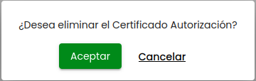

Si se pulsa el botón Cancelar se cerrará la ventana del mensaje de confirmación y el certificado no será borrado.

Si se pulsa el botón Aceptar el certificado desaparecerá de la tabla de certificados de la solicitud de autorización mostrando el icono de la admiración en el menú de "Certificados" y el mensaje de información en la parte de abajo de la pantalla en el pie de página para recordar al personal de gestión que debe de pulsar el botón "Guardar" para que los cambios realizados (en este caso un borrado de un certificado) se consoliden.

###### 2.1.3.4 Descargar certificado

Tras pulsar el icono descargar certificado  del listado de solicitudes de autorización se realiza la descarga del documento a la unidad de disco local.

#### 2.2 Eliminar autorización

Una solicitud de autorización en proyecto externo no es una de las entidades del SGI que admite desactivación, por lo que una vez eliminada desaparecerá del SGI y no se podrá recuperar de ninguna forma.

Sólo se puede eliminar una solicitud de autorización sino tiene notificaciones de CVN asociadas, es decir, si no existe ningún proyecto externo creado en el CVN del personal de investigación relacionado con la solicitud de autorización.

La eliminación de los datos de una solicitud de autorización debe de realizarse a través del icono de acción eliminar  del listado de solicitudes de autorización.

Tras pulsar el icono eliminar se mostrará un mensaje de confirmación.

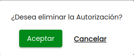

Si se pulsa el botón Cancelar se cerrará la ventana del mensaje de confirmación y la solicitud de autorización no será borrada.

Si se pulsa el botón Aceptar la solicitud de autorización desaparecerá de la tabla de solicitudes de autorización y dejará de estar disponible en el SGI tanto para el personal de gestión como para el personal de investigación.

#### 2.3 Ver autorización

El personal de gestión puede consultar cualquier solicitud de autorización en estado "autorizada". En el resto de estados en vez de consultar la solicitud podrá modificarla (icono del lápiz).

El consultar o visualización de la solicitud de autorización permite:

* Consultar los datos del apartado de "datos generales" sin modificar ninguno de los datos.
* Consultar el histórico de estados, apartado "histórico estados".
* Gestionar los certificados, apartado "Certificador", permitiendo añadir, modificar o eliminar los certificados de participación de la solicitud de autorización.

La consulta de los datos de una solicitud de autorización debe de realizarse a través del icono de acción ver del listado de solicitudes de autorizaciones.

##### 2.3.1  Datos generales

Tras pulsar la acción ver se mostrará el detalle de la solicitud de autorización, en su apartado inicial "datos generales".

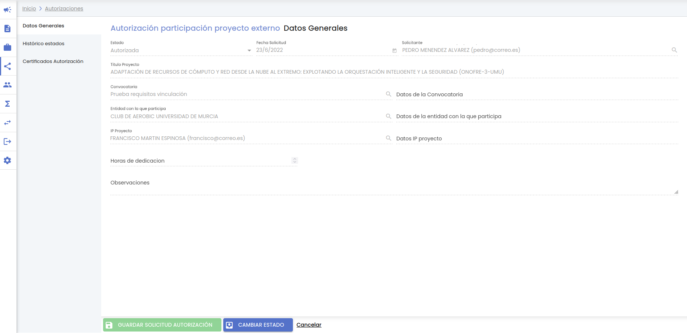

Como se puede ver en la imagen todos los campos están deshabilitados de manera que el personal de gestión no puede realizar ningún cambio en ellos. Para ver la descripción de cada campo ir al apartado [2.1 Modificar autorización -> 2.1.1 Datos generales](#211-datos-generales)

##### 2.3.2  Histórico de estados

Funcionalidad descrita en el apartado [2.1 Modificar autorización -> 2.1.2 Histórico de estados](#212-historico-de-estados)

##### 2.3.2  Certificados

Funcionalidad descrita en el apartado [2.1 Modificar autorización -> 2.1.3 Certificados](#213-certificados)

#### 2.4 Ver notificación CVN

El personal de gestión puede consultar los datos del proyecto externo dado de alta en el CVN por parte del personal de investigación y notificado al SGI si dicho proyecto tiene relacionada la solicitud de autorización.

La consulta de los datos del proyecto externo relacionado con una solicitud de autorización debe de realizarse a través del icono de acción ver notificación CVN  del listado de solicitudes de autorizaciones.

Tras pulsar la acción ver se mostrará el detalle del proyecto externo dado de alta en el CVN y notificado al SGI asociado a la solicitud de autorización. Se muestran todos los datos en modo consulta.

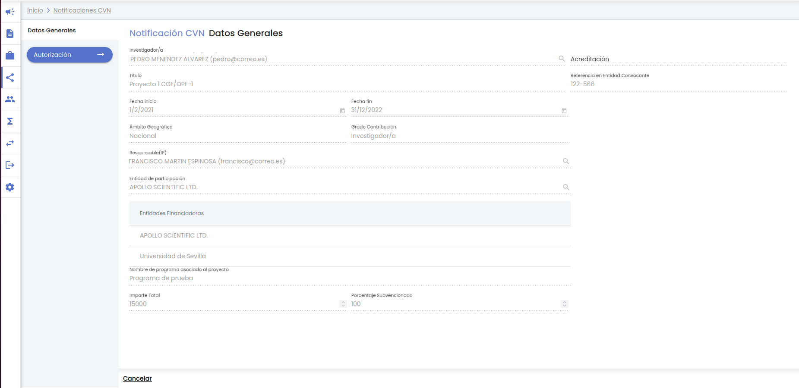

Para ver el detalla de cada uno de los campos se puede ir al apartado del manual [3.1Ver notificación](#31-ver-notificacion-cvn) donde se describen cada uno de los datos que pueden ser informados en el CVN y recibidos en el SGI de forma automática.

Se puede ir a la modificación o consulta de la solicitud de autorización relacionada con el proyecto externo del CVN a través de la opción del menú "autorización →" resaltada en la siguiente imagen:

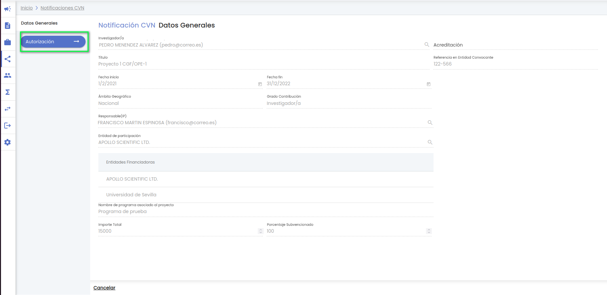

#### 2.5 Ver proyecto

El personal de gestión puede consultar los datos del proyecto del SGI generado a partir de los datos del proyecto externo del CVN (si previamente lo ha relacionado o creado nuevo en el SGI, funcionalidad descrita en [3. Notificaciones CVN -> 3.2 Asociar Proyecto](#32-asociar-proyecto)).

A través del icono de acción ver proyecto del listado de solicitudes de autorizaciones se realiza un cambio de contexto y se accede a la información detallada del proyecto SGI generado a partir de los datos del proyecto externo relacionado con la solicitud de autorización siempre y cuando el personal de gestión tenga el permiso adecuado para acceder al detalle del proyecto. Ver descripción de la funcionalidad en [CSP-Proyectos -> 4.1Datosgenerales -> Fichageneral](csp-proyectos/index.md#41-datos-generales-ficha-general)

#### 2.6 Cambiar estado a una solicitud de autorización

El estado "borrador" es el estado en el que por defecto se crea la solicitud de autorización de participación en proyecto externo en el SGI.

El cambio de estado se podrá realizar a través del botón "Cambiar estado" disponible desde todos los apartados de una solicitud de autorización. Si la solicitud de autorización ya ha sido creada, y se desea cambiar su estado, se deberá acceder al detalle de la misma por medio de la acción "[modificar](#21-modificar-autorizacion)"  o "[consultar](#23-ver-autorizacion)" (dependiendo del estado) del listado de solicitudes de autorización.

No se implementa ningún flujo concreto de estados, por lo que el personal de gestión tendrá libertad para realizar cualquier cambio de estado (incluido el cambio de estado de "autorizada" a "borrador")

El cambio de estado de la solicitud de autorización realizado desde el personal de gestión lleva implícito un comunicado hacia el personal de investigación.

El botón "Cambiar estado" podrá estar habilitado o deshabilitado, en función de que se den o no todas las condiciones necesarias para realizar un cambio de estado.

Vista del detalle de una solicitud de autorización con el botón "Cambiar estado" deshabilitado:

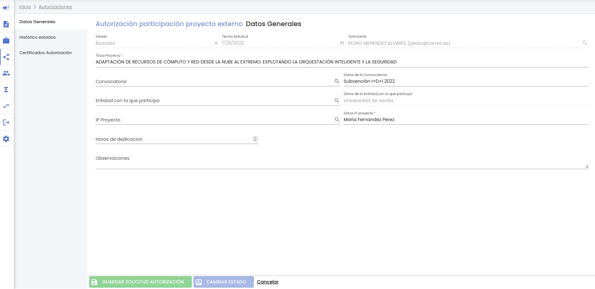

Para que una solicitud de autorización pueda pasar a otro estado han de estar cumplimentados los siguientes campos:

* Título proyecto.
* Entidad con la que participa, habiendo seleccionado una entidad registrada en el sistema de empresas a través del buscador.
* IP proyecto,  habiendo seleccionado una persona registrada en el sistema de personas a través del buscador.

Cuando todos los campos indicados previamente estén cumplimentados, el botón "Cambiar estado" estará habilitado:

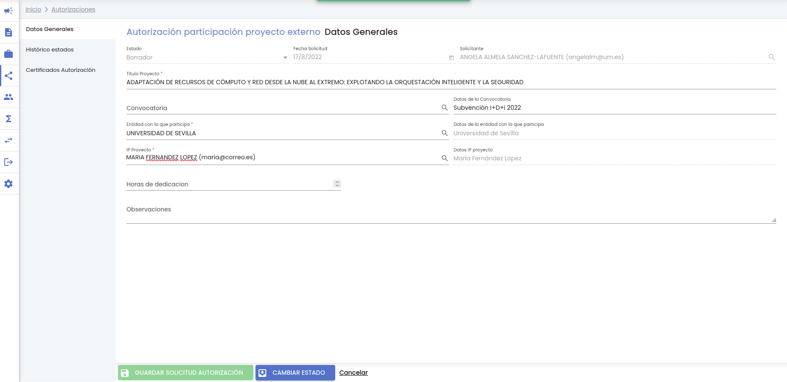

Tras pulsar el botón "Cambiar estado" se mostrará la siguiente pantalla:

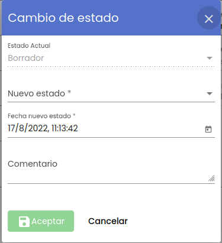

Se dispone de cuatro campos:

* Estado actual: Campo de información para el personal de gestión, para indicarle el estado actual de la solicitud de autorización.
* Nuevo estado: Campo obligatorio de tipo desplegable que determina el nuevo estado al que se quiere pasar. Los valores disponibles son:  
  + Borrador: estado inicial. Es el estado en el que por defecto se crea la solicitud de autorización para la participación en proyecto externo en el SGI.
  + Presentada: estado al que pasa la solicitud de autorización una vez que el personal de investigación envía la solicitud y llega a al personal de gestión. Una vez presentada el personal de investigación no podrá modificar los datos. La edición únicamente podrá realizarla el personal de gestión.
  + Revisión: estado previo al estado autorizada. Estará en este estado mientras el personal de gestión estudia la solicitud.
  + Autorizada: estado final de la solicitud de autorización para indicarle al personal de investigación que puede descargar el certificado de autorización.
* Fecha nuevo estado: Fecha y hora del cambio de estado. Por defecto, se tomará la fecha/hora actuales pero la unidad de gestión podrá cambiar esta fecha y hora de modo que el cambio de estado queda asociado a una fecha/hora diferente a la actual.
* Comentario: Campo opcional de texto libre para indicar cualquier observación sobre el cambio de estado.

Hasta que no se cumplimente todos los datos obligatorios no se activará el botón "Aceptar".

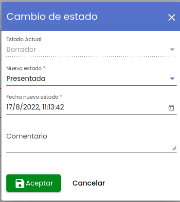

Si se pulsa el botón "Cancelar", se cerrará la ventana y la solicitud de autorización permanecerá en el estado en el que estaba.

Si se pulsa el botón "Aceptar", se cerrará la ventana y la solicitud de autorización pasará al estado indicado en el campo "Nuevo estado". Se mostrará un mensaje informativo cuando la operación haya finalizado.

### 3. Notificaciones CVN

Al pinchar sobre la opción del menú "Notificaciones CVN" se da acceso a la gestión de notificaciones de proyectos externos provenientes del CVN por parte del personal de gestión.  Siguiendo la estructura general del SGI, tras pulsar en el menú "Notificaciones CVN" se accede a la página inicial que contiene el listado de notificaciones del CVN y su buscador, que sigue las normas básicas descritas en [MDU-Manual de usuario - 3.2 Buscadores y listados](../../index.md#34-buscadores-y-listados).

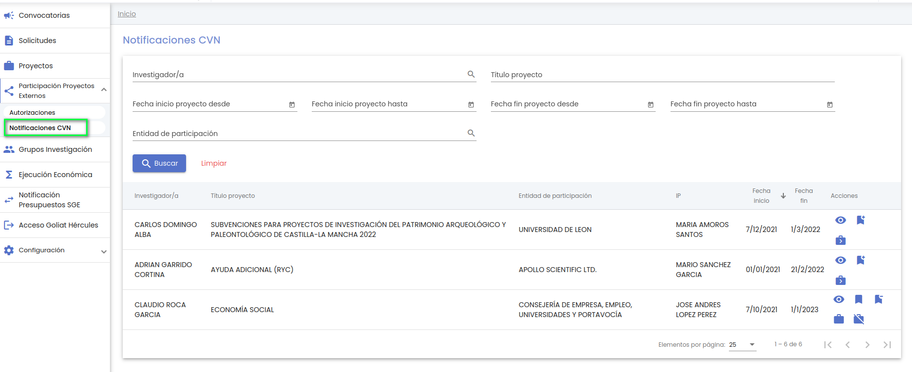

La información mostrada se corresponderá con la introducida en el CVN por el personal investigador. Por defecto, se listan todas las notificaciones CVN disponibles sobre una tabla de resultados paginada, [MDU-Manual de usuario - 3.5 Paginación de listados](../../index.md#37-paginacion-de-listados). La tabla de resultados muestra una serie de campos significativos:

* Investigador/a: Nombre y apellidos de la persona que registra el proyecto en su CVN.
* Título proyecto: Titulo del proyecto registrado en el CVN.
* Entidad de participación: Nombre de la entidad donde se desarrolla el proyecto registrado en el CVN.
* IP: Nombre y apellidos de la persona que es el investigador/a principal del proyecto registrado en el CVN.
* Fecha inicio: Fecha de inicio del proyecto registrado en el CVN.
* Fecha fin: Fecha de finalización del proyecto registrado en el CVN.
* Acciones: Conjunto de acciones que están disponibles sobre el grupo de notificaciones CVN.

Los campos disponibles en el formulario de la búsqueda son:

* Investigador/a: Este campo permite especificar una persona. Se realizará la búsqueda de las notificaciones CVN cuyo solicitante sea la persona indicada. Para indicar la persona se utilizará el buscador común de personas [MDU-Manual de usuario - 8.1 Personas](../../index.md#81-personas)
* Título proyecto: Campo para introducir el filtro que aplicará sobre el título del proyecto recogido de la notificación de CVN.
* Fecha inicio desde - hasta: Con los campos "desde" y "hasta", ambos del tipo fecha, se puede establecer un periodo que permitirá buscar las notificaciones CVN cuya fecha de inicio del proyecto esté comprendida en el mismo. Ambos campos disponen de un control calendario a través del que se podrá seleccionar la fecha deseada.
* Fecha fin desde - hasta: Con los campos "desde" y "hasta", ambos del tipo fecha, se puede establecer un periodo que permitirá buscar las notificaciones CVN cuya fecha de fin del proyecto esté comprendida en el mismo. Ambos campos disponen de un control calendario a través del que se podrá seleccionar la fecha deseada.
* Entidad de participación: Este campo permite especificar una entidad o empresa. Se realizará la búsqueda de las notificaciones CVN desarrolladas en la entidad indicada. Para indicar la entidad se utilizará el buscador común de entidades [MDU-Manual de usuario - 8.2 Entidades o empresas](../../index.md#82-entidades-o-empresas)

Una vez introducidos los filtros de búsqueda se debe pulsar el botón "Buscar". Los resultados coincidentes se mostrarán en el listado de resultados. Todos los filtros de búsqueda actuarán como una conjunción "y", es decir, las notificaciones CVN que se muestren en el listado de resultados deberán cumplir todos los filtros especificados.

Se puede utilizar el botón "Limpiar" para vaciar cualquier valor introducido en cualquiera de los campos. Además de vaciar los campos de búsqueda, el botón "Limpiar" vuelve a realizar la búsqueda mostrando el listado completo de notificaciones CVN.

#### 3.1 Ver notificación CVN

Desde el icono de Ver  del listado de notificaciones CVN, se accederá a una ventana donde se verán algunos campos del registro introducido en CVN. El personal de gestión no podrá modificar ningún dato.

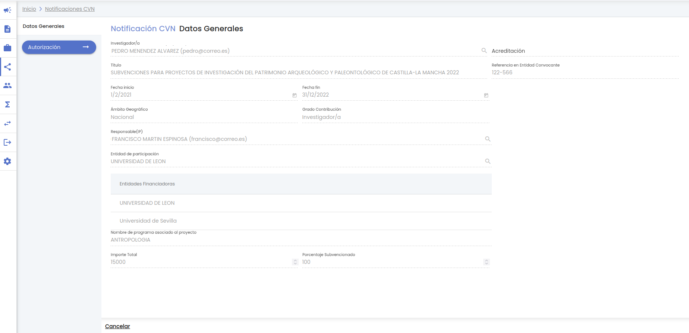

Dichos campos son:

* Investigador/a: Nombre y apellidos de la persona que registra el proyecto en su CVN.
* URL o documento donde se acredita la concesión del proyecto.
* Título: Título del proyecto recogido en el registro del mismo en CVN.
* Referencia en entidad convocante: Referencia del proyecto en la entidad convocante/financiadora recogido en el registro del mismo en CVN.
* Fecha inicio: Fecha de inicio del proyecto de acuerdo a lo recogido en  CVN.
* Fecha fin: Fecha de fin del proyecto de acuerdo a lo recogido en  CVN.
* Ámbito geográfico: Ámbito geográfico del proyecto de acuerdo a lo recogido en  CVN.
* Grado de contribución: Grado de contribución del personal de investigación al proyecto de acuerdo a lo recogido en  CVN.
* Responsable (IP): Nombre y apellidos de la persona que responsable del proyecto de acuerdo a lo recogido en  CVN.
* Entidad de participación: Nombre de la entidad o de la empresa en la que se desarrolla el proyecto de acuerdo a lo recogido en  CVN.
* Listado de entidades financiadoras: Listado con los nombres de las entidades o empresas que financian el proyecto de acuerdo a lo recogido en  CVN.
* Nombre del programa: Nombre del programa de financiación de acuerdo a la información introducida en CVN.
* Importe total: Importe total del proyecto de acuerdo a la información introducida en CVN.
* Porcentaje subvencionado: Porcentaje subvencionado de acuerdo a la información introducida en CVN.

No todos los campos estarán informados, depende de la información que haya introducido el personal de investigación en su CVN.

Desde esta pantalla se tiene un acceso directo a la consulta o modificación de la solicitud de autorización vinculada al proyecto realizando un cambio de contexto a través de la opción del menú "autorización →" resaltada en la siguiente imagen (siempre y cuando el proyecto CVN se haya vinculado a una solicitud de autorización):

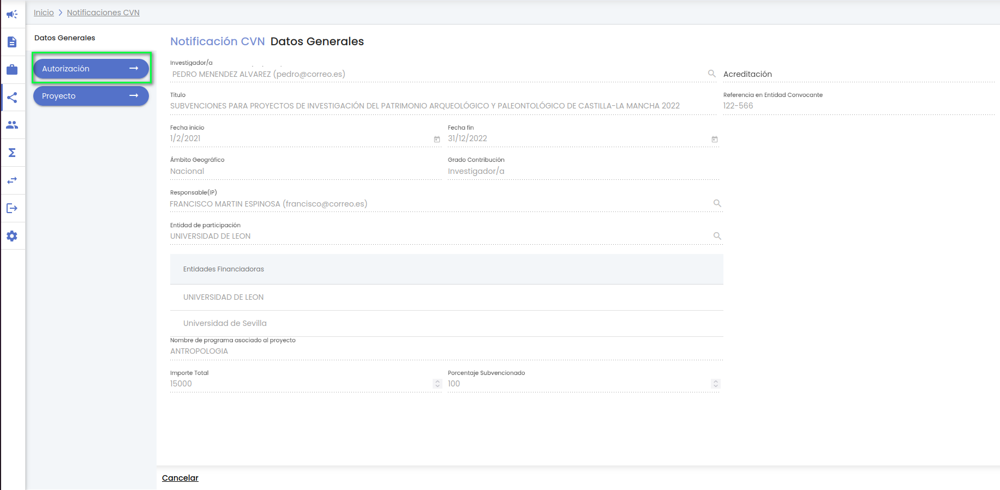

También se podrá acceder a la consulta o modificación del proyecto creado en el SGI a partir de la notificación  del CVN o bien la vinculación al proyecto en caso de que ya estuviera creado en el SGI realizando un cambio de contexto a través de la opción del menú "proyecto →" resaltada en la siguiente imagen (siempre y cuando exista el proyecto en el SGI):

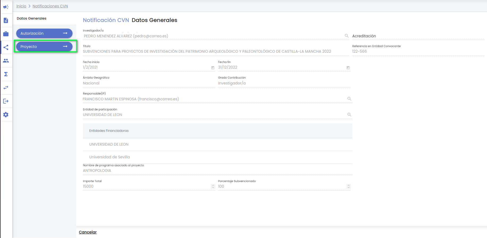

#### 3.2 Asociar Proyecto

Con la información recibida en la notificación de CVN y la disponibilidad o no del documento acreditativo de la concesión del proyecto, el personal de gestión tomará la decisión de registrar el proyecto en el módulo de CSP. Si este proyecto se registra quedará vinculado a la notificación del proyecto creado en el CVN y, por extensión, a la solicitud de autorización inicial (siempre que ésta hubiese sido vinculada por el personal de investigación) al proyecto creado en CVN.

La información recogida desde CVN no será suficiente para registrar el proyecto en el SGI, aunque sí se dispondrá de la información de partida básica. La introducción de los campos en el registro del proyecto deberá ser realizada por el personal de gestión, si bien, como para cualquier otro proyecto SGI, la introducción de los mismos podrá ser realizada progresivamente desde la opción de menú "Proyectos" del módulo de CSP (Ver [CSP-Proyectos - 4 Modificar un proyecto](csp-proyectos/index.md#4-modificar-un-proyecto)).

A partir de la notificación de CVN el personal de gestión podrá tomar la decisión de registrar el proyecto externo en el SGI. Para ello utilizará el icono de acción "Asociar proyecto"  disponible en el listado de Notificaciones CVN (siempre y cuando la notificación CVN aún no tiene un proyecto vinculado):

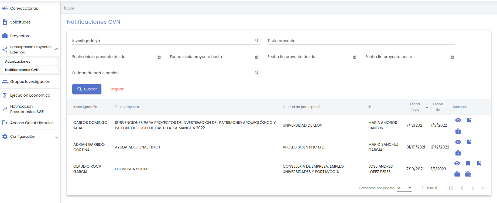

Podrán darse dos casos:

* Que se desee crear un nuevo proyecto externo
* Que se desee vincular la notificación CVN a un proyecto externo ya existente (porque se diese el caso que dos investigadores/as participen en un mismo proyecto externo)

Por ello, tras pulsar el icono  "Asociar proyecto" se deberá elegir una de las dos opciones:

* Crear nuevo proyecto
* Buscar proyecto existente

##### Crear nuevo proyecto

Tras seleccionar la opción "Crear nuevo proyecto" se mostrarán los campos mínimos para poder crear un proyecto SGI. El resto de datos del proyecto se podrán cumplimentar posteriormente desde el apartado [CSP-Proyectos - 4 Modificar un proyecto](csp-proyectos/index.md#4-modificar-un-proyecto).

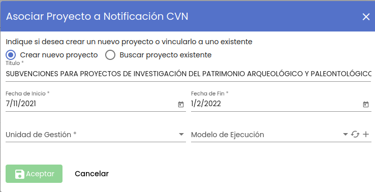

Los datos solicitados en esta pantalla son:

* Título: Campo obligatorio de texto libre para introducir el título del proyecto. Por defecto se inicializa al título del proyecto que viene de la notificación del proyecto CVN.
* Fecha inicio: Campo de tipo fecha para introducir la fecha de inicio del proyecto externo. Se puede introducir la fecha de forma manual o con la ayuda del calendario. Por defecto se inicializa a la fecha de inicio que viene de la notificación del proyecto CVN. Es un campo obligatorio.
* Fecha fin: Campo de tipo fecha para introducir la fecha de finalización del proyecto externo. Se puede introducir la fecha de forma manual o con la ayuda del calendario. Por defecto se inicializa a la fecha de fin que viene de la notificación del proyecto CVN. Es un campo obligatorio.
* Unidad de gestión: Campo de tipo desplegable que indica la unidad de gestión a la que pertenece el proyecto externo que se desea dar de alta. El listado contiene las unidades de gestión sobre las que el usuario conectado tenga permisos de gestor/a. Es un campo obligatorio.
* Modelo de ejecución: Campo de tipo desplegable que indica el modelo de ejecución del proyecto externo que se desea dar de alta. El listado contiene los modelos de ejecución marcados con la característica de "externos" y además estén asociados a las unidades de gestión sobre las que tiene permiso el usuario conectado (CSP-Configuración - 7.2 Añadir modelo de ejecución). Es un campo obligatorio.

Hasta que no se cumplimente todos los datos obligatorios no se activará el botón "Aceptar".

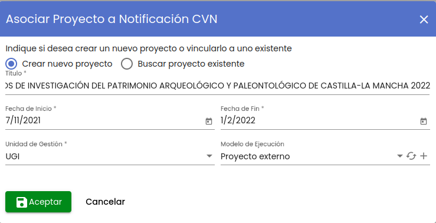

Al pulsar sobre el botón "Aceptar" se crea el proyecto externo en el SGI con el mínimo número de campos, es decir, únicamente con los campos titulo, fecha inicio, fecha fin, unidad de gestión, modelo de ejecución y en estado "borrador".

Se muestra un mensaje de que el proyecto se ha creado correctamente igual que el de la siguiente imagen.

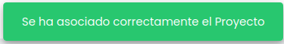

##### Asociar a un proyecto existente

Puede darse el caso de que el proyecto ya se haya creado en el SGI porque otro investigador/a previamente hubiese solicitado la autorización de participación para el mismo proyecto externo. Es el caso en que hubiese mas de un investigador/a de la Universidad trabajando en el mismo proyecto externo.

En este caso en vez de crear el proyecto nuevo en el SGI lo que el personal de gestión debe de hacer es buscar el proyecto a través del buscador cómun de proyectos [MDU-Manual de usuario - 7.2 Buscador de proyectos](../../index.md#72-buscador-de-proyectos).

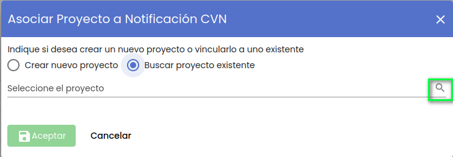

Al seleccionar el icono de la lupa se abre la pantalla del buscador común de proyectos:

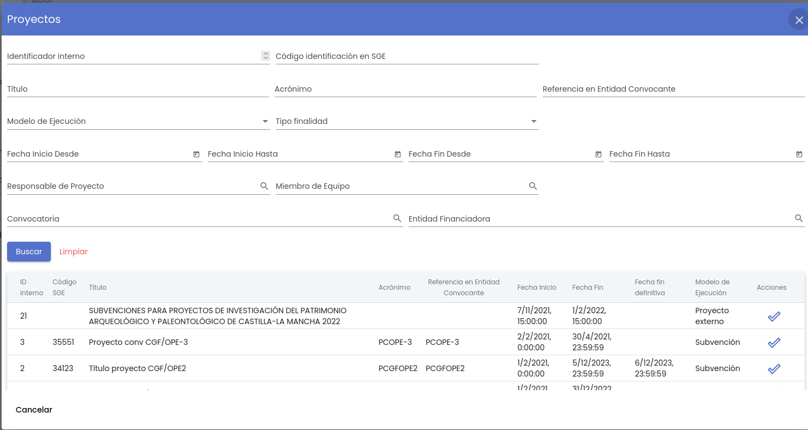

Se selecciona el proyecto deseado (se pulsa sobre el icono de la columna "Acciones" )

Una vez seleccionado un proyecto se mostrará en el campo "Seleccion el proyecto" el título del proyecto:

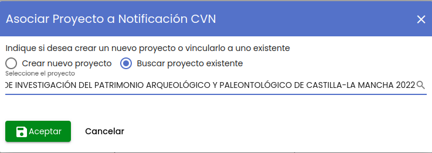

Al pulsar sobre el botón "Aceptar" se vincula el proyecto del SGI con la notificación CVN.

Se muestra un mensaje de que el proyecto se ha asociado correctamente igual que el de la siguiente imagen.

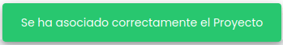

#### 3.3 Des-asociar Proyecto

Si una notificación de CVN se ha vinculado a un proyecto SGI y desea eliminarse este vínculo, el personal de gestión podrá hacer uso del icono de acción "Des-asociar proyecto"   disponible en el listado de Notificaciones CVN:

Tras pulsar el icono "Des-asociar proyecto" se mostrará un mensaje de confirmación.

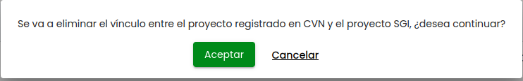

Si se pulsa el botón Cancelar se cerrará la ventana del mensaje de confirmación y el vinculo con el proyecto SGI no será eliminado.

Si se pulsa el botón Aceptar se eliminará la relación entra el proyecto registrado en el CVN y el proyecto creado en el SGI, mostrándose un mensaje informativo al finalizar la operación:

#### 3.4 Asociar Autorización

El personal de gestión podrá asociar una notificación de CVN con una solicitud de participación en proyecto externo previamente autorizada. Esta necesidad podría darse en el caso de que el/la investigador/a no establezca este vínculo en el momento de introducir el proyecto en su CVN. Se usará el icono de acción "Asociar autorización"  del listado de Notificaciones CVN.

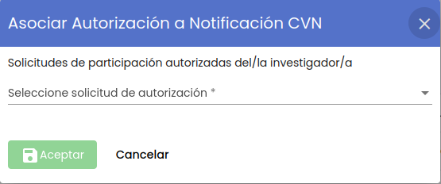

Se listarán las solicitudes de participación del/a investigador/a a quien pertenece la notificación de CVN que dispongan de estado "autorizada".

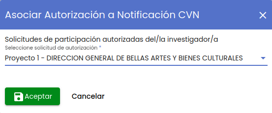

Una vez seleccionada la autorización se activará el botón "Aceptar". Si se pula el botón "Aceptar" se vinculará el proyecto registrado en el CVN con la solicitud de autorización en participación en proyecto externo, mostrándose un mensaje informativo al finalizar la operación:

#### 3.5 Des-asociar Autorización

Si una notificación de CVN se ha vinculado a una solicitud de participación en proyecto externo y desea eliminarse este vínculo, el personal de gestión podrá hacer uso del icono de acción "Des-asociar autorización"  disponible en el listado de Notificaciones CVN.

Tras pulsar el icono "Des-asociar autorización" se mostrará un mensaje de confirmación.

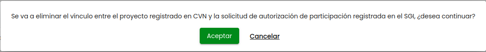

Si se pulsa el botón Cancelar se cerrará la ventana del mensaje de confirmación y el vinculo con la solicitud de autorización no será eliminado.

Si se pulsa el botón Aceptar se eliminará la relación entra el proyecto registrado en el CVN y la solicitud de autorización, mostrándose un mensaje informativo al finalizar la operación:

#### 3.6 Ver Autorización

El personal de gestión puede consultar los datos de la solicitud de autorización de participación en proyecto externo vinculada a la notificación del proyecto proveniente del CVN si existe dicha vinculación, bien porque la haya realizado el personal de investigación en su CVN o el personal de gestión desde la propia aplicación del SGI [Asociar Autorización](#34-asociar-autorizacion).

A través del icono de acción ver autorización del listado de notificaciones CVN se realiza un cambio de contexto y se accede a la información detallada de la solicitud de autorización vinculada a la notificación CVN seleccionada. Ver descripción de la funcionalidad en [Modificar autorización](#21-modificar-autorizacion) o en [Ver autorización](#23-ver-autorizacion) dependiendo de si esta en estado "autorizada" o no.

#### 3.7 Ver Proyecto

El personal de gestión puede consultar los datos del proyecto del SGI generado a partir de los datos de la notificación del proyecto del CVN (si previamente lo ha relacionado o creado nuevo en el SGI, funcionalidad descrita en Asociar Proyecto).

A través del icono de acción ver proyecto del listado de notificaciones CVN se realiza un cambio de contexto y se accede a la información detallada del proyecto SGI generado a partir de los datos del proyecto externo siempre y cuando el personal de gestión tenga el permiso adecuado para acceder al detalle del proyecto. Ver descripción de la funcionalidad en el apartado [CSP-Proyectos - 4 Modificar un proyecto](csp-proyectos/index.md#4-modificar-un-proyecto).

