# Formulario M10

* [I. VALOR SOCIAL Y JUSTIFICACIÓN](#i-valor-social-y-justificacion)
  + [1.1 Valor social del proyecto](#11-valor-social-del-proyecto)
  + [1.2 Justificación del uso de seres humanos](#12-justificacion-del-uso-de-seres-humanos)
* [II. CUALIFICACIÓN DEL EQUIPO INVESTIGADOR](#ii-cualificacion-del-equipo-investigador)
  + [2.1 Personal que llevará a cabo las tareas con seres humanos, sus muestras y/o sus datos](#21-personal-que-llevara-a-cabo-las-tareas-con-seres-humanos-sus-muestras-yo-sus-datos)
* [III. VALIDEZ CIENTÍFICA Y METODOLÓGICA](#iii-validez-cientifica-y-metodologica)
  + [3.1 Objetivos científicos del proyecto](#31-objetivos-cientificos-del-proyecto)
  + [3.2 Diseño metodológico del proyecto cambiar texto](#32-diseno-metodologico-del-proyecto-cambiar-texto)
  + [3.3 Referencias de publicaciones científicas](#33-referencias-de-publicaciones-cientificas)
  + [3.4 Intervenciones o pruebas en seres humanos](#34-intervenciones-o-pruebas-en-seres-humanos)
  + - [3.4.1 Proceso de reclutamiento](#341-proceso-de-reclutamiento)
    - [3.4.2 Reclutamiento realizado por personal ajeno al equipo investigado](#342-reclutamiento-realizado-por-personal-ajeno-al-equipo-investigado)
    - [3.4.3 Descripción de las intervenciones o pruebas](#343-descripcion-de-las-intervenciones-o-pruebas)
    - [3.4.4 Incentivos para la participación](#344-incentivos-para-la-participacion)
  + [3.5 Muestras biológicas de origen humano](#35-muestras-biologicas-de-origen-humano)
    - [3.5.1 Origen de las muestras](#351-origen-de-las-muestras)
  + - [3.5.2 Destino de las muestras de origen humano](#352-destino-de-las-muestras-de-origen-humano)
  + [3.6 Datos de carácter personal](#36-datos-de-caracter-personal)
* [IV. ASPECTOS ÉTICOS ESPECÍFICOS](#iv-aspectos-eticos-especificos)
  + [4.1 Ponderación de los riesgos o molestias](#41-ponderacion-de-los-riesgos-o-molestias)
    - [4.1.1 Tipo de riesgos o molestias](#411-tipo-de-riesgos-o-molestias)
    - [4.1.2 Valoración de los riesgos o molestias](#412-valoracion-de-los-riesgos-o-molestias)
    - [4.1.3 Minimización del riesgo o molestias superiores al mínimo](#413-minimizacion-del-riesgo-o-molestias-superiores-al-minimo)
    - [4.1.4 Aseguramiento del daño](#414-aseguramiento-del-dano)
  + [4.2 Selección equitativa de la muestra](#42-seleccion-equitativa-de-la-muestra)
  + [4.3 Protección de grupos vulnerables](#43-proteccion-de-grupos-vulnerables)
  + [4.4 Información y consentimiento](#44-informacion-y-consentimiento)
    - [4.4.1 Tipo de consentimiento](#441-tipo-de-consentimiento)
    - [4.4.2 Información obligatoria mínima](#442-informacion-obligatoria-minima)
  + [4.5 Estudios genéticos](#45-estudios-geneticos)
    - [4.5.1 Resultado del estudio genético](#451-resultado-del-estudio-genetico)
    - [4.5.2 Consejo genético](#452-consejo-genetico)
    - [4.5.3 No discriminación por motivos genéticos](#453-no-discriminacion-por-motivos-geneticos)
  + [4.6 Estudiantes como sujetos de investigación](#46-estudiantes-como-sujetos-de-investigacion)
    - [4.6.1 Justificación del uso de estudiantes](#461-justificacion-del-uso-de-estudiantes)
    - [4.6.2 Beneficio formativo para el estudiante](#462-beneficio-formativo-para-el-estudiante)
    - [4.6.3 Vinculación académica con el equipo investigador](#463-vinculacion-academica-con-el-equipo-investigador)
    - [4.6.4 Incentivos académicos](#464-incentivos-academicos)
    - [4.6.5 Uso de tiempo lectivo](#465-uso-de-tiempo-lectivo)
    - [4.6.6 Actividades alternativas](#466-actividades-alternativas)
    - [4.6.7 Protección de la privacidad](#467-proteccion-de-la-privacidad)
* [V. CUMPLIMIENTO DE LA DOCUMENTACIÓN](#v-cumplimiento-de-la-documentacion)
  + [5.1 Documento de consentimiento](#51-documento-de-consentimiento)
  + [5.2 Documento de cesión de datos](#52-documento-de-cesion-de-datos)
  + [5.3 Documento de autorización](#53-documento-de-autorizacion)
  + [5.4 Documento de aceptación de colaboración](#54-documento-de-aceptacion-de-colaboracion)
  + [5.5 Informe de la Comisión de Garantías](#55-informe-de-la-comision-de-garantias)
  + [5.6 Acuerdo de trasferencia de muestras](#56-acuerdo-de-trasferencia-de-muestras)
  + [5.7. Documento de registro de tratamiento de datos](#57-documento-de-registro-de-tratamiento-de-datos)
  + [5.8 Documentación adicional](#58-documentacion-adicional)
  + [5.9 Aclaraciones al comité](#59-aclaraciones-al-comite)

Dividido en 5 pasos, uno por cada bloque

* I. VALOR SOCIAL Y JUSTIFICACIÓN
* II. CUALIFICACIÓN DEL EQUIPO INVESTIGADOR
* III. VALIDEZ CIENTÍFICA Y METODOLÓGICA
* IV. ASPECTOS ÉTICOS ESPECÍFICOS
* V. CUMPLIMIENTO DE LA DOCUMENTACIÓN

Para pasar de bloque hay que introducir todos los datos obligatorios del anterior y guardar.

Todos los apartados son obligatorios rellenarlos a no ser que este desactivado. Hay apartados que se activan si se responde que Sí a apartados anteriores.

## I. VALOR SOCIAL Y JUSTIFICACIÓN

### 1.1 Valor social del proyecto

Viene de Datos generales el campo "Valor social" que un campo de text area, es de solo lectura

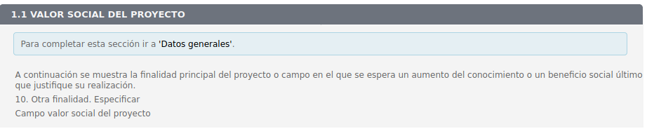

La parte:

"10.Otra finalidad. Especificar

Campo valor social del proyecto"

Sería lo que han introducir en el campo "otroValorSocial" de la tabla PeticionEvaluacion.

### 1.2 Justificación del uso de seres humanos

## II. CUALIFICACIÓN DEL EQUIPO INVESTIGADOR

### 2.1 Personal que llevará a cabo las tareas con seres humanos, sus muestras y/o sus datos

Tabla con las siguientes columnas (viene informado por el equipo de investigación, es de solo lectura):

* Nombre
* NIF
* Vinculación
* Nivel académico
* Tarea
* Experiencia

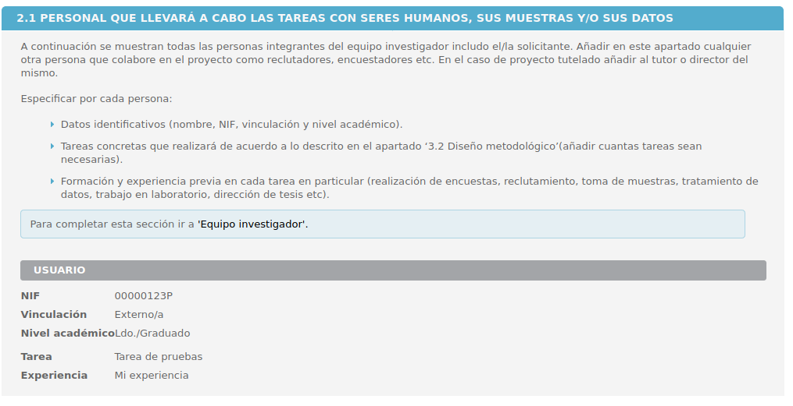

## III. VALIDEZ CIENTÍFICA Y METODOLÓGICA

### 3.1 Objetivos científicos del proyecto

Viene de datos generales, es de solo lectura

### 3.2 Diseño metodológico del proyecto  cambiar texto

Viene de datos generales, es de solo lectura

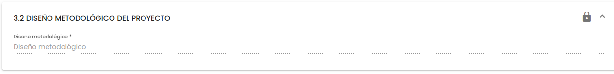

### 3.3 Referencias de publicaciones científicas

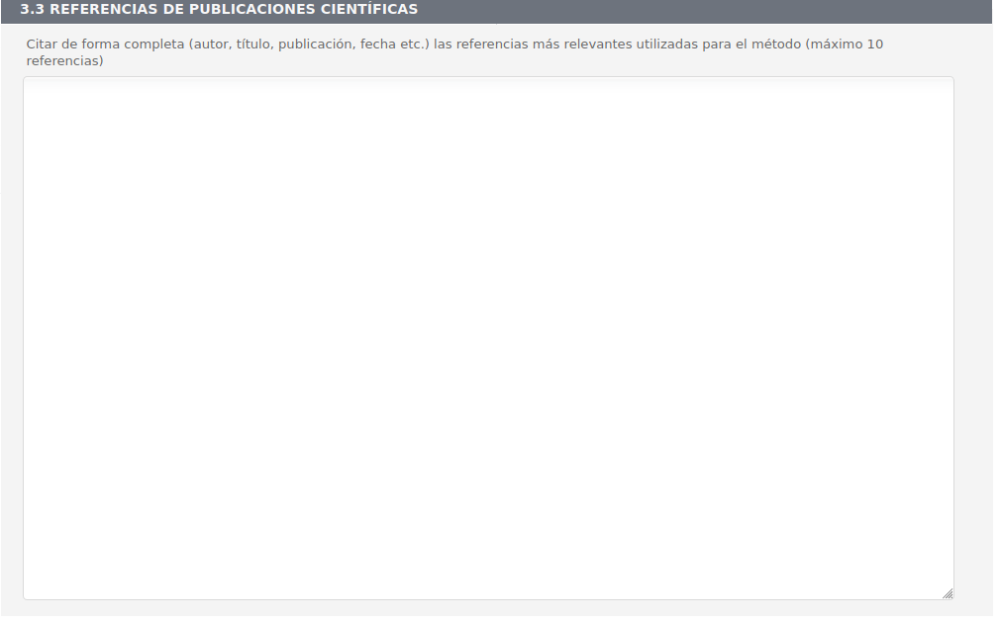

### 3.4 Intervenciones o pruebas en seres humanos

Los check se activan si se contesta que "Sí", y la caja de texto de Otras. especificar si se selecciona el check de "Otras. Especificar".

En caso de contestar que "No" tampoco se activan el resto de subapartados:

* 3.4.1 Proceso de reclutamiento
* 3.4.2 Reclutamiento realizado por personal ajeno al equipo investigado
* 3.4.3 Descripción de las intervenciones o pruebas
* 3.4.4 Incentivos para la participación

Y el apartado 4.1 Ponderación de los riesgos o molestias  con todos sus subapartdos:

* 4.1.1 Tipo de riesgos o molestias
* 4.1.2 Valoración de los riesgos o molestias

#### 3.4.1 Proceso de reclutamiento

En la NOTA: donde pone UPV/EHU sustituirlo por UMU

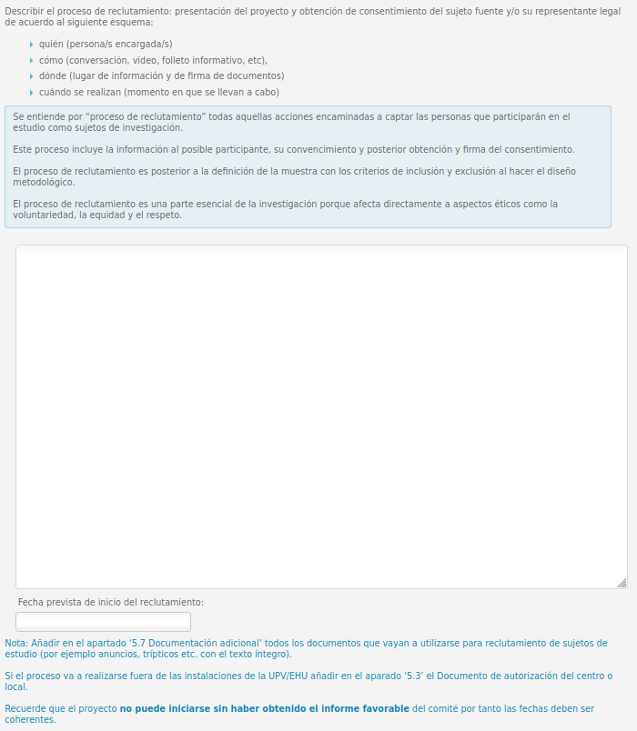

#### 3.4.2 Reclutamiento realizado por personal ajeno al equipo investigado

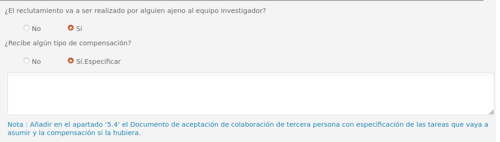

La segunda pregunta se activa si se contesta que "Sí" a la primera. Y la caja de texto se activa si se contesta a la segunda pregunta "Si. Especificar"

#### 3.4.3 Descripción de las intervenciones o pruebas

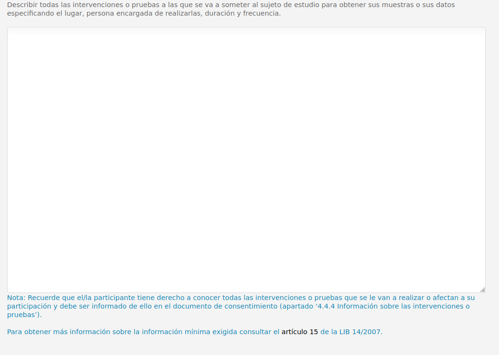

#### 3.4.4 Incentivos para la participación

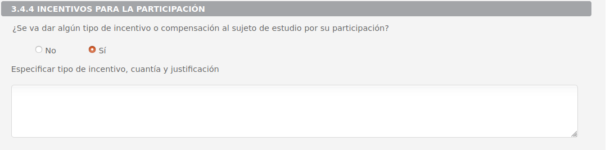

La caja de texto se activa si se contesta que "Sí"

### 3.5 Muestras biológicas de origen humano

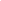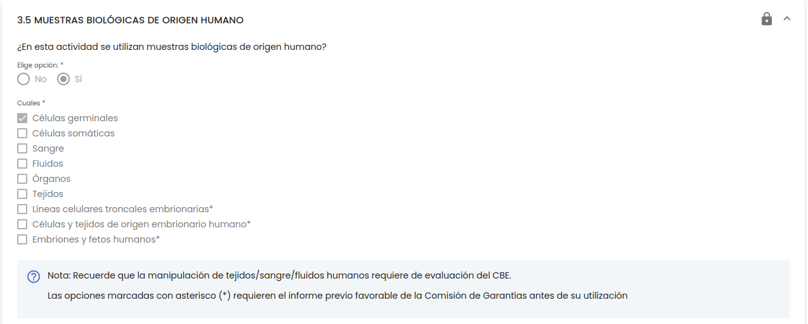

Los check se activan si se contesta que "Sí"

En caso de contestar que "No" tampoco se activan el resto de subapartados:

* 3.5.1 Origen de las muestras
* 3.5.2 Destino de las muestras de origen humano

#### 3.5.1 Origen de las muestras

#### 3.5.2 Destino de las muestras de origen humano

### 3.6 Datos de carácter personal

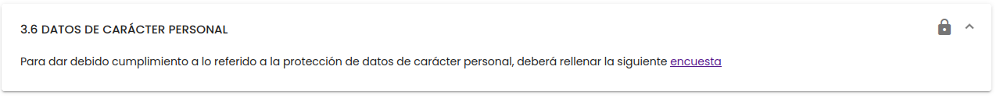

## IV. ASPECTOS ÉTICOS ESPECÍFICOS

### 4.1 Ponderación de los riesgos o molestias

"Para más información sobre el balance riesgo/beneficio consultar el documento de la CIOMS ['Pautas éticas internacionales para la investigación biomédica en seres humanos'"](https://www.um.es/web/comision-etica-investigacion/comision-etica)

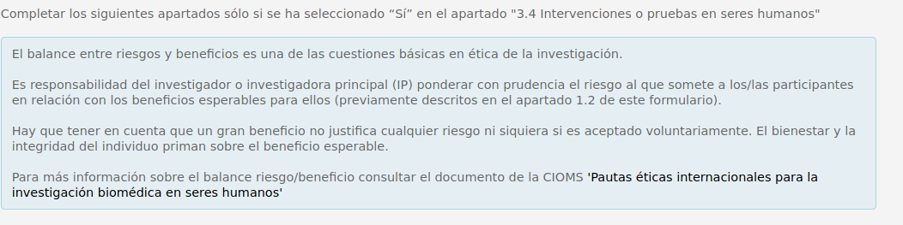

#### 4.1.1 Tipo de riesgos o molestias

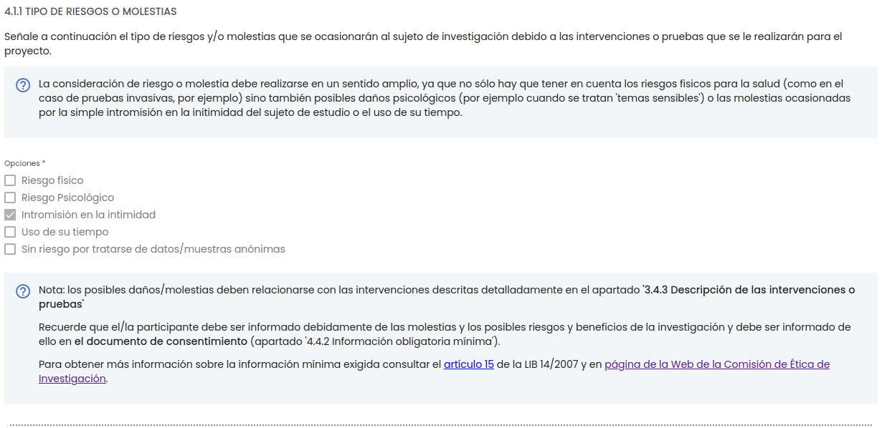

En caso de contestar "Sin riesgo por tratarse de datos/muestras anónimas" los apartados sucesivos no se mostrarán, es decir:

* 4.1.2 Valoración de los riesgos o molestias
* 4.1.3 Minimización del riesgo o molestias superiores al mínimo

  4.1.4 Aseguramiento del daño

#### 4.1.2 Valoración de los riesgos o molestias

Si se selecciona "Riesgo superior...." se activa la caja de texto y el siguiente apartado 4.1.3 Minimización del riesgo o molestias superiores al mínimo

#### 4.1.3 Minimización del riesgo o molestias superiores al mínimo

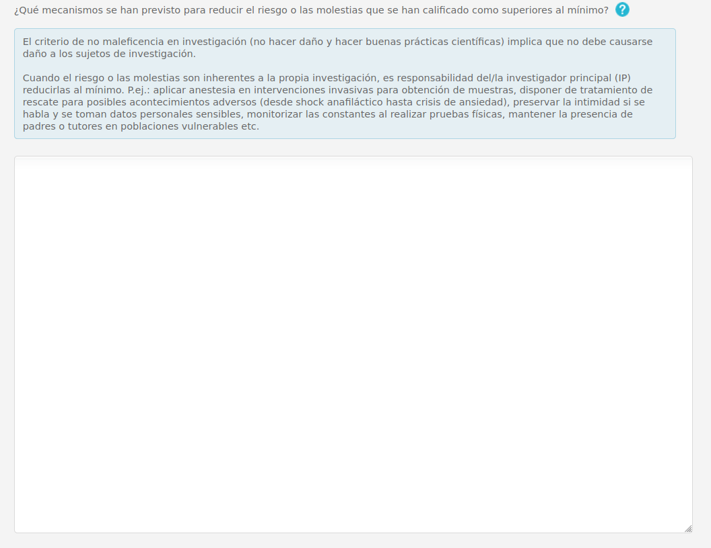

#### 4.1.4 Aseguramiento del daño

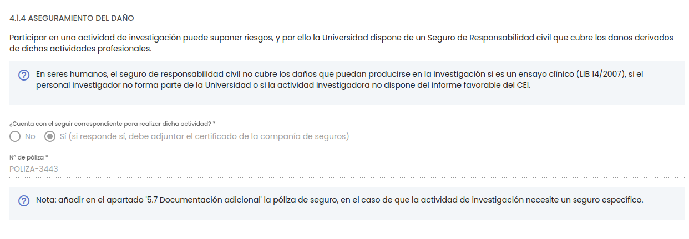

### 4.2 Selección equitativa de la muestra

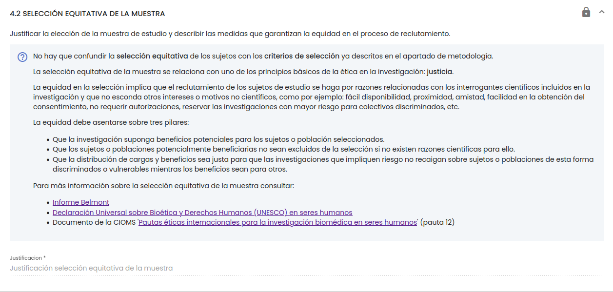

### 4.3 Protección de grupos vulnerables

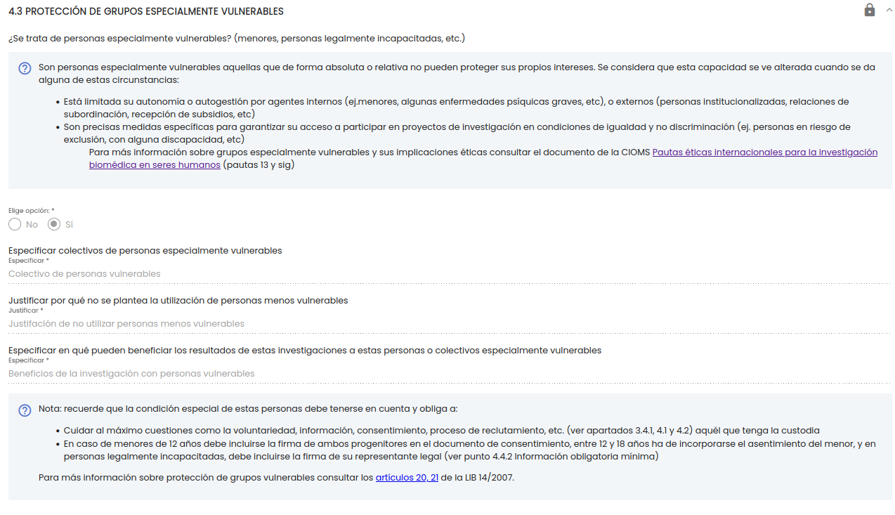

Si se selecciona que "Sí" se activan las 3 cajas de texto siguientes.

### 4.4 Información y consentimiento

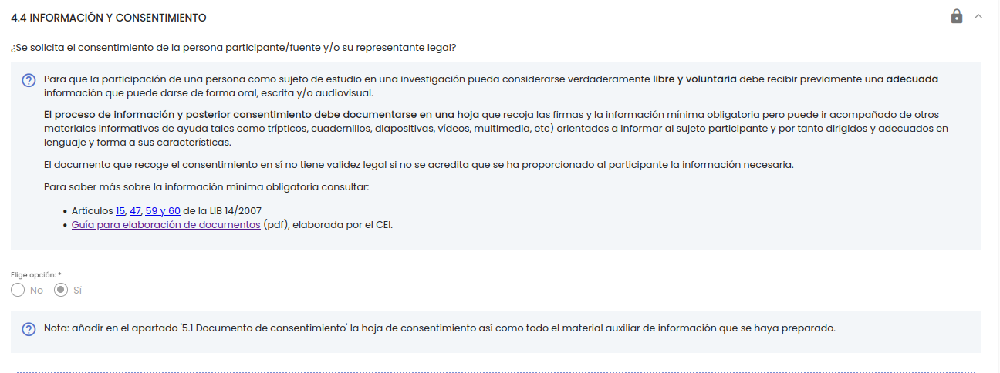

Si se selecciona "No" se desactivan los apartados siguientes 4.4.1 Tipo de consentimiento y 4.4.2 Información obligatoria mínima

Si se selecciona "Sí" se activa los apartados siguientes 4.4.1 Tipo de consentimiento y 4.4.2 Información obligatoria mínima

#### 4.4.1 Tipo de consentimiento

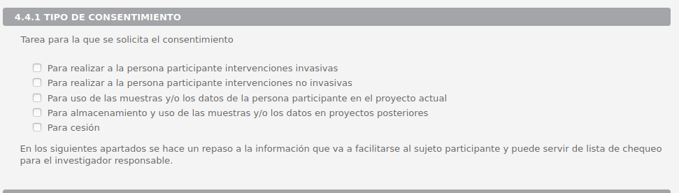

#### 4.4.2 Información obligatoria mínima

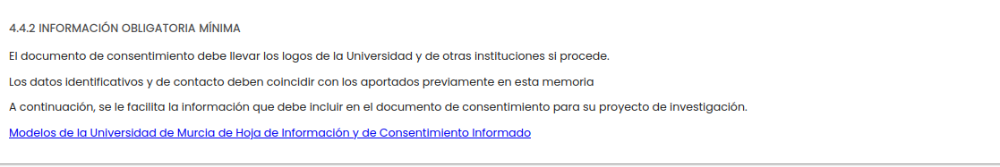

### 4.5 Estudios genéticos

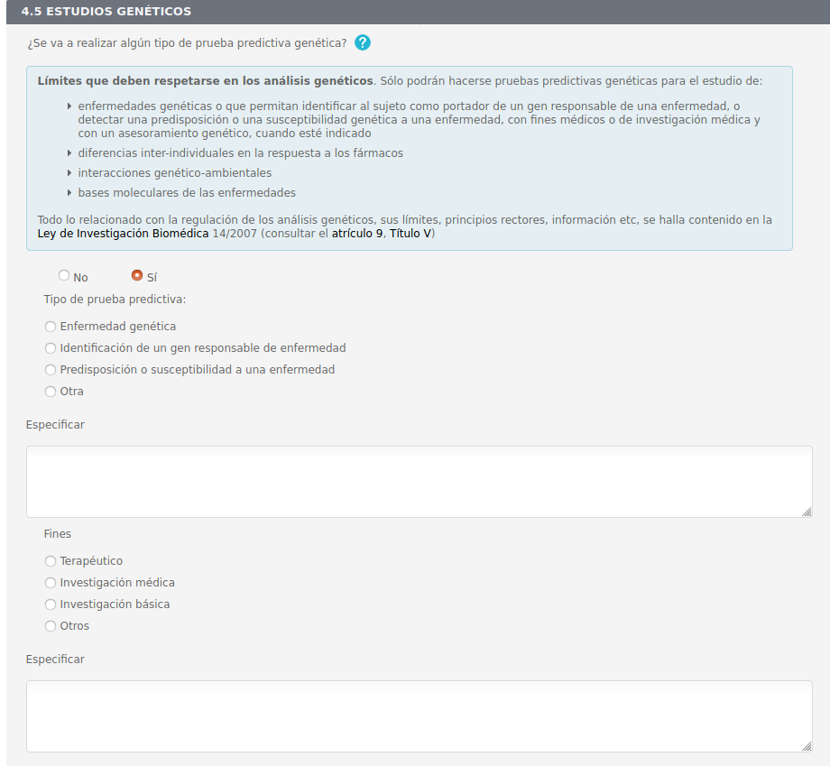

Si se selecciona "No" todo el resto esta desactivado y también se desactivan los subapartados:

* 4.5.1 Resultado del estudio genético
* 4.5.2 Consejo genético
* 4.5.3 No discriminación por motivos genéticos

#### 4.5.1 Resultado del estudio genético

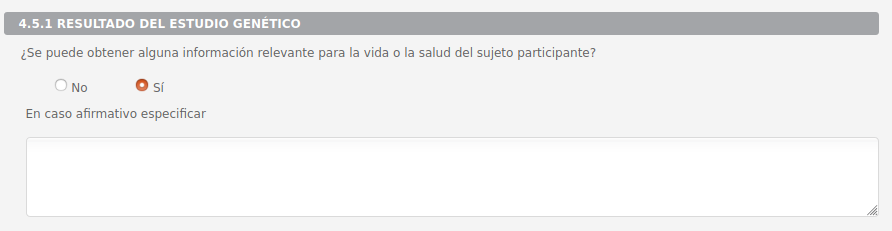

Si se selecciona "Sí" se activa la caja de texto

#### 4.5.2 Consejo genético

#### 4.5.3 No discriminación por motivos genéticos

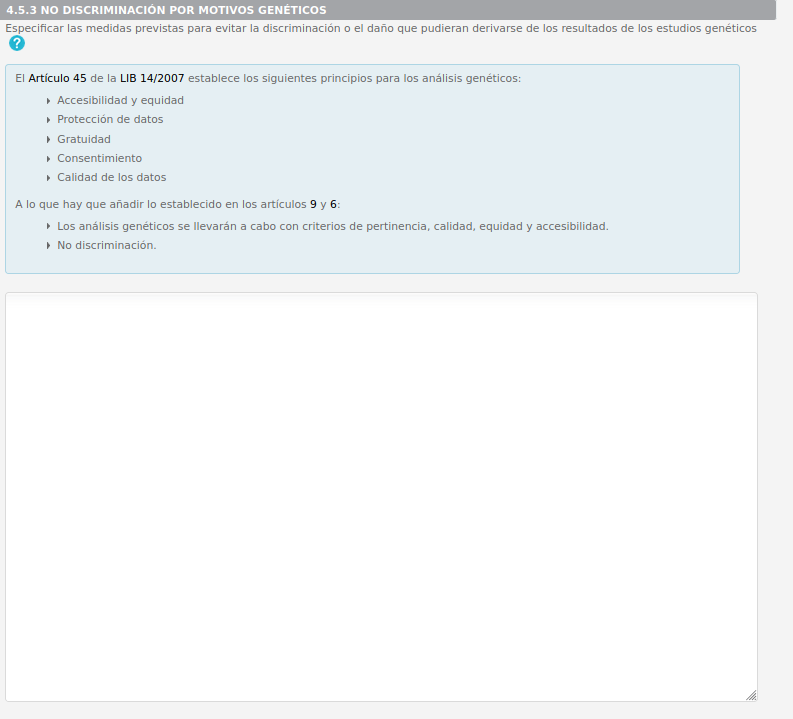

### 4.6 Estudiantes como sujetos de investigación

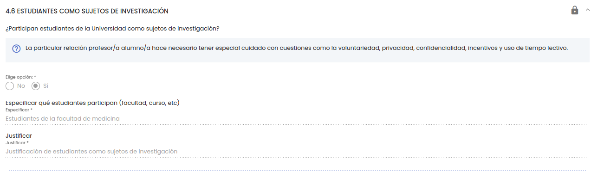

Si se selecciona "No" todo el resto esta desactivado y también se desactivan los subapartados:

* 4.6.1 Justificación del uso de estudiantes
* 4.6.2 Beneficio formativo para el estudiante
* 4.6.3 Vinculación académica con el equipo investigador
* 4.6.4 Incentivos académicos
* 4.6.5 Uso de tiempo lectivo
* 4.6.6 Actividades alternativas
* 4.6.7 Protección de la privacidad

#### 4.6.1 Justificación del uso de estudiantes

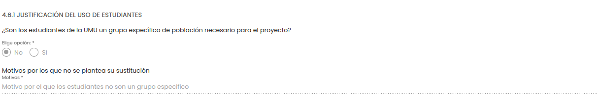

Si se selecciona "No" hay que especificar los motivos, si se selecciona "Sí" se desactiva la caja de texto.

#### 4.6.2 Beneficio formativo para el estudiante

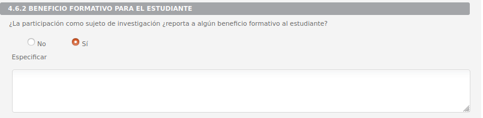

Si se selecciona "Sí" se activa la caja de texto.

#### 4.6.3 Vinculación académica con el equipo investigador

La parte de la pregunta de "Qué medidas especiales .... " sólo debe aparecer si contestan que Sí a la primera pregunta

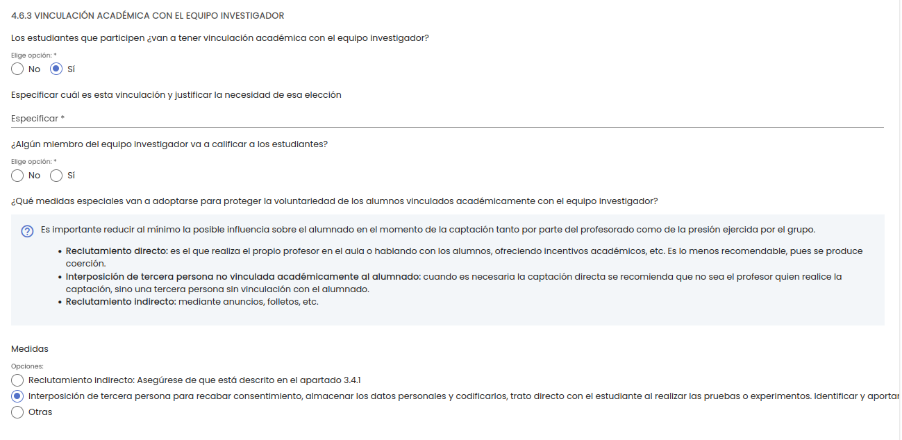

#### 4.6.4 Incentivos académicos

Si se selecciona "Sí" se activa la caja de texto.

#### 4.6.5 Uso de tiempo lectivo

Si se selecciona "Sí" se activa la caja de texto.

Si se selecciona "No" no se activa la caja de texto y el apartado siguiente "4.6.6. Actividades alternativas"  no se mostrará.

#### 4.6.6 Actividades alternativas

#### 4.6.7 Protección de la privacidad

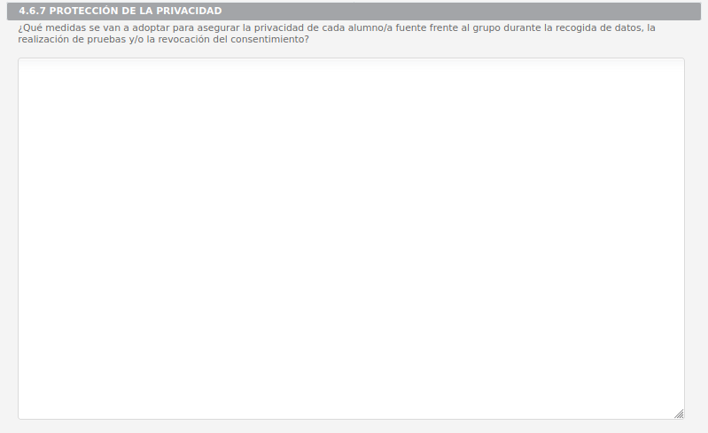

## V. CUMPLIMIENTO DE LA DOCUMENTACIÓN

### 5.1 Documento de consentimiento

### 5.2 Documento de cesión de datos

### 5.3 Documento de autorización

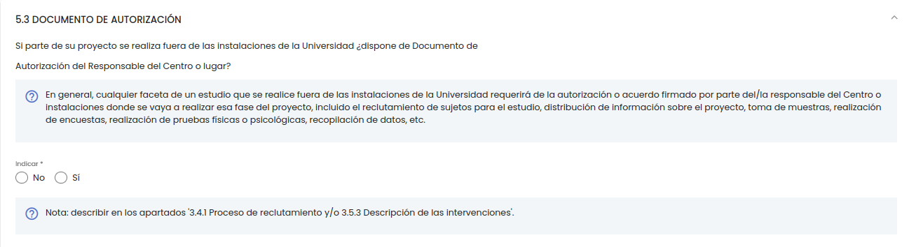

### 5.4 Documento de aceptación de colaboración

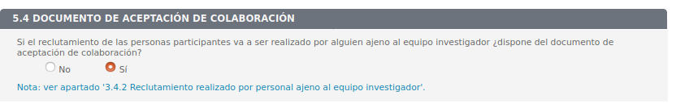

### 5.5 Informe de la Comisión de Garantías

### 5.6 Acuerdo de trasferencia de muestras

### 5.7. Documento de registro de tratamiento de datos

### 5.8 Documentación adicional

### 5.9 Aclaraciones al comité