# Formulario M20

* [I. VALOR SOCIAL Y JUSTIFICACIÓN](#i-valor-social-y-justificacion)
  + [1.1 Valor social del proyecto](#11-valor-social-del-proyecto)
    - [1.1.1 FIN ESPECÍFICO DEL PROYECTO](#111-fin-especifico-del-proyecto)
  + [1.2 Justificación del uso de animales](#12-justificacion-del-uso-de-animales)
* [II. CUALIFICACIÓN DEL EQUIPO INVESTIGADOR](#ii-cualificacion-del-equipo-investigador)
  + [2.1 Personal que llevará a cabo las tareas con animales](#21-personal-que-llevara-a-cabo-las-tareas-con-animales)
* [III. VALIDEZ CIENTÍFICA Y METODOLÓGICA](#iii-validez-cientifica-y-metodologica)
  + [3.1 Objetivos científicos del proyecto](#31-objetivos-cientificos-del-proyecto)
  + [3.2 Diseño metodológico del proyecto](#32-diseno-metodologico-del-proyecto)
  + [3.3 Título descriptivo](#33-titulo-descriptivo)
  + [3.4 TIPO DE PROYECTO](#34-tipo-de-proyecto)
  + [3.5 Lugar en el que se realizarán las intervenciones de los animales](#35-lugar-en-el-que-se-realizaran-las-intervenciones-de-los-animales)
  + [3.6 Datos referentes a los animales de experimentación](#36-datos-referentes-a-los-animales-de-experimentacion)
    - [3.6.1 Definición](#361-definicion)
    - [3.6.2 Animales modificados genéticamente](#362-animales-modificados-geneticamente)
    - [3.6.3 Animales protegidos o en peligro de extinción](#363-animales-protegidos-o-en-peligro-de-extincion)
    - [3.6.4 Número de animales a utilizar](#364-numero-de-animales-a-utilizar)
    - [3.6.5 Periodo del proyecto durante el que se utilizarán los animales](#365-periodo-del-proyecto-durante-el-que-se-utilizaran-los-animales)
  + [3.7 Proceso de experimentación al que va a ser sometido el animal](#37-proceso-de-experimentacion-al-que-va-a-ser-sometido-el-animal)
    - [3.7.1 Intervenciones/procedimientos que se realizarán al animal](#371-intervencionesprocedimientos-que-se-realizaran-al-animal)
    - [3.7.2 Duración del proceso de experimentación](#372-duracion-del-proceso-de-experimentacion)
    - [3.7.3 Referencias de publicaciones científicas](#373-referencias-de-publicaciones-cientificas)
    - [3.7.4 Intervenciones quirúrgicas](#374-intervenciones-quirurgicas)
    - [3.7.5 Analgesia](#375-analgesia)
  + - [3.7.6 Anestesia](#376-anestesia)
  + - [3.7.7 Administración de sustancias](#377-administracion-de-sustancias)
    - [3.7.8 Agentes biológicos](#378-agentes-biologicos)
    - [3.7.9 Administración de isótopos radiactivos](#379-administracion-de-isotopos-radiactivos)
  + - [3.7.10 Extracción de sangre](#3710-extraccion-de-sangre)
  + - [3.7.11 Privación de alimento y/o agua](#3711-privacion-de-alimento-yo-agua)
  + - [3.7.12 Destino final](#3712-destino-final)
    - [3.7.13 Eutanasia](#3713-eutanasia)
    - [3.7.14 Mantenimiento con vida](#3714-mantenimiento-con-vida)
    - [3.7.15 Relación y protocolo de sustancias y agentes biológicos administradas incluidas anestesia y analgesia](#3715-relacion-y-protocolo-de-sustancias-y-agentes-biologicos-administradas-incluidas-anestesia-y-analgesia)
* [IV. ASPECTOS ÉTICOS ESPECÍFICOS](#iv-aspectos-eticos-especificos)
  + [4.1 Reemplazo](#41-reemplazo)
    - [4.1.1 Métodos alternativos](#411-metodos-alternativos)
    - [4.1.2 Fuentes consultadas para búsqueda de métodos alternativos](#412-fuentes-consultadas-para-busqueda-de-metodos-alternativos)
    - [4.1.3 Elección de la especie](#413-eleccion-de-la-especie)
  + [4.2 Refinamiento](#42-refinamiento)
    - [4.2.1 Valoración de la severidad y medidas correctoras ante el dolor, sufrimiento o la angustia del animal](#421-valoracion-de-la-severidad-y-medidas-correctoras-ante-el-dolor-sufrimiento-o-la-angustia-del-animal)
    - [4.2.2 No aplicación de medidas correctoras](#422-no-aplicacion-de-medidas-correctoras)
    - [4.2.3 Severidad global](#423-severidad-global)
    - [4.2.4 Protocolo de supervisión](#424-protocolo-de-supervision)
    - [4.2.5 Criterios de punto final](#425-criterios-de-punto-final)
  + [4.3 Reducción](#43-reduccion)
    - [4.3.1 Justificación del tamaño muestral y tratamiento estadístico](#431-justificacion-del-tamano-muestral-y-tratamiento-estadistico)
    - [4.3.2 Reutilización](#432-reutilizacion)
    - [4.3.3 Excepciones de reutilización](#433-excepciones-de-reutilizacion)
* [V. CUMPLIMIENTO DE LA DOCUMENTACIÓN](#v-cumplimiento-de-la-documentacion)
  + [5.1 Acreditaciones](#51-acreditaciones)
  + [5.2 Informe veterinario](#52-informe-veterinario)
  + [5.3 Evaluación retrospectiva](#53-evaluacion-retrospectiva)
  + [5.4 Situaciones especiales, excepciones o salvaguardias legales](#54-situaciones-especiales-excepciones-o-salvaguardias-legales)
  + [5.5 Resumen no técnico (RNT)](#55-resumen-no-tecnico-rnt)
  + [5.6 Documentación adicional](#56-documentacion-adicional)
  + [5.7 Aclaraciones al comité](#57-aclaraciones-al-comite)

Dividido en 5 pasos, uno por cada bloque

* I. VALOR SOCIAL Y JUSTIFICACIÓN
* II. CUALIFICACIÓN DEL EQUIPO INVESTIGADOR
* III. VALIDEZ CIENTÍFICA Y METODOLÓGICA
* IV. ASPECTOS ÉTICOS ESPECÍFICOS
* V. CUMPLIMIENTO DE LA DOCUMENTACIÓN

Para pasar de bloque hay que introducir todos los datos obligatorios del anterior y guardar.

## I. VALOR SOCIAL Y JUSTIFICACIÓN

### 1.1 Valor social del proyecto

Viene de datos generales, es de solo lectura

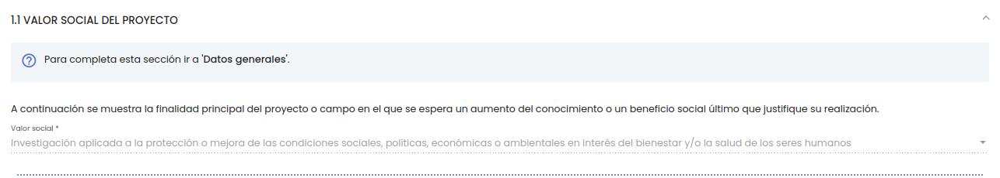

#### 1.1.1 FIN ESPECÍFICO DEL PROYECTO

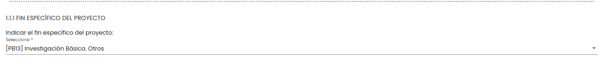

Combo con los valores indicados en el documento [Tabla fines proyectos.xlsx](../../../../../attachments/597853154/597858431.xlsx)

### 1.2 Justificación del uso de animales

## II. CUALIFICACIÓN DEL EQUIPO INVESTIGADOR

### 2.1 Personal que llevará a cabo las tareas con animales

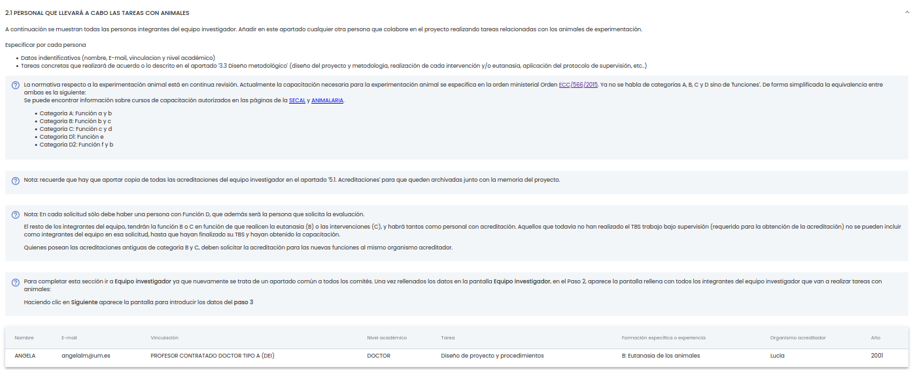

## III. VALIDEZ CIENTÍFICA Y METODOLÓGICA

### 3.1 Objetivos científicos del proyecto

Viene de datos generales, es de solo lectura

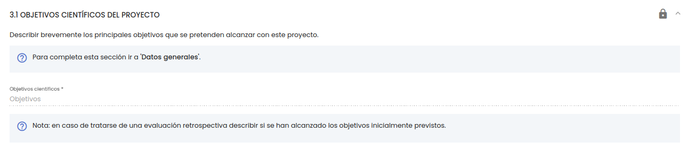

### 3.2 Diseño metodológico del proyecto

Viene de datos generales, es de solo lectura

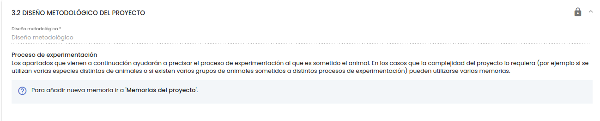

### 3.3 Título descriptivo

### 3.4 TIPO DE PROYECTO

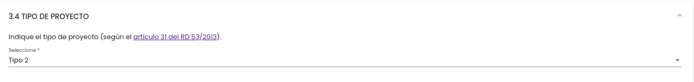

Combo con tres opciones ( Tipo 1, Tipo 2 y Tipo 3)

### 3.5 Lugar en el que se realizarán las intervenciones de los animales

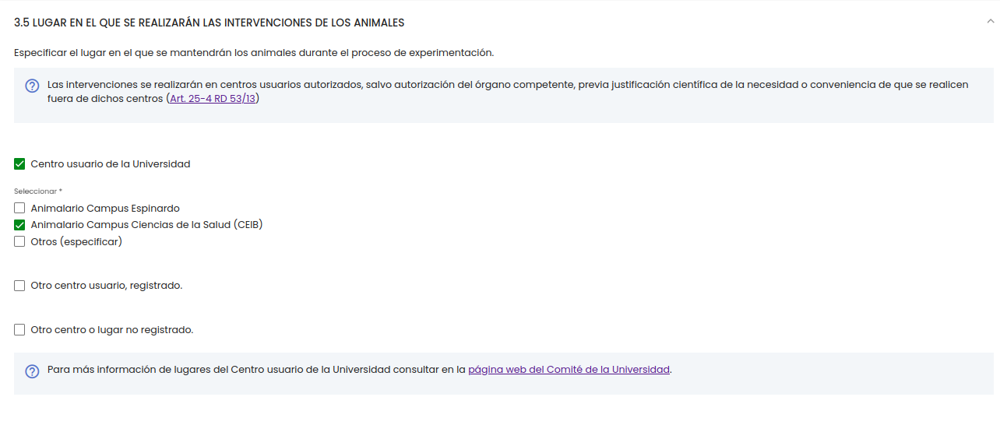

### 3.6 Datos referentes a los animales de experimentación

#### 3.6.1 Definición

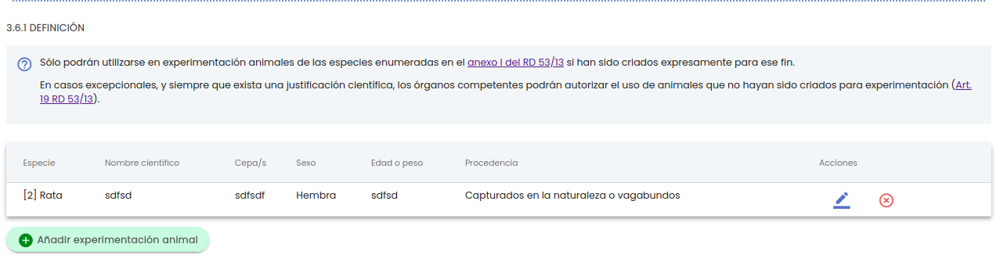

#### 3.6.2 Animales modificados genéticamente

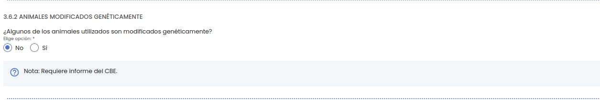

#### 3.6.3 Animales protegidos o en peligro de extinción

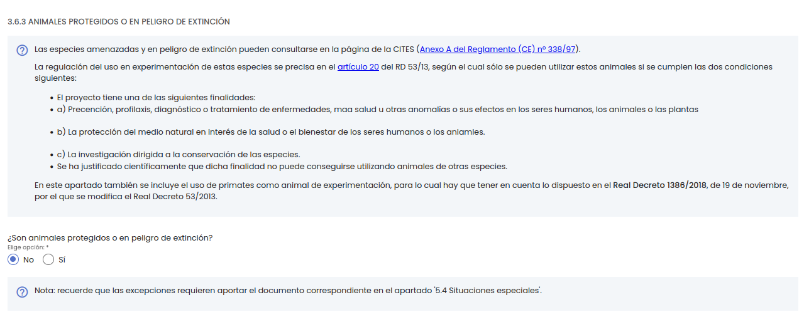

#### 3.6.4 Número de animales a utilizar

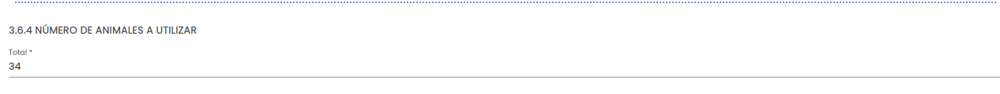

#### 3.6.5 Periodo del proyecto durante el que se utilizarán los animales

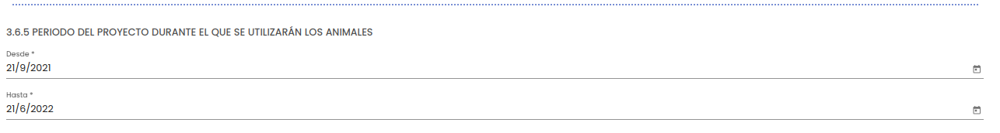

### 3.7 Proceso de experimentación al que va a ser sometido el animal

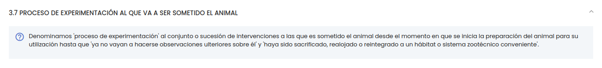

#### 3.7.1 Intervenciones/procedimientos que se realizarán al animal

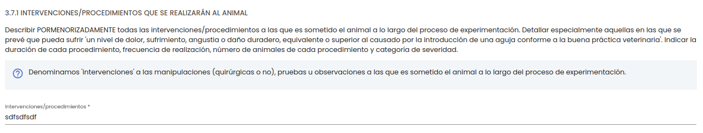

#### 3.7.2 Duración del proceso de experimentación

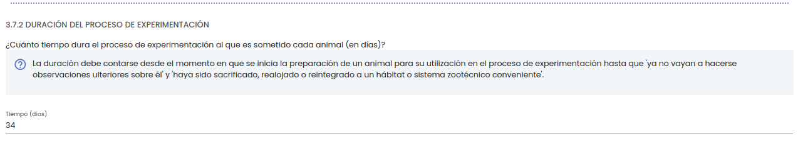

#### 3.7.3 Referencias de publicaciones científicas

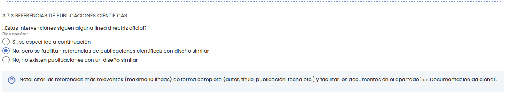

#### 3.7.4 Intervenciones quirúrgicas

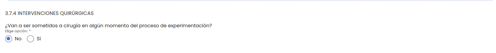

#### 3.7.5 Analgesia

#### 3.7.6 Anestesia

#### 3.7.7 Administración de sustancias

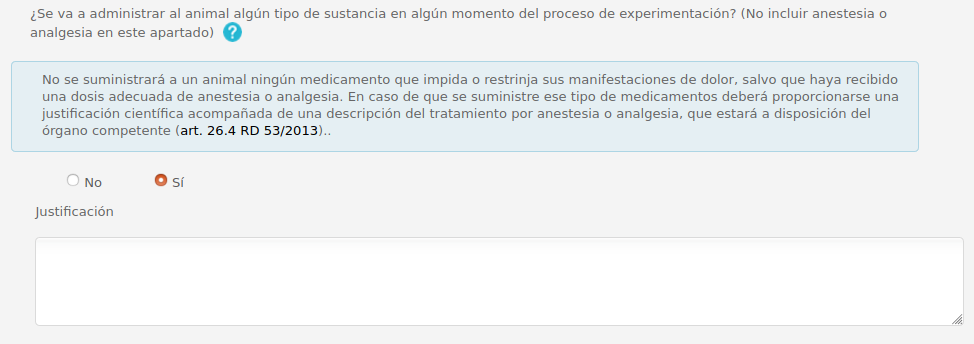

#### 3.7.8 Agentes biológicos

#### 3.7.9 Administración de isótopos radiactivos

#### 3.7.10 Extracción de sangre

Analgesia/Anestesia: combo con los valores:

* Analgesia
* Anestesia

#### 3.7.11 Privación de alimento y/o agua

#### 3.7.12 Destino final

* Si el valor es "Eutanasia" hay que cumplimentar el apartado 3.6.13 Eutanasia
* Si el valor es "El proceso implica la muerte del animal" no se rellena ni el apartado 3.6.13 Eutanasia  ni 3.6.14 Mantenimiento con vida
* Si el valor es "Mantenimiento con vida" se debe rellenar el campo de texto libre de Justificar de este apartado y el apartado 3.6.14 Mantenimiento con vida

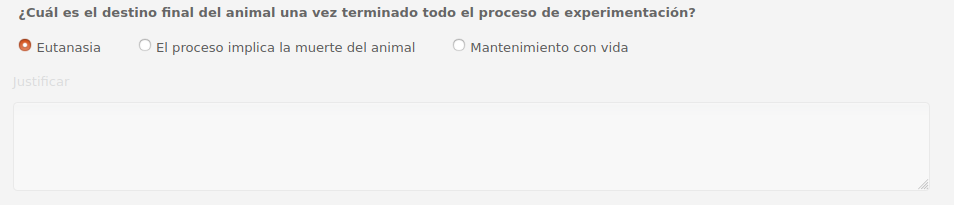

#### 3.7.13 Eutanasia

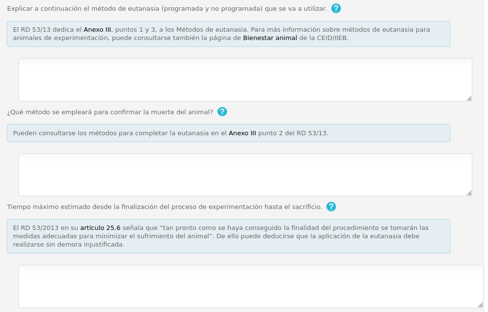

#### 3.7.14 Mantenimiento con vida

#### 3.7.15 Relación y protocolo de sustancias y agentes biológicos administradas incluidas anestesia y analgesia

Tipo: combo con los valores:

* Pre-anestesia para intervención quirúrgica
* Anestesia
* Anestesia intraoperatoria
* Anestesia post-operatoria
* Analgesia en intevención no quirúrgica
* Otra sustancia del procedimiento de experimentación
* Eutanasia programada
* Eutanasia no programada
* Eutanasia (programada y no programada)

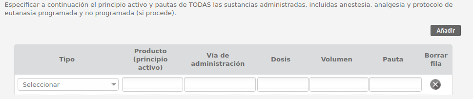

## IV. ASPECTOS ÉTICOS ESPECÍFICOS

### 4.1 Reemplazo

#### 4.1.1 Métodos alternativos

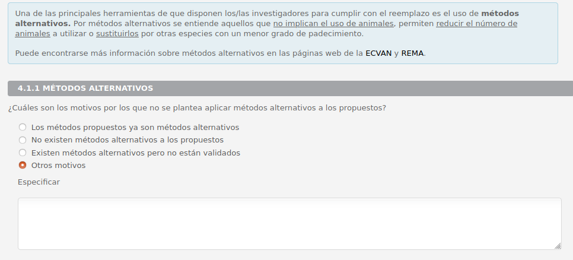

#### 4.1.2 Fuentes consultadas para búsqueda de métodos alternativos

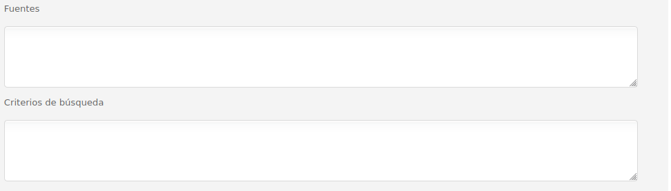

#### 4.1.3 Elección de la especie

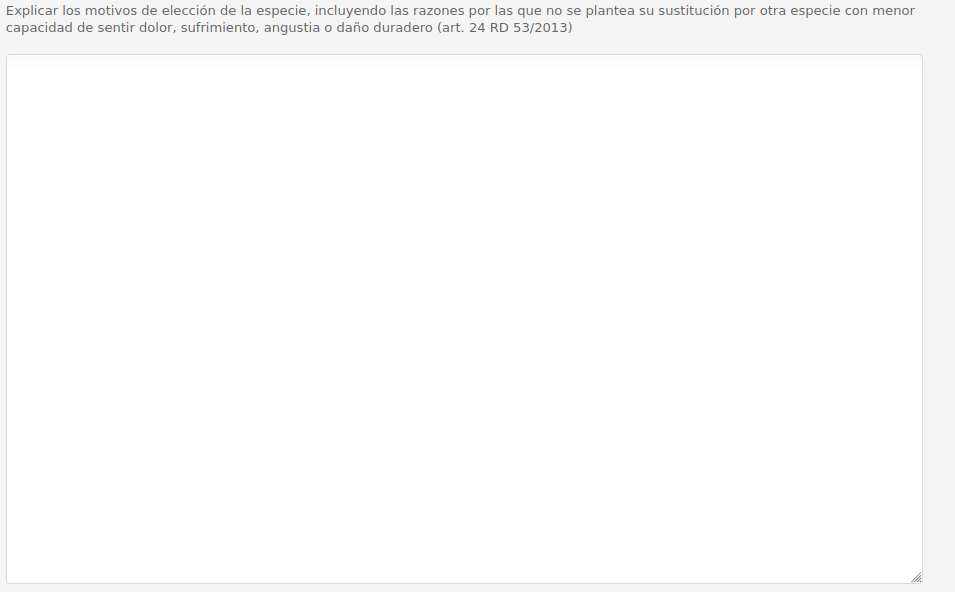

### 4.2 Refinamiento

#### 4.2.1 Valoración de la severidad y medidas correctoras ante el dolor, sufrimiento o la angustia del animal

Severidad: combo con los valores:

* No recuperación
* Leve
* Moderada
* Severa

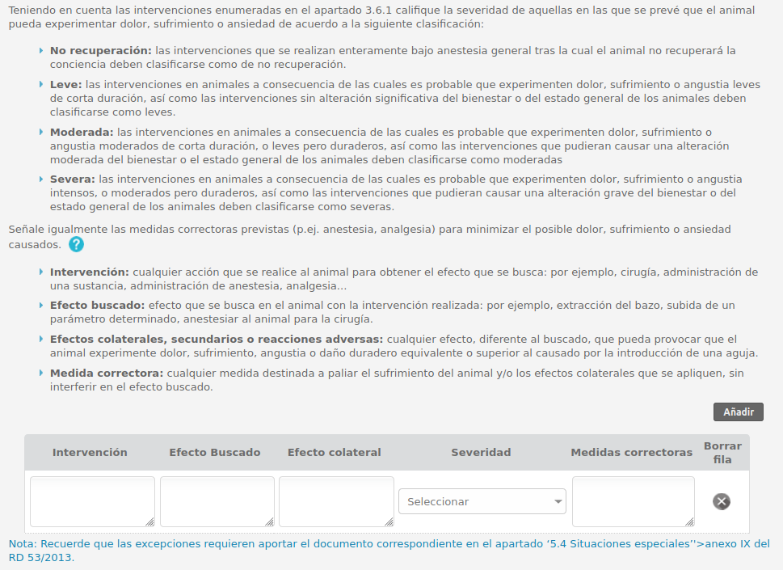

#### 4.2.2 No aplicación de medidas correctoras

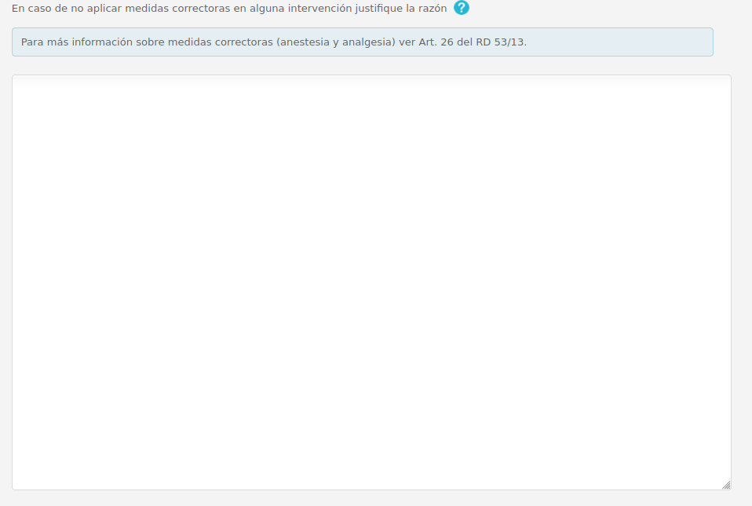

#### 4.2.3 Severidad global

#### 4.2.4 Protocolo de supervisión

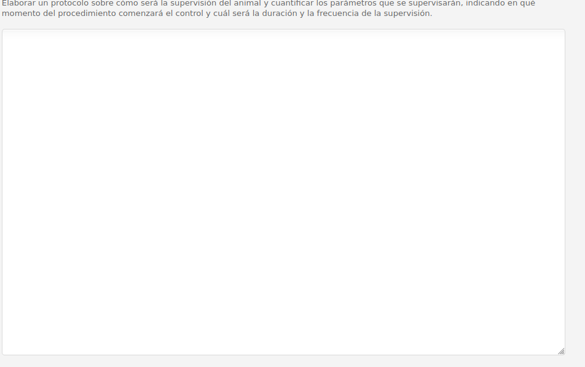

#### 4.2.5 Criterios de punto final

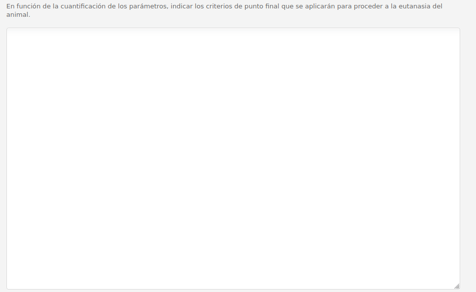

### 4.3 Reducción

#### 4.3.1 Justificación del tamaño muestral y tratamiento estadístico

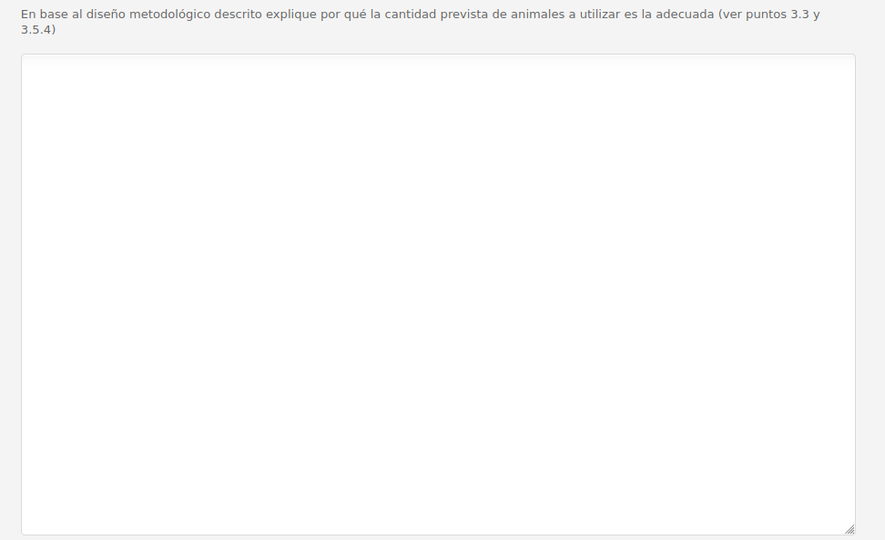

#### 4.3.2 Reutilización

Al marcar “Anterior” debe aparecer:

* Código de referencia del proyecto
* Grado de severidad global del proyecto anterior/posterior

Al marcar “Posterior” debe aparecer:

* Grado de severidad global del proyecto anterior/posterior

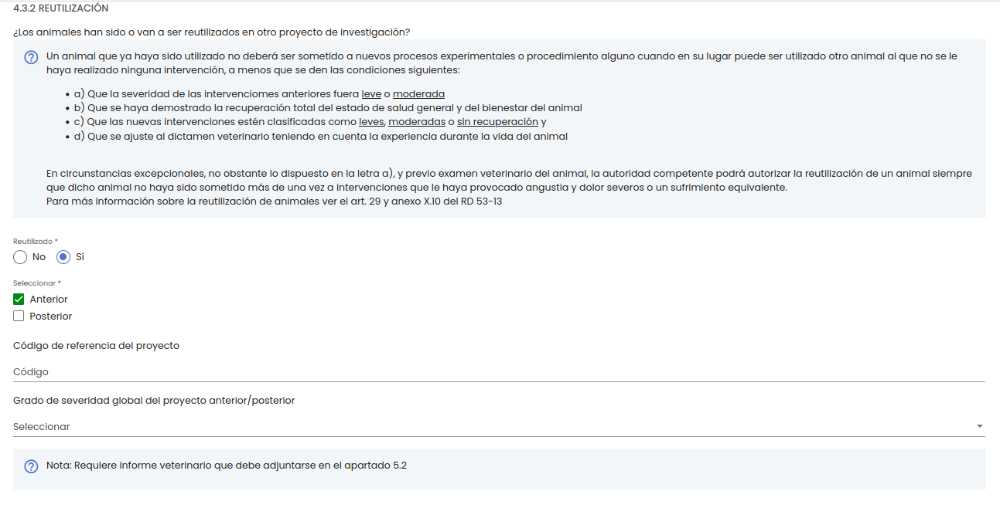

#### 4.3.3 Excepciones de reutilización

Se activa si en el apartado anterior se dijo que se había trabajado con los animales en otro proyecto anterior o posterior

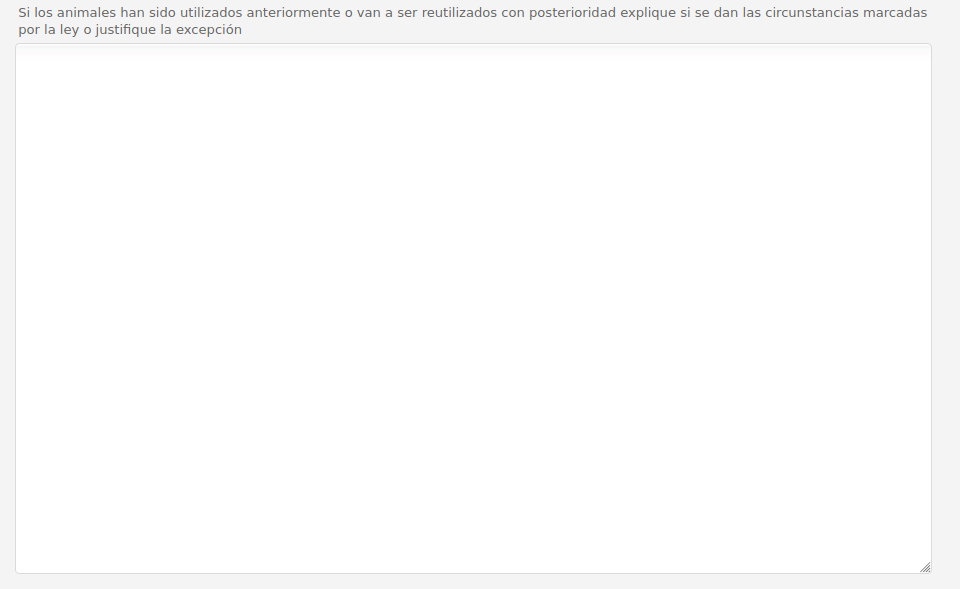

## V. CUMPLIMIENTO DE LA DOCUMENTACIÓN

### 5.1 Acreditaciones

### 5.2 Informe veterinario

### 5.3 Evaluación retrospectiva

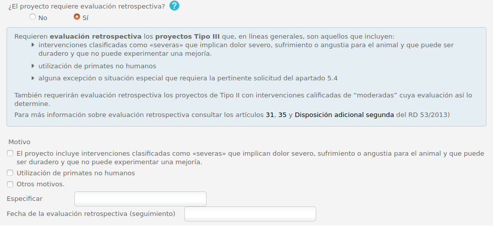

Al realizar la acción de "Guardar" este formulario, si se ha marcado "Sí" a la cuestión de si el proyecto requiere evaluación retrospectiva, se utilizará la Fecha de la evaluación retrospectiva para crear la entrada correspondiente en el módulo de tareas programadas y de comunicados para avisar a los investigadores cuando se acerque dicha fecha y no hayan presentado aún el informe de retrospectiva.

La descripción detallada para la generación de este tipo de comunicado se encuentra en el apartado **Informe de retrospectiva de memoria tipo CEEA pendiente**dentro de [ETI - Comunicados](../eti-comunicados.md) y el flujo general de operativa de este tipo de comunicados en [CU-COM-0020 - Generar comunicado programado](../../gen-aspectos-generales/com-modulo-de-comunicados/com-casos-de-uso/cu-com-0020-generar-comunicado-programado.md).

### 5.4 Situaciones especiales, excepciones o salvaguardias legales

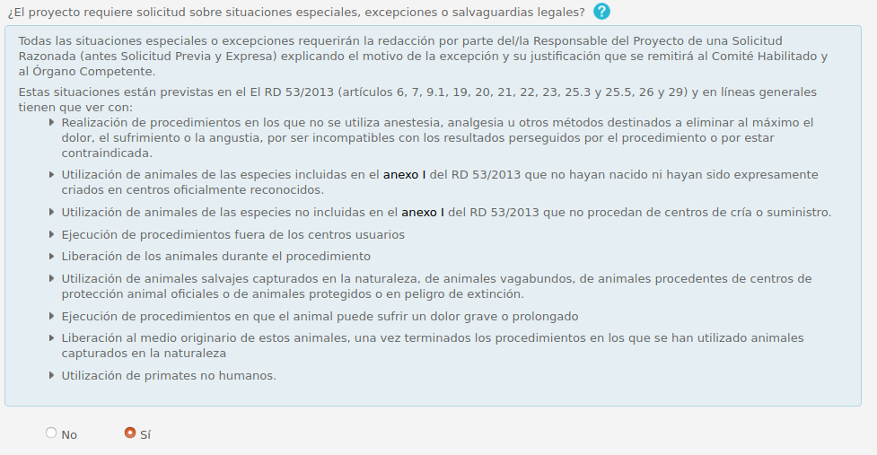

### 5.5 Resumen no técnico (RNT)

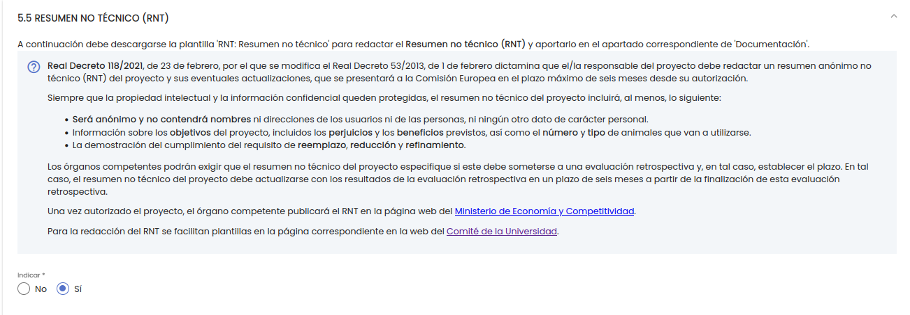

### 5.6 Documentación adicional

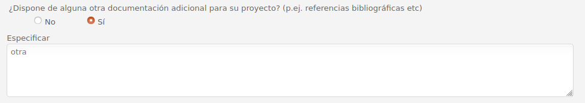

### 5.7 Aclaraciones al comité

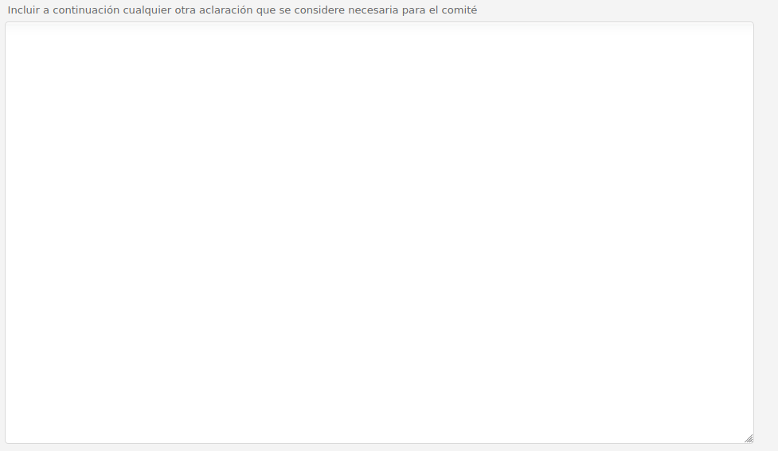