# Formulario M30

Para pasar de bloque hay que introducir todos los datos obligatorios del anterior y guardar.

Todos los apartados son obligatorios rellenarlos a no ser que este desactivado. Hay apartados que se activan si se responde que Sí a apartados anteriores.

* [I. VALOR SOCIAL Y JUSTIFICACIÓN](#i-valor-social-y-justificacion)
  + [1.1 Valor social del proyecto](#11-valor-social-del-proyecto)
  + [1.2 Justificación del uso de agentes biológicos, OMG, Sustancias Químicas Peligrosas, Sustancias Radiactivas y/o Nanoparticulas](#12-justificacion-del-uso-de-agentes-biologicos-omg-sustancias-quimicas-peligrosas-sustancias-radiactivas-yo-nanoparticulas)
* [II. CUALIFICACIÓN DEL EQUIPO INVESTIGADOR CAMBIOS TEXTO](#ii-cualificacion-del-equipo-investigador-cambios-texto)
  + [2.1 Personal que llevará a cabo las tareas con agentes biológicos, OMG, Sustancias Químicas Peligrosas, Sustancias Radiactivas y/o Nanoparticulas.](#21-personal-que-llevara-a-cabo-las-tareas-con-agentes-biologicos-omg-sustancias-quimicas-peligrosas-sustancias-radiactivas-yo-nanoparticulas)
* [III. VALIDEZ CIENTÍFICA Y METODOLÓGICA](#iii-validez-cientifica-y-metodologica)
  + [3.1 Objetivos científicos del proyecto](#31-objetivos-cientificos-del-proyecto)
* + [3.2 Diseño metodológico del proyecto](#32-diseno-metodologico-del-proyecto)
  + [3.3 Referencias de publicaciones científicas](#33-referencias-de-publicaciones-cientificas)
  + [3.4 Tipo de exposición](#34-tipo-de-exposicion)
    - [3.4.1 Exposición no intencionada o incidental](#341-exposicion-no-intencionada-o-incidental)
    - [3.4.2 Exposición deliberada](#342-exposicion-deliberada)
    - [3.4.3 Uso confinado de OMG](#343-uso-confinado-de-omg)
    - [3.4.4 SUSTANCIAS QUÍMICAS PELIGROSAS](#344-sustancias-quimicas-peligrosas)
    - [3.4.5 SUSTANCIAS RADIACTIVAS](#345-sustancias-radiactivas)
  + [3.5 Datos referentes a los agentes biológicos, Sustancias Químicas Peligrosas , Sustancias Radiactivas y/o Nanopartículas](#35-datos-referentes-a-los-agentes-biologicossustancias-quimicas-peligrosas-sustancias-radiactivas-yo-nanoparticulas)
    - [3.5.1 Microorganismos /parásitos](#351-microorganismos-parasitos)
    - [3.5.2 Cultivos celulares](#352-cultivos-celulares)
    - [3.5.3 Material biológico](#353-material-biologico)
    - [3.5.4 Organismo modificado genéticamente](#354-organismo-modificado-geneticamente)
    - [3.5.5 SUSTANCIAS QUÍMICAS PELIGROSAS](#355-sustancias-quimicas-peligrosas)
    - [3.5.6 SUSTANCIAS RADIACTIVAS, EQUIPO RADIOLÓGICO, INSTALACIÓN RADIACTIVA](#356-sustancias-radiactivas-equipo-radiologico-instalacion-radiactiva)
  + [3.6 Frecuencia y periodicidad de uso](#36-frecuencia-y-periodicidad-de-uso)
  + [3.7 Trayectoria completa de los agentes biológicos, OMG, Sustancias Químicas Peligrosas , Sustancias Radiactivas y/o Nanopartículas](#37-trayectoria-completa-de-los-agentes-biologicos-omg-sustancias-quimicas-peligrosas-sustancias-radiactivas-yo-nanoparticulas)
* [IV Aspectos éticos específicos](#iv-aspectos-eticos-especificos)
  + [4.1 Evaluación del riesgo](#41-evaluacion-del-riesgo)
    - [4.1.1 NIVEL DE RIESGO](#411-nivel-de-riesgo)
    - [4.1.2 Características del riesgo de los agentes biológicos y/o material biológico, Sustancias Químicas Peligrosas , Sustancias Radiactivas y/o Nanopartículas](#412-caracteristicas-del-riesgo-de-los-agentes-biologicos-yo-material-biologico-sustancias-quimicas-peligrosas-sustancias-radiactivas-yo-nanoparticulas)
    - [4.1.3 Características del riesgo de los OMG](#413-caracteristicas-del-riesgo-de-los-omg)
    - [4.1.4 Efectos nocivos que puedan derivarse del uso de agentes, material biológico, Sustancias Químicas Peligrosas , Sustancias Radiactivas y/o Nanopartículas](#414-efectos-nocivos-que-puedan-derivarse-del-uso-de-agentes-material-biologico-sustancias-quimicas-peligrosas-sustancias-radiactivas-yo-nanoparticulas)
    - [4.1.5 Tratamiento profiláctico disponible](#415-tratamiento-profilactico-disponible)
  + [4.2 Medidas técnicas de seguridad](#42-medidas-tecnicas-de-seguridad)
    - [4.2.1 Lugar en el que se realizará el manejo de agentes biológicos, OMG, Sustancias Químicas Peligrosas , Sustancias Radiactivas y/o Nanopartículas](#421-lugar-en-el-que-se-realizara-el-manejo-de-agentes-biologicos-omg-sustancias-quimicas-peligrosas-sustancias-radiactivas-yo-nanoparticulas)
      * [4.2.1.1 Laboratorio de la Universidad](#4211-laboratorio-de-la-universidad)
        + [4.2.1.1.1 Medidas de contención](#42111-medidas-de-contencion)
        + 4.2.1.1.2 Equipos de seguridad
        + 4.2.1.1.3 Buenas prácticas de laboratorio
        + 4.2.1.1.4 Instalaciones
      * [4.2.1.2 Otro centro o lugar ajeno a la Universidad](#4212-otro-centro-o-lugar-ajeno-a-la-universidad)
    - [4.2.2 Sustitución](#422-sustitucion)
    - [4.2.3 Reducción de riesgos](#423-reduccion-de-riesgos)
      * [4.2.3.1 Control de la exposición](#4231-control-de-la-exposicion)
      * [4.2.3.2 Medidas de reducción de la exposición](#4232-medidas-de-reduccion-de-la-exposicion)
      * [4.2.3.3 Medidas de protección](#4233-medidas-de-proteccion)
      * [4.2.3.4 Métodos de descontaminación/desinfección](#4234-metodos-de-descontaminaciondesinfeccion)
      * [4.2.3.5 Gestión de residuos](#4235-gestion-de-residuos)
  + [4.3 Vigilancia y protección de la salud](#43-vigilancia-y-proteccion-de-la-salud)
    - [4.3.1 Vacunación](#431-vacunacion)
    - [4.3.2 Medidas especiales de protección](#432-medidas-especiales-de-proteccion)
* [V. Cumplimiento de documentación](#v-cumplimiento-de-documentacion)
  + [5.1 Acreditaciones](#51-acreditaciones)
  + [5.2 COMUNICACIÓN DE USO DE AGENTES BIOLÓGICOS, SUSTANCIAS QUÍMICAS PELIGROSAS, SUSTANCIAS RADIACTIVAS Y/O NANOPARTÍCULAS Y AUTORIZACIÓN PARA LLEVAR A CABO UTILIZACIÓN CONFINADA DE OMG](#52-comunicacion-de-uso-de-agentes-biologicos-sustancias-quimicas-peligrosas-sustancias-radiactivas-yo-nanoparticulas-y-autorizacion-para-llevar-a-cabo-utilizacion-confinada-de-omg)
    - [5.2.1 COMUNICACIÓN DE USO DE AGENTES BIOLÓGICOS, SUSTANCIAS QUÍMICAS PELIGROSAS, SUSTANCIAS RADIACTIVAS Y/O NANOPARTÍCULAS](#521-comunicacion-de-uso-de-agentes-biologicos-sustancias-quimicas-peligrosas-sustancias-radiactivas-yo-nanoparticulas)
    - [5.2.2 AUTORIZACIÓN PARA LLEVAR A CABO UTILIZACIÓN CONFINADA DE OMG](#522-autorizacion-para-llevar-a-cabo-utilizacion-confinada-de-omg)
  + [5.3 Seguro de accidentes y responsabilidad civil](#53-seguro-de-accidentes-y-responsabilidad-civil)
  + [5.4 Protocolo de actuación en caso de accidente biológico](#54-protocolo-de-actuacion-en-caso-de-accidente-biologico)
  + [5.5 Documentación adicional](#55-documentacion-adicional)
  + [5.6 Aclaraciones al comité](#56-aclaraciones-al-comite)

## I. VALOR SOCIAL Y JUSTIFICACIÓN

### 1.1 Valor social del proyecto

Viene de datos generales, es de solo lectura

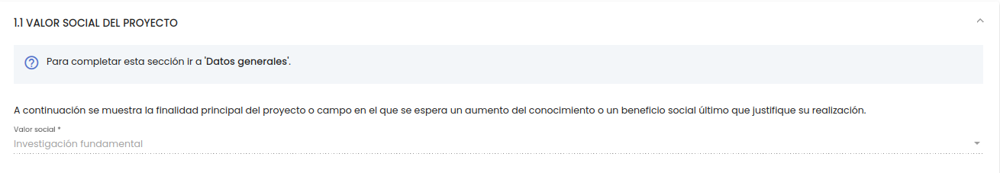

### 1.2 Justificación del uso de agentes biológicos, OMG, Sustancias Químicas Peligrosas, Sustancias Radiactivas y/o Nanoparticulas

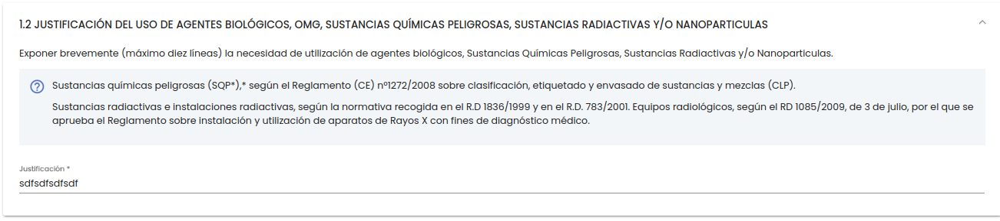

## II. CUALIFICACIÓN DEL EQUIPO INVESTIGADOR CAMBIOS TEXTO

### 2.1 Personal que llevará a cabo las tareas con agentes biológicos, OMG, Sustancias Químicas Peligrosas, Sustancias Radiactivas y/o Nanoparticulas.

Se cambia el nombre de la columna "Formación específica o experiencia" por "Formación en riesgo biológico"

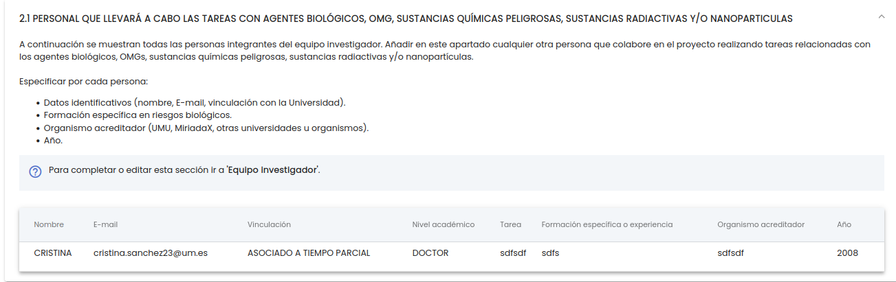

## III. VALIDEZ CIENTÍFICA Y METODOLÓGICA

### 3.1 Objetivos científicos del proyecto

Viene de datos generales, es de solo lectura

### 3.2 Diseño metodológico del proyecto

Viene de datos generales, es de solo lectura

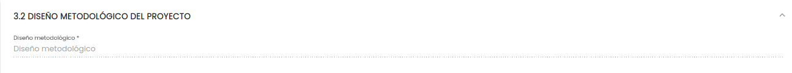

### 3.3 Referencias de publicaciones científicas

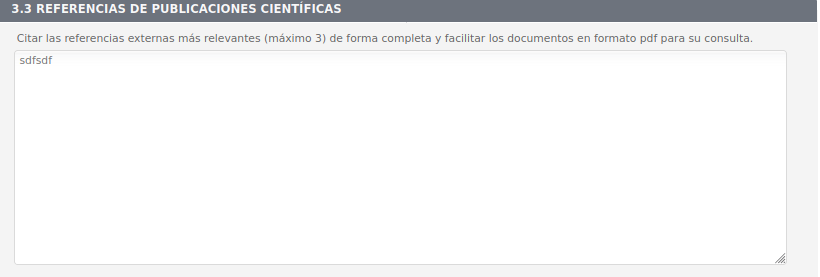

### 3.4 Tipo de exposición

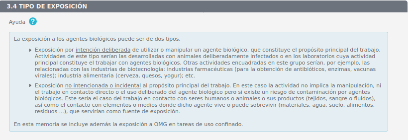

#### 3.4.1 Exposición no intencionada o incidental

Al seleccionar Sí se muestra la parte de abajo y es obligatorio seleccionar una opción de los checkbox.

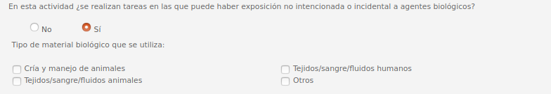

#### 3.4.2 Exposición deliberada

Al seleccionar Sí se muestra la parte de abajo y es obligatorio seleccionar una opción de los checkbox.

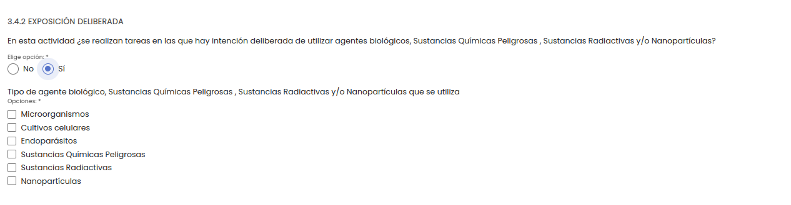

#### 3.4.3 Uso confinado de OMG

Al seleccionar Sí se muestra la parte de abajo y es obligatorio seleccionar una opción de los checkbox.

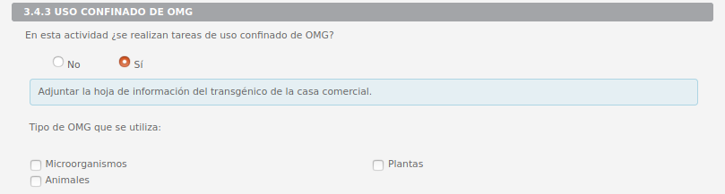

#### **3.4.4 SUSTANCIAS QUÍMICAS PELIGROSAS**

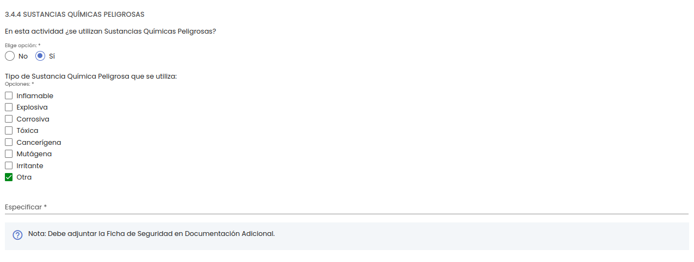

Lo del tipo saldrá si se selecciona que Sí

Si se selecciona Otra saldrá una caja de texto para indicar cual es

#### **3.4.5 SUSTANCIAS RADIACTIVAS**

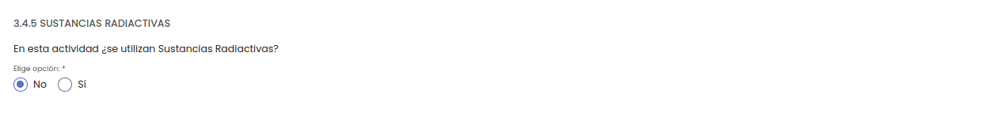

### 3.5 Datos referentes a los agentes biológicos**,**Sustancias Químicas Peligrosas , Sustancias Radiactivas y/o Nanopartículas

**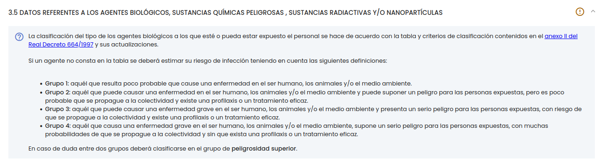**

#### 3.5.1 Microorganismos /parásitos

Solo se mostrará/activará si se marca el valor "Si" en el apartado **3.4.2 EXPOSICIÓN DELIBERADA**

No es necesario comprobar que se haya insertado ninguna fila.

Tipo: combo con los siguientes valores:

* Bacterias y afines
* Virus
* Parásitos
* Hongos

Grupo de riesgo: combo con los siguientes valores:

* Grupo 1
* Grupo 2
* Grupo 3
* Grupo 4

**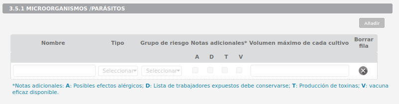**

#### 3.5.2 Cultivos celulares

Solo se mostrará/activará si se marca el valor "Si" en el apartado **3.4.2 EXPOSICIÓN DELIBERADA**

No es necesario comprobar que se haya insertado ninguna fila.

Tipo de cultivo: combo con los siguientes valores:

* Líneas celulares bien caracterizadas de origen humano o de simios
* Líneas celulares bien caracterizadas de origen no humano ni de simios, con bajo riesgo de infección endógena con patógenos humanos
* Líneas celulares o cepas no totalmente caracterizadas o autentificadas
* Células con patógenos endógenos y células deliberadamente infectadas
* Células sanguíneas, linfoides, tejido nervioso, etc. de origen humano o simio
* Otra sustancia del proceso de experimentación
* Células sanguíneas, linfoides, tejido nervioso, etc., de origen no humano ni de simio

Grupo de riesgo: combo con los siguientes valores:

* Grupo 1
* Grupo 2
* Grupo 3
* Grupo 4

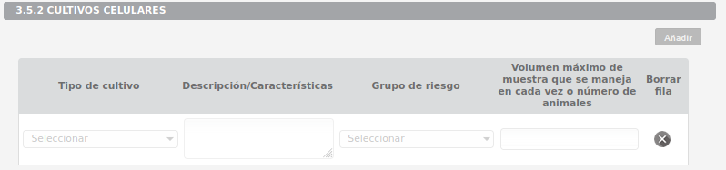

#### 3.5.3 Material biológico

Solo se mostrará/activará si se marca el valor "Si" en el apartado **3.4.1 EXPOSICIÓN NO INTENCIONADA O INCIDENTAL**\*\*

No es necesario comprobar que se haya insertado ninguna fila.

Tipo de material: combo con los siguientes valores:

* Cría y manejo de animales
* Tejido, sangre y/o fluidos animales
* Tejido, sangre y/o fluidos humanos
* Otros

Grupo de riesgo: combo con los siguientes valores:

* Grupo 1
* Grupo 2
* Grupo 3
* Grupo 4

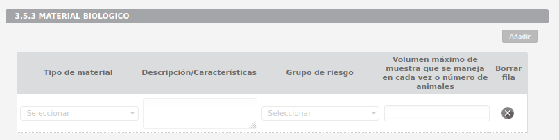

#### 3.5.4 Organismo modificado genéticamente

Solo se mostrará/activará si se marca el valor "Si" en el apartado **3.4.3 USO CONFINADO DE OMG**

Se pasará a un listado con los campos:

* Nombre
* Huésped
* Vector utilizado
* Inserto y especie de procedencia del inserto
* Proteína que codifica
* Grupo de riesgo: combo con los siguientes valores:

  + Grupo 1
  + Grupo 2
  + Grupo 3
  + Grupo 4
* Estimación de volumen semanal  de muestra que se maneja

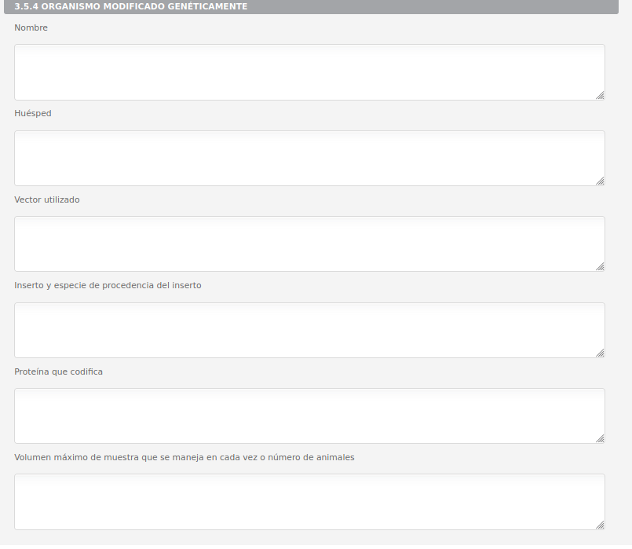

#### 3.5.5 SUSTANCIAS QUÍMICAS PELIGROSAS

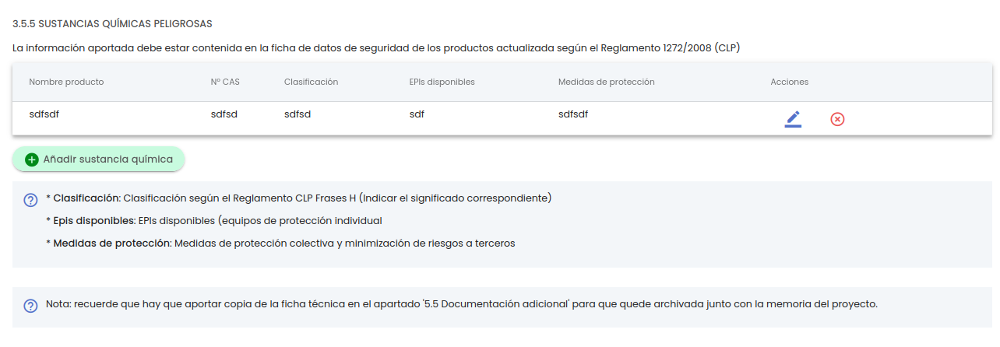

#### 3.5.6 SUSTANCIAS RADIACTIVAS, EQUIPO RADIOLÓGICO, INSTALACIÓN RADIACTIVA

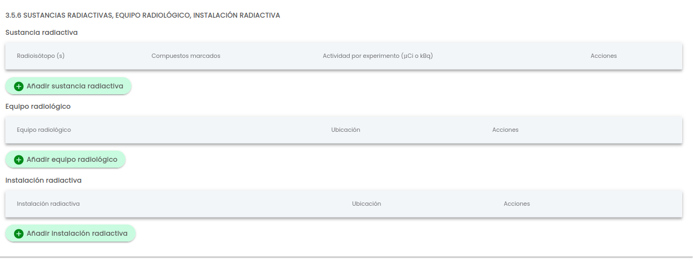

Sustancias radiactivas (tabla con los siguientes campos) :

* Radioisótopo (s)
* Compuestos marcados
* Actividad por experimento (μCi o kBq)

Equipos radiológicos (tabla con los siguientes campos) :

* Equipo radiológico
* Ubicación

Instalaciones radiactivas (tabla con los siguientes campos) :

* Instalación radiactiva
* Ubicación

### 3.6 Frecuencia y periodicidad de uso

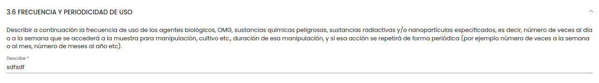

### 3.7 Trayectoria completa de los agentes biológicos, OMG, Sustancias Químicas Peligrosas , Sustancias Radiactivas y/o Nanopartículas

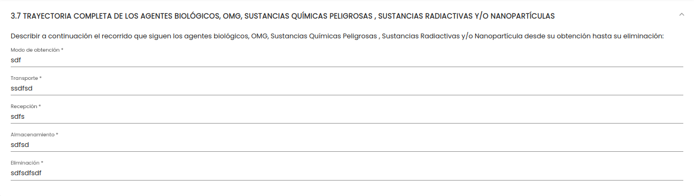

## IV Aspectos éticos específicos

### 4.1 Evaluación del riesgo

#### 4.1.1 NIVEL DE RIESGO

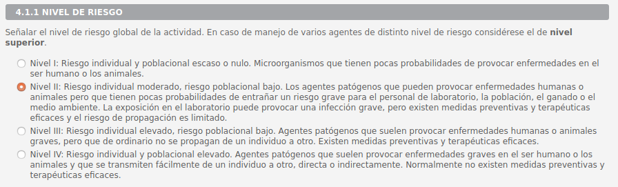

#### 4.1.2 Características del riesgo de los agentes biológicos y/o material biológico, Sustancias Químicas Peligrosas , Sustancias Radiactivas y/o Nanopartículas

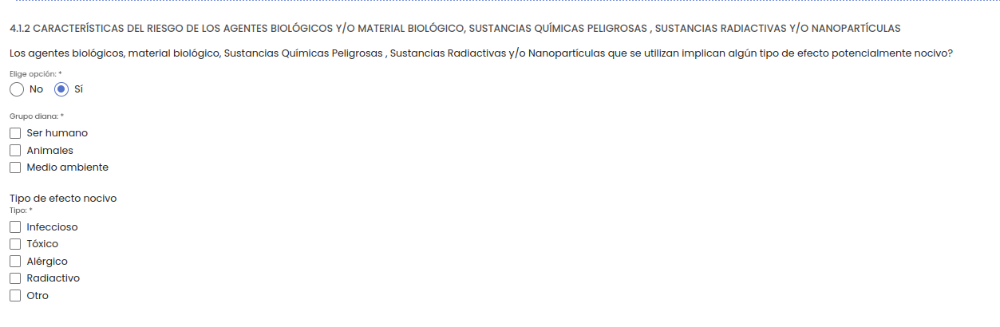

Al pulsar el Sí se activa la parte de Grupo diana y Tipo de efecto nocivo.

#### 4.1.3 Características del riesgo de los OMG

Solo se mostrará/activará si se marcar el valor "Si" en el apartado **3.4.3 USO CONFINADO DE OMG**

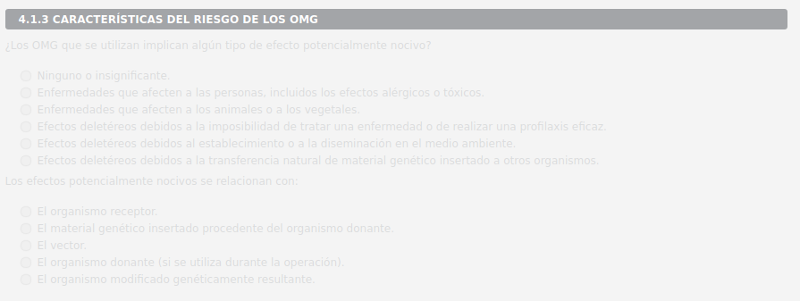

#### 4.1.4 Efectos nocivos que puedan derivarse del uso de agentes, material biológico, Sustancias Químicas Peligrosas , Sustancias Radiactivas y/o Nanopartículas

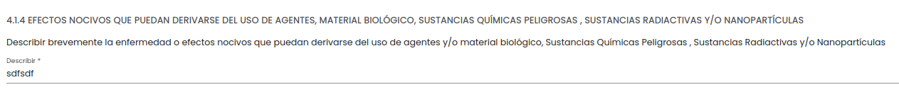

#### 4.1.5 Tratamiento profiláctico disponible

Si se selecciona que Sí se activa la caja de Especificar.

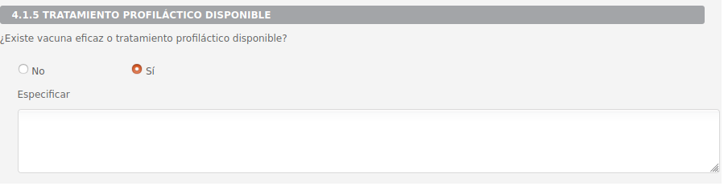

### 4.2 Medidas técnicas de seguridad

#### 4.2.1 Lugar en el que se realizará el manejo de agentes biológicos, OMG, Sustancias Químicas Peligrosas , Sustancias Radiactivas y/o Nanopartículas

**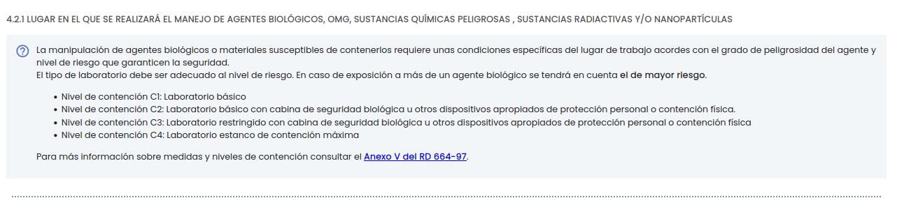**

##### 4.2.1.1 Laboratorio de la Universidad

Los apartados 4.2.1.1.1 MEDIDAS DE CONTENCIÓN, 4.2.1.1.2 EQUIPOS DE SEGURIDAD , 4.2.1.1.3 BUENAS PRÁCTICAS DE LABORATORIO  Y 4.2.1.1.4 INSTALACIONES solo se mostrará/activará si en el apartado 4.2.1.1 LABORATORIO DE LA UNIVERSIDAD se ha indicado un laboratorio con nivel de contención >= C2, es decir, si existe un laboratorio con nivel de contención C2 o C3 o C4.

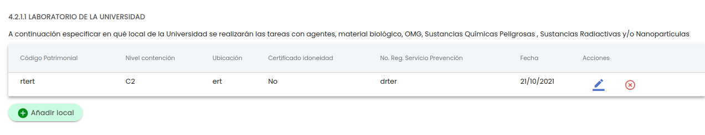

Nivel contención: combo con los siguientes valores:

* C1
* C2
* C3
* C4

Certificado idoneidad: combo con los siguientes valores:

* Sí
* No

###### **4.2.1.1.1 Medidas de contención**

Solo se mostrará/activará si en el apartado 4.2.1.1 LABORATORIO DE LA UNIVERSIDAD se ha indicado un laboratorio con nivel de contención >= C2, es decir, si existe un laboratorio con nivel de contención C2 o C3 o C4.

**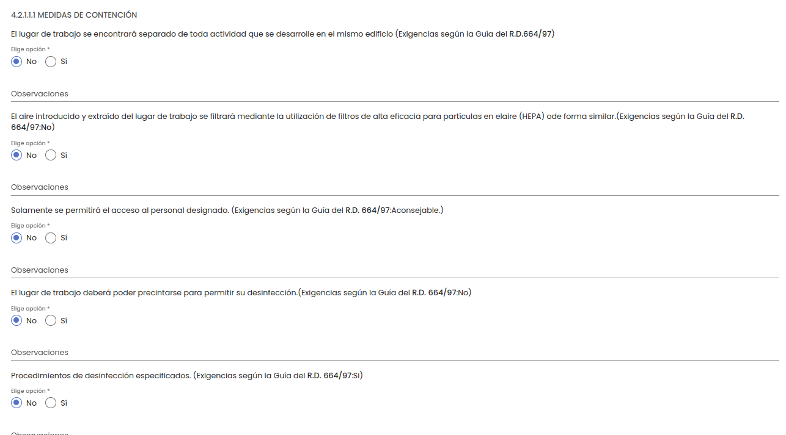**

**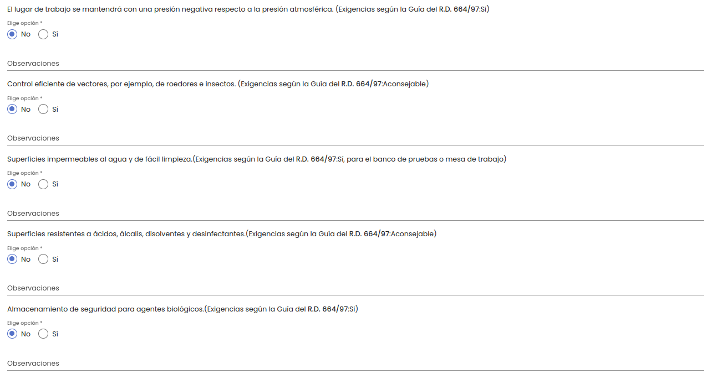**

**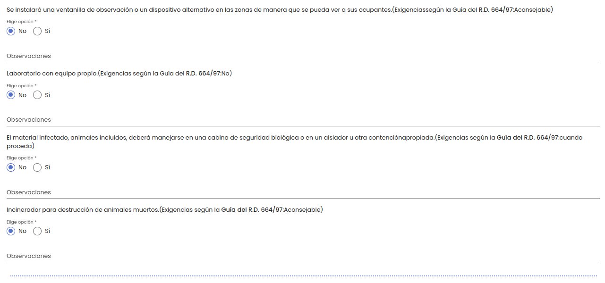**

###### ****4.2.1.1.2** Equipos de seguridad**

Solo se mostrará/activará si en el apartado 4.2.1.1 LABORATORIO DE LA UNIVERSIDAD se ha indicado un laboratorio con nivel de contención >= C2, es decir, si existe un laboratorio con nivel de contención C2 o C3 o C4.

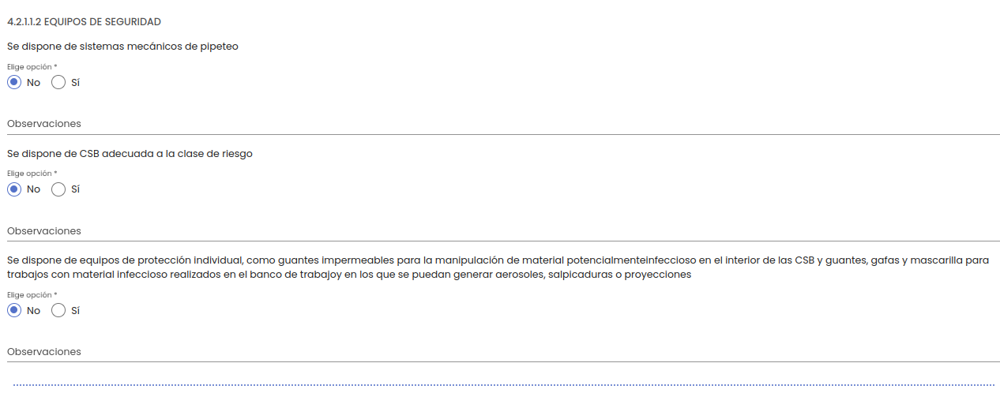

###### ******4.2.1.1.3**** Buenas prácticas de laboratorio**

Solo se mostrará/activará si en el apartado 4.2.1.1 LABORATORIO DE LA UNIVERSIDAD se ha indicado un laboratorio con nivel de contención >= C2, es decir, si existe un laboratorio con nivel de contención C2 o C3 o C4.

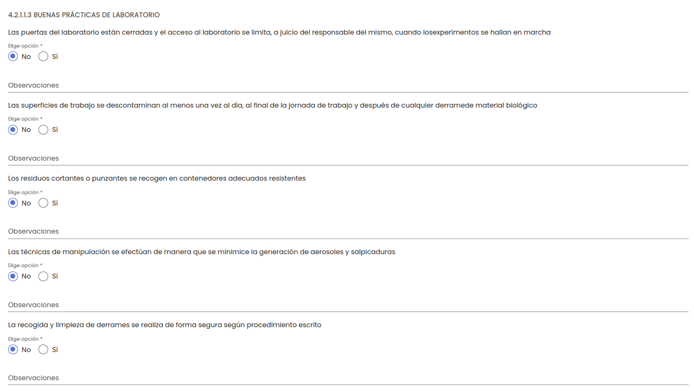

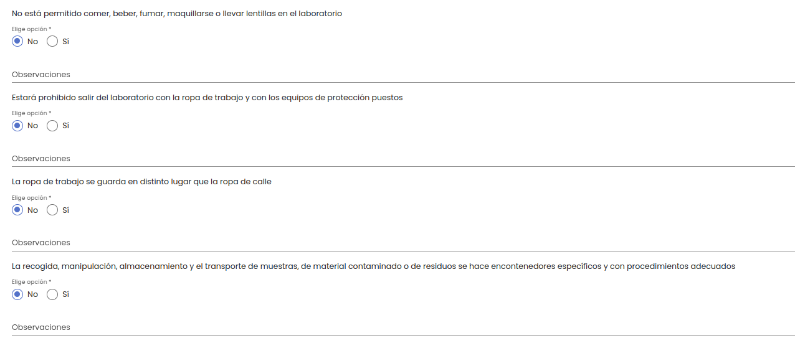

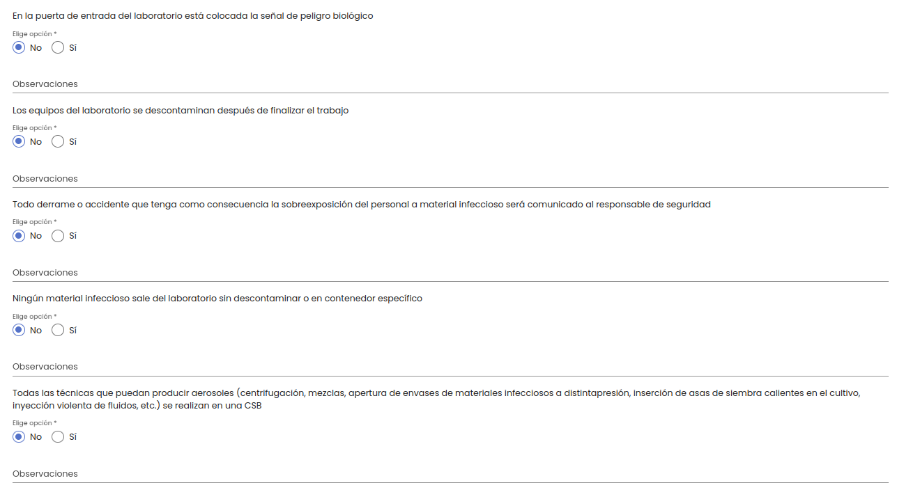

###### ********4.2.1.1.4****** Instalaciones**

Solo se mostrará/activará si en el apartado 4.2.1.1 LABORATORIO DE LA UNIVERSIDAD se ha indicado un laboratorio con nivel de contención >= C2, es decir, si existe un laboratorio con nivel de contención C2 o C3 o C4.

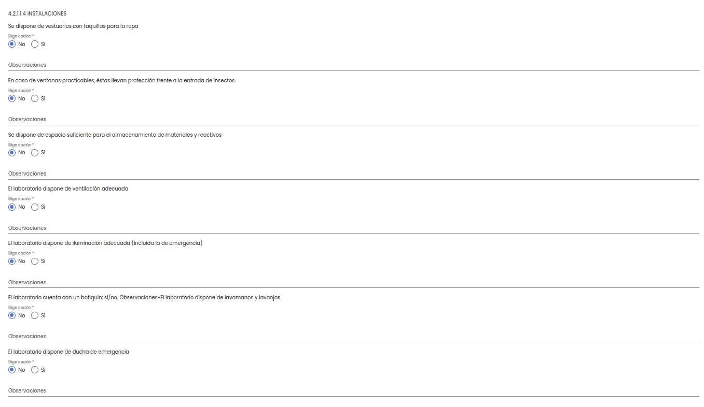

##### 4.2.1.2 Otro centro o lugar ajeno a la Universidad

Si se selecciona el valor Sí, se activan las cajas de texto y la fecha

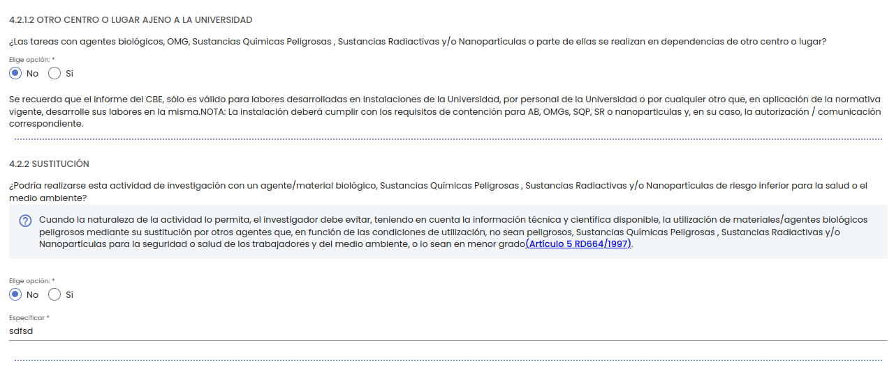

#### 4.2.2 Sustitución

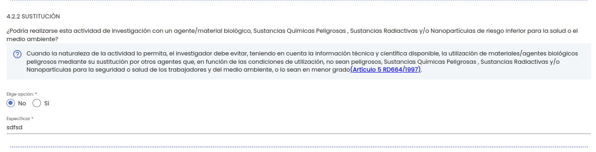

#### 4.2.3 Reducción de riesgos

##### 4.2.3.1 Control de la exposición

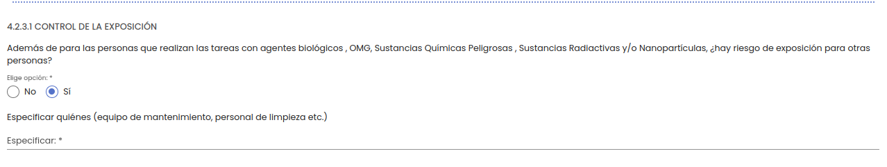

Al seleccionar el Si se activa la caja de texto.

##### 4.2.3.2 Medidas de reducción de la exposición

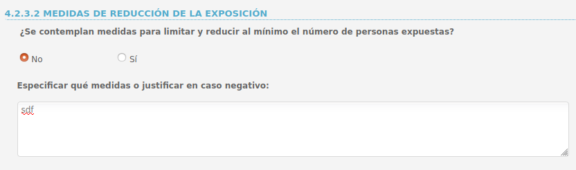

##### 4.2.3.3 Medidas de protección

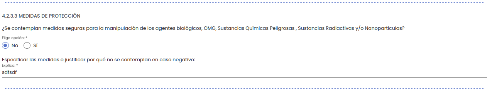

##### 4.2.3.4 Métodos de descontaminación/desinfección

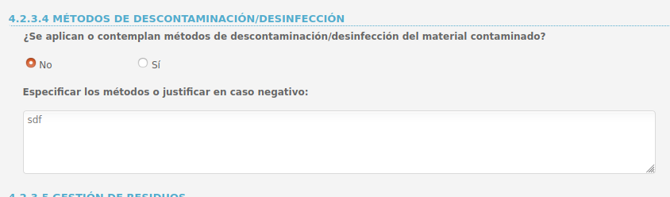

##### 4.2.3.5 Gestión de residuos

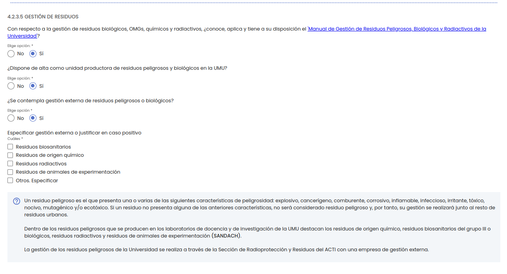

Si "¿Se contempla gestión externa de residuos peligrosos o biológicos?" tiene valor Si, mostrar:  
  
Especificar gestión externa o justificar en caso **positivo \***

* Residuos biosanitarios (chekbox)
* Residuos de origen químico (chekbox)
* Residuos radiactivos (chekbox)
* Residuos de animales de experimentación (chekbox)
* Otros. Especificar (chekbox)

Otros. Especificar \* (caja de texto en caso de seleccionar Otros. Especificar)

### 4.3 Vigilancia y protección de la salud

#### 4.3.1 Vacunación

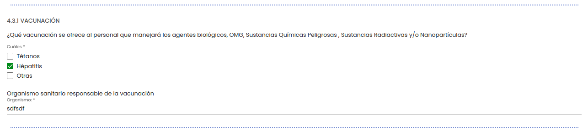

Por petición de Murcia se debe de añadir la opción "No es necesaria vacunación" debajo de "Otras".

En el caso de que se seleccione esta nueva opción de "No es necesaria vacunación" el otro campo "Organismo sanitario responsable de la vacunación" no se mostrará y no será obligatorio. Es decir, el campo "Organismo sanitario responsable de la vacunación" solo se muestra y es obligatorio se seleccionan "Tétanos", "Hepatitis" o "Otras"

#### 4.3.2 Medidas especiales de protección

**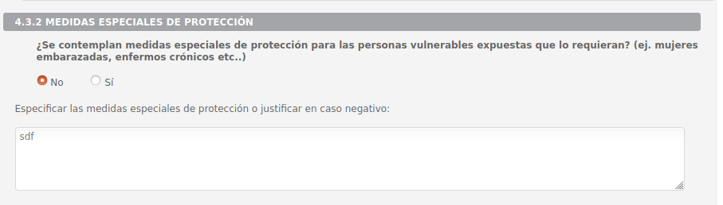**

## V. Cumplimiento de documentación

### 5.1 Acreditaciones

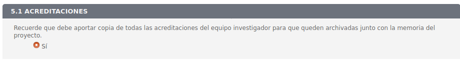

### 5.2 COMUNICACIÓN DE USO DE AGENTES BIOLÓGICOS, SUSTANCIAS QUÍMICAS PELIGROSAS, SUSTANCIAS RADIACTIVAS Y/O NANOPARTÍCULAS Y AUTORIZACIÓN PARA LLEVAR A CABO UTILIZACIÓN CONFINADA DE OMG

#### 5.2.1 COMUNICACIÓN DE USO DE AGENTES BIOLÓGICOS, SUSTANCIAS QUÍMICAS PELIGROSAS, SUSTANCIAS RADIACTIVAS Y/O NANOPARTÍCULAS

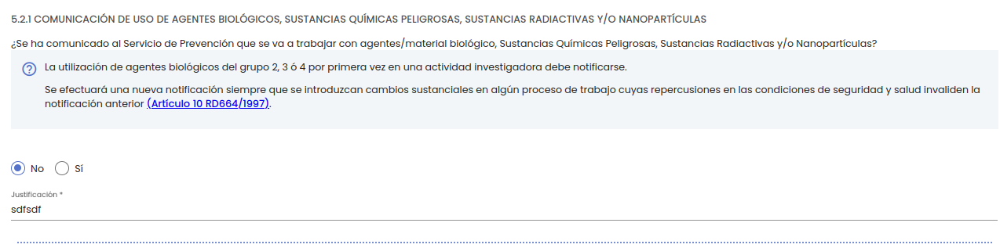

Si se contesta que "Sí" en vez de pedir la Justificación, se pide una fecha:

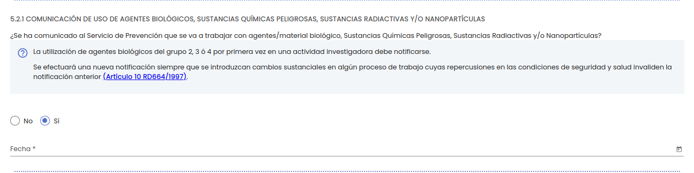

#### 5.2.2 AUTORIZACIÓN PARA LLEVAR A CABO UTILIZACIÓN CONFINADA DE OMG

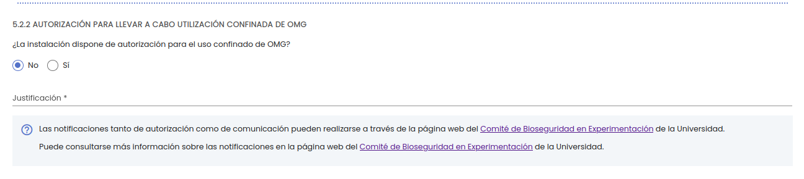

Si se contesta que "Sí" en vez de pedir la Justificación, se pide una fecha:

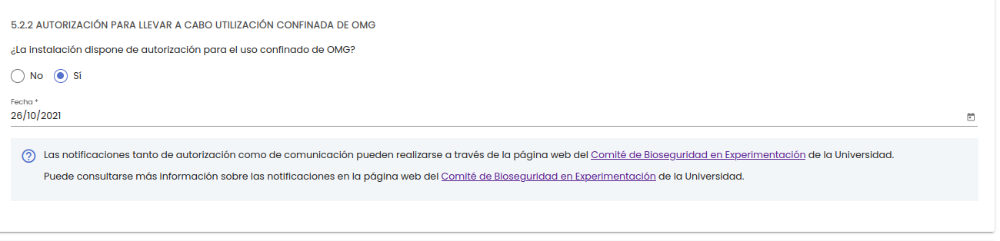

### 5.3 Seguro de accidentes y responsabilidad civil

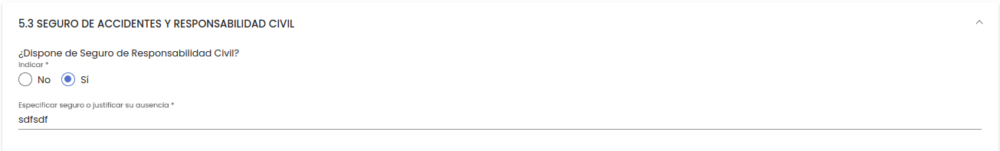

### 5.4 Protocolo de actuación en caso de accidente biológico

### 5.5 Documentación adicional

### 5.6 Aclaraciones al comité
